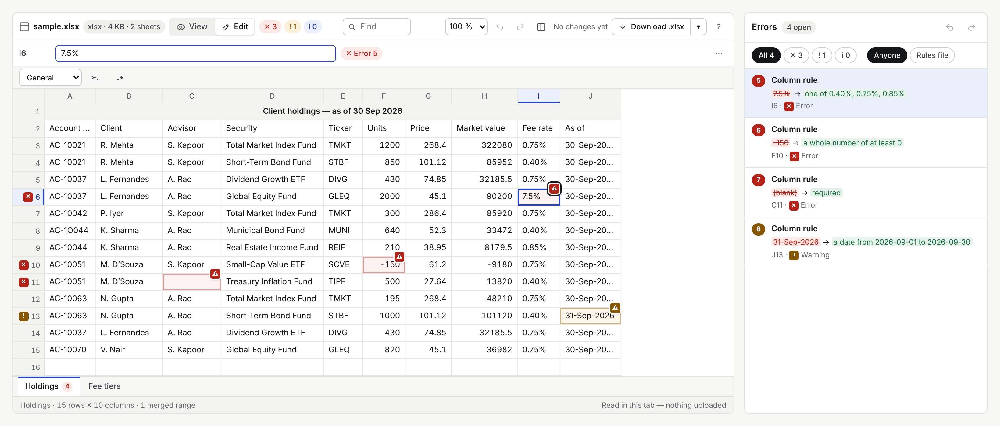
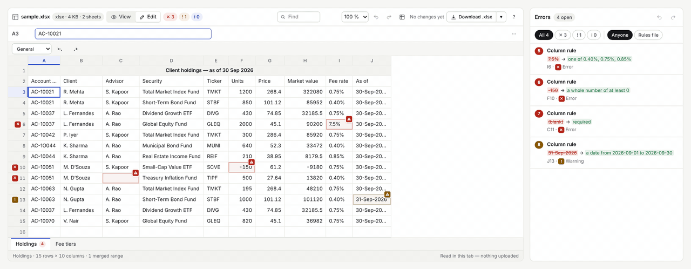

<div align="center">

<picture>
  <source media="(prefers-color-scheme: dark)" srcset="docs/readme/logo-dark.svg">
  
</picture>

### Open, edit and review `.xlsx` and `.csv` files inside your web app.<br>Nothing is uploaded. Download gives back the original file, with only your edits patched in.

[](https://github.com/arpitarya/sheetpane/actions/workflows/ci.yml)
[](LICENSE)
[](packages/grid/README.md#typings-and-editor-support)
[](#works-where-you-work)

[**Playground**](https://arpitarya.github.io/sheetpane/) ·
[**Get started**](#get-started) ·
[**Docs**](packages/grid/README.md) ·
[**Starters**](examples/starters/README.md) ·
[**Changelog**](CHANGELOG.md)

<br>

<picture>
  <source media="(prefers-color-scheme: dark)" srcset="docs/readme/screenshot-dark.png">
  
</picture>

<sub>A real capture, not a mock-up: <code>sample.xlsx</code> checked by <a href="docs/readme/holdings.rules.json">a 9-line rules file</a>. Regenerate it with <code>node docs/readme/capture.mjs</code>.</sub>

</div>

---

## Three lines of HTML

```html
<script type="module">import '@sheetpane/grid';</script>

<sheetpane-excel pane="q3" src="holdings.xlsx" mode="edit" rules-src="rules.json"></sheetpane-excel>
<sheetpane-errors pane="q3"></sheetpane-errors>
```

**That is the whole integration.** A spreadsheet, an error list, kept in sync by
the shared `pane` id — put them side by side, in tabs, or in a dialog.

---

## Why sheetpane

|  |  |
|---|---|
| 🔒 **Private by construction** | The file is read in the browser tab. There is no server to send it to. |
| 📄 **The file survives the round trip** | Untouched → back **byte for byte**. Edited → the original with only the changed cells patched in. |
| ✅ **Review built in** | Errors are flagged on the cell *and* listed beside the sheet — from a JSON rules file, your own column rules, or the workbook's own validation. |
| ⚡ **Big files stay smooth** | A 250,000-row CSV scrolls with **0 dropped frames** (measured in headless Chromium on a MacBook — not a promise for your hardware). |
| 🧩 **Pay for what you use** | Formulas, styles, charts, images and more are opt-in plugins — you ship only what you import. |
| 🎨 **Looks like your app** | No font of its own — it inherits yours. Light, dark or auto. |

---

## Fix it in place

Edit a flagged cell and its error resolves in the panel — every change held in
memory until you download.

<p align="center">
  
</p>

The rules behind it are [this JSON file](docs/readme/holdings.rules.json), with a [schema](packages/grid/README.md#rules-file) your editor completes:

```json
{
  "version": 1,
  "sheets": { "Holdings": { "headerRow": 2, "columns": {
    "Advisor":  { "required": true },
    "Units":    { "type": "integer", "min": 0 },
    "Fee rate": { "oneOf": ["0.40%", "0.75%", "0.85%"] },
    "As of":    { "type": "date", "min": "2026-09-01", "max": "2026-09-30", "severity": "warning" }
  } } }
}
```

---

## Get started

> [!NOTE]
> **`0.1.0` is about to ship.** Until it is on npm, the install commands and the
> playground links will not work yet.

```sh
npm install @sheetpane/grid
```

Then follow the [`@sheetpane/grid` guide](packages/grid/README.md). Or try it
first: the [playground](https://arpitarya.github.io/sheetpane/), its
[React version](https://arpitarya.github.io/sheetpane/react/), or a
[starter in StackBlitz](examples/starters/README.md).

---

## Works where you work

The elements are standard web components, so they render in any framework — or
none. **No wrapper packages**; one `import type` line gives typed tags, props
and events.

| | |
|---|---|
| **Plain HTML** | `import '@sheetpane/grid'` — no build step needed |
| **React 19 / 18** | typed JSX, plus [copy-in hooks](packages/grid/README.md#react-hooks-recipes) (`useSelection`, `useErrors`, `useChanges`…) |
| **Vue · Svelte · Solid · Angular** | [one line of setup each](packages/grid/README.md#vue-svelte-solid-angular) |
| **Your tests** | [`@sheetpane/testing`](packages/testing/README.md) — locators and actions for Playwright and Vitest |
| **Your AI agent** | [skills](packages/skills/README.md) for Claude Code, Kiro and Codex · a read-only [MCP server](packages/mcp/README.md) · [`llms.txt`](llms.txt) |

---

## Plugins

**Opt-in, one import each.** Ship only what your users need.

| plugin | adds |
|---|---|
| [`numfmt`](packages/numfmt/README.md) | every Excel number format, with locales |
| [`formulas`](packages/formulas/README.md) | recalculation as you edit — IronCalc, WebAssembly, lazy-loaded |
| [`styles`](packages/styles/README.md) | fills, fonts, borders, alignment, merges |
| [`condfmt`](packages/condfmt/README.md) | conditional formatting, colour scales, data bars |
| [`validation`](packages/validation/README.md) | the workbook's own data-validation rules |
| [`charts`](packages/charts/README.md) | bar, column, line, pie, doughnut and scatter |
| [`images`](packages/images/README.md) | pictures anchored in the sheet |
| [`comments`](packages/comments/README.md) | notes and threaded comments, read and written |
| [`visibility`](packages/visibility/README.md) | hide, unhide and group rows, columns and sheets |

```html
<script type="module">import '@sheetpane/grid'; import '@sheetpane/formulas/ui';</script>
<sheetpane-excel src="model.xlsx" plugins="formulas"></sheetpane-excel>
```

---

## The editing basics, included

Typing and paste · undo/redo · range selection with Count · Sum · Average ·
find · zoom · freeze panes · resize rows and columns · hidden rows, columns and
sheets · a pop-up mode · keyboard and touch.

---

## What it deliberately does not do

**XLSX and CSV only** ([law L3](records/0005_LAW-3-xlsx-and-csv-only.md)).
Anything else is refused with a clear message — never half-read.

| not supported | what happens |
|---|---|
| `.xls`, `.xlsm`, `.xlsb`, `.ods`, `.numbers` | refused, with the reason |
| macros, password-protected files | detected and refused |
| real-time collaboration, storage | the workbook lives in memory; saving it is your app's job |
| pivot tables | shown as their values, with a badge — not recalculated |

---

## How far it is proven

**Every feature has tests**, in Node and a real browser: Chromium on every
change; Chromium, Firefox and WebKit nightly. Both demos are driven end to end —
also from the packed tarballs npm would publish.

<details>
<summary><b>The honest gaps</b> — tracked in <a href="work/OPEN-WORK.md"><code>OPEN-WORK</code></a></summary>

<br>

- **Files saved by real apps.** The reader is tested on generated and
  library-written files; not yet on files saved by Excel, Google Sheets,
  LibreOffice and Numbers (W-30).
- **The round trip in desktop Excel.** Exports are read back by independent
  libraries in CI; opening them in Excel is still a manual check.
- **Phones.** Touch selection and download are built, not yet checked on a real
  iPhone.

Until 1.0 the API may change between minor versions — the
[CHANGELOG](CHANGELOG.md) says when.

</details>

**Found a file that opens wrongly?** [Open an issue](https://github.com/arpitarya/sheetpane/issues/new)
with the file (or a minimal copy) attached — it is the most useful thing you can send.

---

## Packages

**One version for all**, ESM with types.

| package | what it is |
|---|---|
| [`@sheetpane/grid`](packages/grid/README.md) | the two web components, the pane's workbook, the plugin host |
| [`@sheetpane/import`](packages/import/README.md) | `.xlsx` / `.csv` in, a plain JavaScript workbook out |
| [`@sheetpane/export`](packages/export/README.md) | a workbook in, `.xlsx` / `.csv` out — build, patch the original, `download()` |
| [`@sheetpane/testing`](packages/testing/README.md) | locators and actions for Playwright and Vitest browser mode |
| [`@sheetpane/fixtures`](packages/fixtures/README.md) | known workbooks for your tests |
| [`@sheetpane/skills`](packages/skills/README.md) | agent skills for Claude Code, Kiro and Codex |
| [`@sheetpane/mcp`](packages/mcp/README.md) | a read-only MCP server: the API, and workbook inspection |

**Dependencies:** none at runtime outside the project, except the engines two
plugins use — [`numfmt`](https://github.com/borgar/numfmt) and
[IronCalc](https://github.com/ironcalc/IronCalc). Every dependency is free and
open source ([law L2](records/0004_LAW-2-foss-dependencies.md)).

---

## Contributing

**Welcome — especially failing files and bug reports.** You need **Node 22+**,
**pnpm 10** and [**just**](https://just.systems).

```sh
just install     # pnpm install --frozen-lockfile
just check       # type-check, test (Node + Chromium) and build
just demo-html   # the plain HTML demo at http://127.0.0.1:5173
```

<details>
<summary><b>Every command</b></summary>

<br>

| command | does |
|---|---|
| `just test-pkg <name>` | one package's tests, e.g. `just test-pkg grid` |
| `just test-browsers` | the browser suites in Chromium, Firefox and WebKit |
| `just demo-react` | the React 19 demo at http://127.0.0.1:5174 |
| `just demo-check` | both demos driven end to end in Chromium |
| `just pack-check` | every package packed as npm would publish it, and checked |
| `just release <version>` | bump every package together, check, push; a GitHub Release publishes ([RELEASING.md](RELEASING.md)) |

</details>

**How the project is run.** Every rule lives in one record under
[`records/`](records/README.md); the live queue is
[`work/OPEN-WORK.md`](work/OPEN-WORK.md); the map is
[`docs/ARCHITECTURE.md`](docs/ARCHITECTURE.md). Much of the code was written by
AI coding agents working under those records — **the tests, not the prose, are
the evidence**. Start at [`CLAUDE.md`](CLAUDE.md) if you are one.

---

<div align="center">

[MIT](LICENSE) © Arpit Arya

</div>
