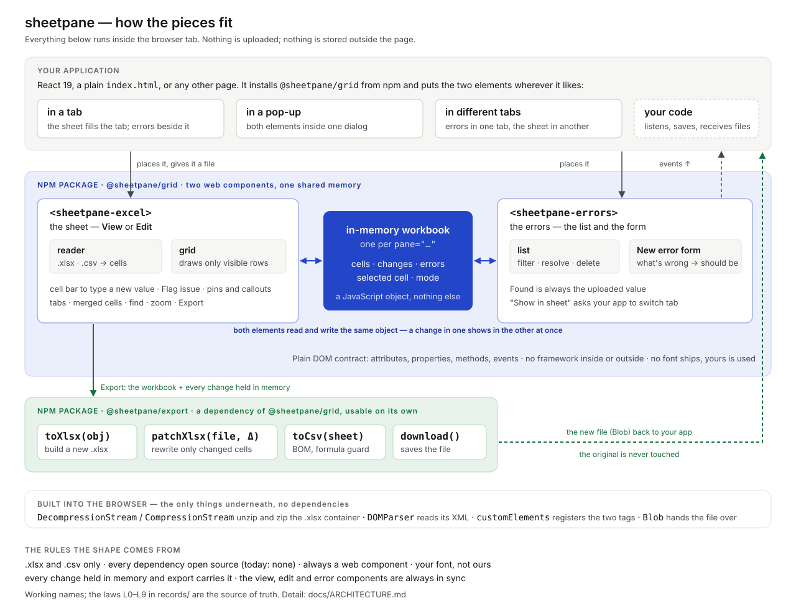
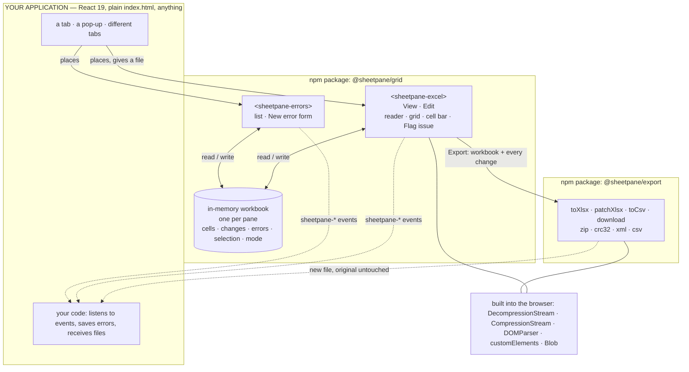

# sheetpane — architecture

**In one sentence:** a host web page installs one npm package, `@sheetpane/grid`,
drops two custom elements anywhere it likes, and both of them read and write a single
JavaScript object — the workbook — which an export package turns back into an
`.xlsx` or `.csv` file. Nothing leaves the browser tab.

**What this document is.** The map. The *rules* are the laws in
[`records/`](../records/README.md); the *decisions* are the four verdicts in
[`work/compare/`](../work/compare/README.md); the *work* is in
[`work/OPEN-WORK.md`](../work/OPEN-WORK.md). This page restates none of them
in full — it shows how they fit and links to each. If this page and a record
disagree, the record wins and this page gets fixed.

## The picture



The same picture as a flow:



<details>
<summary><b>ASCII twin</b> — the same picture, for terminals and diffs</summary>

```text
  YOUR APPLICATION  (React 19 · plain index.html · anything)
  [ a tab ] [ a pop-up ] [ different tabs ]            [ your code: events, saves, files ]
        |                   |                                   ^            ^
        | places it         | places it                 events |            | new file
        v                   v                                   |            |
  +-- npm: @sheetpane/grid ---------------------------------------------------+   |
  |  <sheetpane-excel>  <--->  ( in-memory workbook )  <--->  <sheetpane-errors> |   |
  |  View · Edit                one per pane                   list · form      |   |
  |  reader · grid              cells · changes · errors                        |   |
  |  cell bar · Flag issue      selection · mode                                |   |
  +----------|----------------------------------------------------------------+   |
             | Export: the workbook + every change held in memory                 |
             v                                                                    |
  +-- npm: @sheetpane/export ---------------------------------+                   |
  |  toXlsx · patchXlsx · toCsv · download(data, filename)    |-------------------+
  +-----------------------------------------------------------+
  built into the browser: DecompressionStream · CompressionStream · DOMParser · customElements · Blob
```

</details>

## The pieces

| piece | what it is | where it lives | decided in |
|---|---|---|---|
| **host application** | any web page; installs `@sheetpane/grid` from npm; places the elements; listens to events | the host's codebase; demos in `examples/` (W-09) | [SR-LAW-4](../records/0006_LAW-4-web-component.md), [SR-LAW-8](../records/0010_LAW-8-npm-package.md) |
| **`<sheetpane-excel>`** | the sheet: the **view** component and the **edit** component as two modes of one element; reader, virtualised grid, cell bar, Flag issue, pins and callouts, Export | `packages/grid/src/excel/` (W-01) | [grid verdict](../work/compare/grid-rendering.compare.md) |
| **`@sheetpane/import`** | the reader: turns an `.xlsx` or `.csv` into the same `Workbook` object export takes in: ZIP walk + inflate + XML, or a CSV state machine; display text through a small number-format subset; usable without the UI | `packages/import/` (W-13) | [reading verdict](../work/compare/xlsx-csv-reading.compare.md), decision 5 overridden by Arpit 2026-10-18 |
| **in-memory workbook** | the one shared object — sheets and cells, cell **changes**, **errors**, selected cell, mode; a store with `subscribe` / `getSnapshot`; one instance per `pane` id | `packages/grid/src/pane/` (W-01) | [contract verdict](../work/compare/workbook-and-error-contract.compare.md) |
| **`<sheetpane-errors>`** | the **error** component: the list (filter, resolve, delete) and the New error form; always on the same workbook as the sheet | `packages/grid/src/errors/` (W-02) | [contract verdict](../work/compare/workbook-and-error-contract.compare.md) |
| **`@sheetpane/export`** | a plain object or the original file plus changes → `.xlsx` or `.csv` bytes; `download()` to save it (W-12, [SR-DOWNLOAD](../records/0101_DOWNLOAD.md)); ZIP read and write, CRC-32, XML, CSV; zero dependencies; also usable without the UI | `packages/export/` (W-03, W-12) | [export verdict](../work/compare/export-shape.compare.md) |
| **plugins** | eight separate packages that register against the one workbook through six hooks (`format`, `decorate`, `derive`, `validate`, `overlay`, `exportPatch`) and add controls to six slots the grid draws; the grid with none installed is unchanged | `packages/numfmt/` `formulas/` `styles/` `validation/` `condfmt/` `images/` `charts/` `comments/` (W-15–W-22); the host in `packages/grid/src/plugins/` (W-14) | [plugins verdict](../work/compare/plugins.compare.md) |
| **browser APIs** | `DecompressionStream` / `CompressionStream` (`deflate-raw`), `DOMParser`, `customElements`, `Blob` | the browser; Node 20+ uses `zlib` for export | the reading and export verdicts |

**Dependency direction:** host → plugins → `@sheetpane/grid` → `@sheetpane/import` → `@sheetpane/export` → browser.
Nothing points the other way. `@sheetpane/export` has no runtime dependencies;
`@sheetpane/grid` depends on `import` and `export`; every plugin lists
`@sheetpane/grid` as a peer at the exact version. Two plugins carry the only
third-party runtime dependencies in the project — `numfmt` (MIT) and
`@ironcalc/wasm` (MIT / Apache-2.0), both pinned. Everything is versioned in
lockstep and published together.

## The four flows

**1 · Load.** The host gives the element a file (`src` URL or base64, or the
`file` property). The reader inflates the parts it needs, parses the XML,
resolves shared strings and merges, formats typed cells once, and writes the
sheets into the workbook store. The grid draws the visible window. Anything
that is not `.xlsx` or `.csv` is refused before parsing (L3).

**2 · Edit.** In Edit mode the cell bar is a text box. A new value becomes a
`change` in the store — `sheet!ref → { was, now }` — never a write to the file.
Every element on the same `pane` re-renders from the store: the sheet shows a
corner mark and "Changed · was X"; the error list shows "matches suggestion"
if the new value equals an error's correction. A reload loses unexported
changes (L6, L9), so the sheet warns on `beforeunload` while changes are held.

**3 · Flag and review.** **Flag issue** on a cell sets `composing` on the
store. If a `<sheetpane-errors>` is connected to the pane it shows the form;
otherwise the sheet shows a small inline form. **Add error** writes a
`SheetpaneError` into the store: `found` is frozen as the uploaded value; the
sheet pins the cell; the list gains a row. Resolve, reopen and delete work from
either element. **Show in sheet** dispatches `sheetpane-reveal` so the host can
switch to the tab that holds the sheet.

**4 · Export.** The sheet asks `@sheetpane/export` for the file: for an `.xlsx`
source, `patchXlsx(originalBytes, changes)` rewrites only the changed cells and
copies every other part byte for byte — charts, styles, comments and defined
names survive; for a `.csv` source, `toCsv(activeSheet)` with BOM and the
formula guard. The result is a `Blob`, dispatched as `sheetpane-export` and
returned from `export()`; the Export button hands it to `download()` from the
same package. The uploaded file is never modified.

## The public contract (working names)

Settled in the [contract verdict](../work/compare/workbook-and-error-contract.compare.md); W-01's record makes it final.

| kind | names |
|---|---|
| elements | `<sheetpane-excel>`, `<sheetpane-errors>` |
| link | `pane="…"` on both — same id, same workbook; or set the `workbook` property |
| attributes | `src`, `mode` (`view` \| `edit`), `display` (`tab` \| `popup`), `open`, `author`, `readonly` |
| properties | `file`, `workbook`, `errors`, `errorTypes` |
| methods | `load()`, `export()`, `select()`, `getErrors()`, `setErrors()` |
| events | `sheetpane-load` · `-change` · `-errors` · `-select` · `-mode` · `-close` · `-export` · `-reveal` — bubbling, composed |
| styling | `--sp-*` custom properties on the element for colour, spacing, radius; **no font** — the host's font is inherited through the shadow root |

Plain HTML:

```html
<script type="module" src="/node_modules/@sheetpane/grid/dist/index.js"></script>
<sheetpane-excel pane="q3" src="/files/holdings.xlsx" mode="edit"></sheetpane-excel>
<sheetpane-errors pane="q3"></sheetpane-errors>
```

React 19 renders the same tags; React 18 sets properties through a `ref`
(no wrapper ships — ruled in [SR-LAW-4](../records/0006_LAW-4-web-component.md) Consequences).

## Where each law lands

| law | what it fixes | where you see it in the shape |
|---|---|---|
| [L2](../records/0004_LAW-2-foss-dependencies.md) FOSS dependencies | every dependency OSI-licensed; no copyleft at runtime | both packages have **zero** runtime dependencies; the licence check is B-008 |
| [L3](../records/0005_LAW-3-xlsx-and-csv-only.md) XLSX and CSV only | no other parser, reader or writer | the reader refuses by extension and magic bytes; `.csv` dialects (`,` `;` tab) are read; `download()` refuses other extensions |
| [L4](../records/0006_LAW-4-web-component.md) always a web component | DOM-only contract; no framework peer | two custom elements; plain DOM inside; the host's framework is its own business |
| [L5](../records/0007_LAW-5-host-font.md) the host's font | no font ships; every part inherits | shadow root with inherited `font`; `font: inherit` on controls; `--sp-*` tokens carry no font |
| [L6](../records/0008_LAW-6-edits-in-memory-export-with-changes.md) edits in memory, export carries them | memory is the only store; export applies every change; original untouched | the `changes` map; `patchXlsx`; `beforeunload` warning |
| [L7](../records/0009_LAW-7-surfaces-always-in-sync.md) always in sync | one workbook, no private copies | the store registry by `pane`; both elements subscribe; selection syncs |
| [L8](../records/0010_LAW-8-npm-package.md) an npm package | one distribution; safe to import in Node | `packages/grid` and `packages/export`, lockstep versions; elements register only when `customElements` exists; `download()` throws cleanly without a `document` |
| [L9](../records/0011_LAW-9-memory-is-a-javascript-object.md) memory is a JavaScript object | no IndexedDB or storage, for now | the store is objects in the page; IndexedDB waits on B-025 |

## Package layout

```text
pnpm-workspace.yaml       packages/*  (W-10: pnpm replaces npm workspaces)
justfile                  install · build · test · typecheck · check · release
packages/
  export/                 @sheetpane/export — zero dependencies
    src/
      zip/                read (central directory) + write; crc32; dos dates
      xml/                tiny escaper and builders for the parts
      xlsx/               toXlsx (build), patchXlsx (rewrite changed <c> only)
      csv/                toCsv — RFC 4180, BOM, formula guard
      download/           download(data, filename) — W-12, SR-DOWNLOAD
      index.ts
  import/                 @sheetpane/import — W-13; depends only on @sheetpane/export (zip, crc32, types)
    src/                  xlsx.ts, csv.ts, formats.ts (the number-format subset), refuse.ts
  grid/                   @sheetpane/grid — depends on @sheetpane/import and @sheetpane/export (workspace:)
    src/
      pane/               the workbook store, the pane registry, the error schema
      excel/              <sheetpane-excel>: grid (virtualiser), toolbar, cell bar, pins, callout, inline form, popup
      errors/             <sheetpane-errors>: list, filters, New error form
      tokens.css          --sp-* custom properties (no font)
      plugins/            W-14 — hooks, slots, control descriptors, the plugins attribute
      index.ts            registers both elements when customElements exists
  numfmt/                 @sheetpane/numfmt — W-15; dep: numfmt 4.0.1
  formulas/               @sheetpane/formulas — W-16; dep: @ironcalc/wasm 0.9.0 (lazy-loaded)
  styles/                 @sheetpane/styles — W-17
  validation/             @sheetpane/validation — W-18
  condfmt/                @sheetpane/condfmt — W-19; peer: @sheetpane/styles
  images/                 @sheetpane/images — W-20
  charts/                 @sheetpane/charts — W-21; peer: @sheetpane/images
  comments/               @sheetpane/comments — W-22
    (each: package.json · README.md · tsconfig.json · src/index.ts, and src/ui.ts where it adds controls)
examples/                 W-09 — html/ (one index.html) and react/ (Vite + React 19)
```

## Build order

```text
W-10 pnpm + just  ──►  W-04 build · test · CI · publish  ──►  W-03 export ──►  W-01 excel + workbook  ──►  W-02 errors  ──►  W-09 demos
                                                              W-12 download (inside export's package, beside W-03)
                                                              (W-01 may start beside W-03; only its Export step waits)
```

Then the plugins, in this order (each waits on the plugin host and the reader):

```text
W-14 plugin host ──► W-15 numfmt ──► W-16 formulas ──► W-23 undo ──► W-17 styles ──► W-18 validation ──► W-19 condfmt ──► W-20 images ──► W-21 charts ──► W-22 comments
W-24 freeze panes runs beside W-01 (core, not a plugin)
```

Every research question that gated this order was ruled on 2026-10-18; the
five verdicts and their reopen-triggers are in [`work/compare/`](../work/compare/README.md).
How it is all tested — Vitest, real browsers, fixtures, goldens — is the
[testing verdict](../work/compare/testing.compare.md).

## Still open, on purpose

- **IndexedDB** (B-025) — the decider's deferred request; needs L6 and L9 rewritten.
- **Undo/redo for cell edits** (B-027) — out of v1 by the contract verdict.
- **Largest workbook the tab can hold** (B-026) — unmeasured until W-01 lands.
- **The mechanical checks still owed** (B-008 licences, B-009, B-012's element half,
  B-017, B-020) — each becomes a test once there is code to check; the font,
  framework-peer and publishable checks run today ([SR-BUILD](../records/0102_BUILD.md)).
