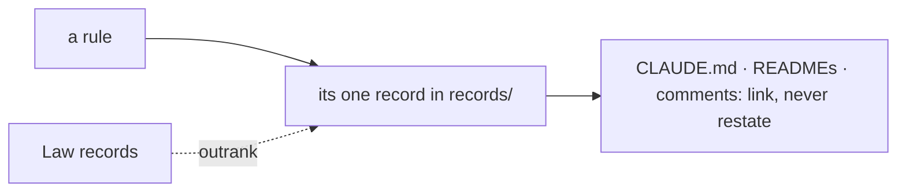

# SR-LAW-0 — L0, the records are the only source of truth

## §1 — For humans

**Every rule has one home: a record in `records/`.** `CLAUDE.md`, READMEs,
comments and skills link to that record and never restate it. A rule changes
in its record first.

**The restatement test:** *could this artifact and the record disagree while
both still look correct?* If yes, it is a restatement, and it is forbidden.

**Laws outrank every other record.** A sentence in a lower document that
conflicts with a Law is void, and is deleted on contact.



<details>
<summary><b>ASCII twin</b> — the same diagram, for terminals and diffs</summary>

```text
   a rule ---> its one record in records/ ---> CLAUDE.md, READMEs, comments
                     ^                          (link, never restate)
   Law records ......| outrank
```

</details>

---

## §2 — For agents

### Context

Rules copied into `CLAUDE.md` and READMEs drift from the records they copy:
one copy is edited, the other is not, and both still read as correct.
sheetpane starts with no code, so the authority is fixed before the first copy
can exist.

### Decision

1. **Source.** Every rule has exactly one home, a record. Every other artifact
   — `CLAUDE.md`, a README, a comment, a skill, a diagram — **links to it and
   never restates it**. A change is made in the record first.
1a. **The records are always up to date — in the change that makes them
   wrong.** Three obligations: (i) no behaviour change lands without its record
   updated in the **same commit**; (ii) a change that touches no recorded
   decision says so — `no SR affected`, on its own line of the commit message;
   (iii) before a session ends, re-read every record you changed code under.
   (i) and (ii) are enforced by the guard; (iii) is judgment and is the only
   thing covering coherence — a record can be amended into self-contradiction
   and every check passes.
2. **Precedence.** Law records outrank every other record. A record that
   conflicts with a Law is **void in the conflicting part** — a defect, never a
   trade-off.
2a. **On contact, the conflicting sentence is deleted from the lower document**
   — never softened, footnoted, or left beside a pointer.
3. **Amendment is entrenched.** A Law changes only on the decider's ruling, named in
   the record. An ordinary record a session may accept.
4. **The restatement test:** *could this artifact and the record disagree
   while both still look correct?* If yes it is a restatement and forbidden.
   If it would simply fail, it is an implementation (code naming a key) or an
   enforcement (a test, a hook) and permitted. Prose explaining *how* or *why*
   beside the code is permitted; a second statement of the rule is not.
5. **A generated view is permitted only while a test binds it byte-equal.**
   Remove the test and the view is an illegal restatement. (Not used by this
   bootstrap — tests are deferred — so `CLAUDE.md` links to the laws and
   carries none of their text.)

### Consequences

- **Enforced today:** obligations 1a (i)–(ii), by `scripts/sr-guard.sh` once
  the decider installs it as the `commit-msg` hook.
- **Judgment today:** obligation 1a (iii) — the only cover for coherence
  (backlog B-006, `cost`); precedence (2); the restatement test (4).
- `CLAUDE.md` carries pointers only; a generated law block waits for a test
  that binds it (decision 5).

### Alternatives considered

- Rules in `CLAUDE.md`, records as commentary — rejected: that is the drift
  this law ends.

### Reference (required)

- [`scripts/sr-guard.sh`](../scripts/sr-guard.sh) — the executable form of
  decision 1a (i)–(ii).

### Veto condition

**Reopen this decision if:** a rule's text is found in two live files.

**How to check it:** `grep -rln 'Every rule has exactly one home' --include=*.md . | grep -v '^./archive/'  # only records/0002 should print`

---

## References

*Every source this record cites, gathered in one place. An archived document
is never listed here.*

**Records** — [SR-LAWS](0001_LAWS.md) · [SR-WORK-OWNERSHIP](0058_WORK-ownership.md)

**Code**

- [`scripts/sr-guard.sh`](../scripts/sr-guard.sh)
