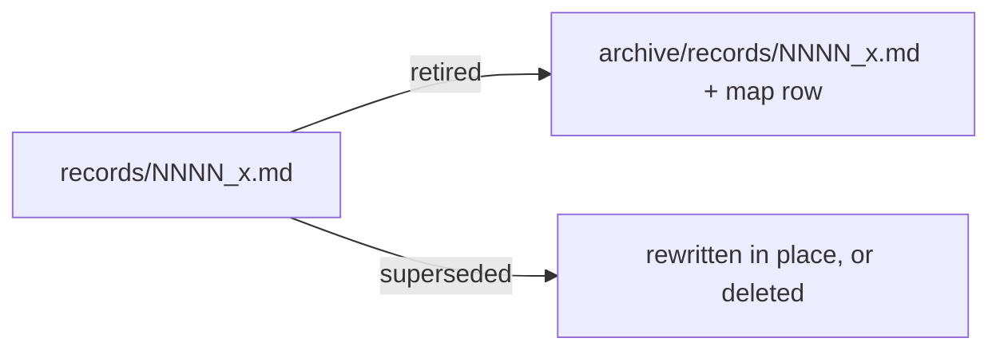

# SR-LAW-1 — L1, a retired record is archived, never deleted

## §1 — For humans

**A retired record is moved, never deleted.** It goes to `archive/records/` in
the same change, with a row in `archive/README.md`, `status: archived` and a
dated banner.

**Archived means named, never cited.** It may be mentioned with a link; it
never grounds a live claim.

**Superseded is different.** A superseded record is rewritten or deleted, and
its successor says what it replaced.



<details>
<summary><b>ASCII twin</b> — the same diagram, for terminals and diffs</summary>

```text
   records/NNNN_x.md --retired----> archive/records/NNNN_x.md + map row
                     --superseded-> rewritten in place, or deleted
```

</details>

---

## §2 — For agents

### Context

Deleting a retired record loses why something was once true; leaving it in
`records/` lets it be cited as if live. Moving it keeps both the history and
the boundary.

### Decision

1. When a record's subject, rule or law is retired, the record is **moved** to
   `archive/records/`, mirroring its path, **in the same change** — with a row
   in `archive/README.md`, `status: archived`, and a top banner
   `ARCHIVED <date> — retired by <ruling>`.
2. An archived record may be **named, never cited** as grounding for a live
   claim.
3. A **superseded** record is different: it is rewritten or deleted in the
   change that supersedes it, and the successor says in prose what it replaced.
4. A retired law is written `ex-L<n>` in live text; its handle is never reused.

### Consequences

- **Judgment today:** all of it — nothing mechanical checks this law; the veto
  command is the manual check.
- A retired law's handle is never reused (decision 4).

### Alternatives considered

- Delete retired records — rejected: the reasoning is lost.
- Keep them in `records/` marked `archived` — rejected: they get cited as live.

### Reference (required)

- [`archive/README.md`](../archive/README.md) — the map every archived record
  gets a row in.
- [SR-WORK-ARCHIVE](0057_WORK-archive.md) — the archive's rules.

### Veto condition

**Reopen this decision if:** `archive/records/` holds a file without an `archive/README.md` row, or `records/` holds a `status: archived` file.

**How to check it:** `ls archive/records/; grep -l '^status: archived' records/*.md`

---

## References

*Every source this record cites, gathered in one place. An archived document
is never listed here.*

**Records** — [SR-LAW-0](0002_LAW-0-authority.md) · [SR-WORK-ARCHIVE](0057_WORK-archive.md)

**Project docs**

- [`archive/README.md`](../archive/README.md)
