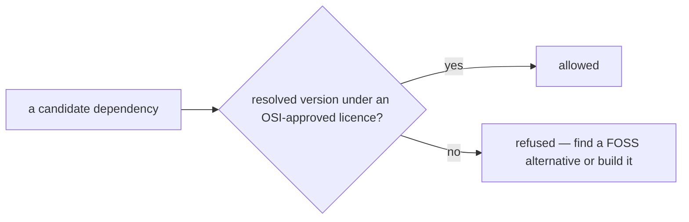

# SR-LAW-2 — L2, every dependency is free and open source

## §1 — For humans

**Every dependency is FOSS.** Nothing enters sheetpane's dependency tree unless
the exact version resolved is released under a free and open source licence.

**"Every" means every.** Runtime, peer, optional and dev dependencies, and
every transitive one under them. Vendored or copied third-party code counts as
a dependency.

**Not FOSS, not allowed.** Source-available, "fair source", Commons Clause,
BSL, SSPL, freeware, and code with no licence at all are all out.



<details>
<summary><b>ASCII twin</b> — the same diagram, for terminals and diffs</summary>

```text
   a candidate dependency ---> resolved version under an OSI-approved licence?
                                   |-- yes --> allowed
                                   '-- no ---> refused: find a FOSS alternative or build it
```

</details>

---

## §2 — For agents

### Context

sheetpane is an npm package other teams ship inside their own apps. A
non-free licence anywhere in its tree becomes their legal problem. The
decider ruled on 2026-10-18 that every dependency is free and open source.

### Decision

1. **Every dependency is FOSS** — runtime, peer, optional, dev, and every
   transitive dependency of each.
2. **FOSS means** the exact version resolved is released under a licence on
   the OSI-approved list. A dual-licensed package qualifies only if one of its
   licences for that version is on the list.
3. **Not FOSS:** source-available, "fair source", Commons Clause, BSL, SSPL,
   freeware, proprietary, and no licence at all (`UNLICENSED`, or no licence
   file).
4. **Vendored or copied third-party code is a dependency** under this law — a
   copied file, a CDN script, a pasted snippet.
5. **A licence that changes** to non-FOSS in a later version: the dependency
   is pinned below that version or removed, in the change that notices.

### Consequences

- **Judgment today:** nothing checks this law yet — the
  `package.json` files exist (W-04) but run no licence check. The licence check is backlog B-008 (`ungated`).
- **Copyleft (ruled 2026-10-18, "resolve all the blockers"):** GPL, AGPL and
  LGPL are not allowed in `dependencies` or `peerDependencies` of either
  package — a copyleft runtime dependency would bind every host app; they are
  allowed in `devDependencies`. Today both packages have no runtime
  dependencies at all, so the rule costs nothing.

### Alternatives considered

- Permissive licences only, everywhere — rejected: dev tooling may be copyleft
  without binding a host; the ruling draws the line at runtime and peer.
- Allow source-available packages case by case — rejected by the ruling.

### Reference (required)

- The decider's ruling, 2026-10-18 session — `work/WORKLOG.md`, the entry of
  that date titled "laws L2 and L3 filed".
- The OSI-approved licence list — https://opensource.org/licenses

### Veto condition

**Reopen this decision if:** any resolved dependency carries a licence that is
not on the OSI-approved list.

**How to check it:** `test -f pnpm-lock.yaml && pnpm licenses list --prod || echo "no dependencies yet"`

---

## References

*Every source this record cites, gathered in one place. An archived document
is never listed here.*

**Records** — [SR-LAWS](0001_LAWS.md) · [SR-LAW-0](0002_LAW-0-authority.md)

**Project docs**

- [`work/BACKLOG.md`](../work/BACKLOG.md) — B-008
- [`work/WORKLOG.md`](../work/WORKLOG.md)

**External**

- OSI-approved licences — https://opensource.org/licenses
