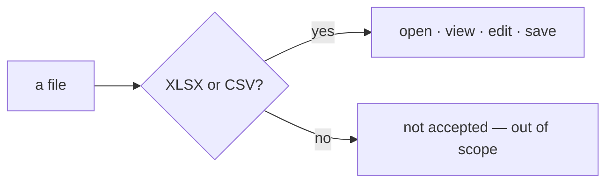

# SR-LAW-3 — L3, sheetpane supports XLSX and CSV only

## §1 — For humans

**Two formats, no more.** sheetpane reads and writes `.xlsx` and `.csv`.
Nothing else.

**Everything else is out** — `.xls`, `.xlsm`, `.xlsb`, `.ods`, `.numbers`,
Google Sheets. Not parsed, not written, not half-supported.

**"Right now" is the point.** This is a scope law. Adding a format is a ruling
by the decider that rewrites this record — never a quiet addition in code.



<details>
<summary><b>ASCII twin</b> — the same diagram, for terminals and diffs</summary>

```text
   a file ---> XLSX or CSV?
                 |-- yes --> open, view, edit, save
                 '-- no ---> not accepted: out of scope
```

</details>

---

## §2 — For agents

### Context

A spreadsheet library can grow a parser per format and support none of them
well. The decider ruled on 2026-10-18 that sheetpane supports XLSX and CSV,
and only those, for now.

### Decision

1. **Supported formats are exactly two:**

   | format | extension | standard |
   |---|---|---|
   | XLSX | `.xlsx` | Office Open XML spreadsheet (ECMA-376) |
   | CSV | `.csv` | comma-separated values (RFC 4180) |

2. **Supported means both directions** — open and view, edit, save and export.
3. **Every other format is out of scope:** no parser, no writer, no partial
   path, no "best effort". That includes `.xls`, `.xlsm`, `.xlsb`, `.ods`,
   `.numbers` and Google Sheets.
4. **A new format is a ruling, not a commit.** It enters only by the decider
   rewriting decision 1 (L0 decision 3).

### Consequences

- How an unsupported file is refused (error shape, message) is a component
  decision, owed by the first record that owns the file-loading code.
- **Judgment today:** no code exists, so nothing checks this law. The check is
  backlog B-009 (`ungated`).
- **Delimiter variants (ruled 2026-10-18, "resolve all the blockers"):** a
  `.csv` file may use `,` `;` or tab and is read with the delimiter detected;
  export defaults to `,` with `;` and tab as options. The `.tsv` extension stays
  refused — CSV is the format, the delimiter is a dialect. Detail:
  [`work/compare/xlsx-csv-reading.compare.md`](../work/compare/xlsx-csv-reading.compare.md).

### Alternatives considered

- Support every format the parsing library offers — rejected by the ruling:
  each format is a surface to test and maintain.
- XLSX only — rejected by the ruling: CSV is in.

### Reference (required)

- The decider's ruling, 2026-10-18 session — `work/WORKLOG.md`, the entry of
  that date titled "laws L2 and L3 filed".
- RFC 4180 — https://www.rfc-editor.org/rfc/rfc4180

### Veto condition

**Reopen this decision if:** live code names a spreadsheet extension other than
`.xlsx` or `.csv`.

**How to check it:** `grep -rnE '\.(xls|xlsm|xlsb|ods|numbers|tsv)\b' --exclude-dir=node_modules --exclude-dir=archive --exclude-dir=records --exclude-dir=work . || echo clean`

---

## References

*Every source this record cites, gathered in one place. An archived document
is never listed here.*

**Records** — [SR-LAWS](0001_LAWS.md) · [SR-LAW-0](0002_LAW-0-authority.md)

**Project docs**

- [`work/BACKLOG.md`](../work/BACKLOG.md) — B-009
- [`work/WORKLOG.md`](../work/WORKLOG.md)

**External**

- RFC 4180 — https://www.rfc-editor.org/rfc/rfc4180
- ECMA-376 — https://ecma-international.org/publications-and-standards/standards/ecma-376/
