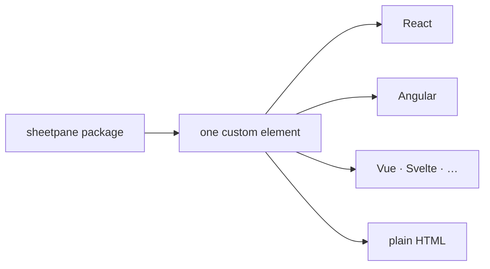

# SR-LAW-4 — L4, sheetpane is always a web component

## §1 — For humans

**sheetpane is a web component, always.** What the package gives its users is
a custom element — an HTML tag the browser itself understands.

**Any framework, or none.** React, Angular, Vue, Svelte or a plain HTML page
all use the same element. No adapter is required to use it.

**No framework is required of the user.** sheetpane never makes React, or any
other framework, a requirement for using it.



<details>
<summary><b>ASCII twin</b> — the same diagram, for terminals and diffs</summary>

```text
   sheetpane package ---> one custom element ---> React
                                             |--> Angular
                                             |--> Vue, Svelte, ...
                                             '--> plain HTML
```

</details>

---

## §2 — For agents

### Context

sheetpane is meant to drop into any single-page app. A component written for
one framework locks out every team on another. The decider ruled on 2026-10-18
that sheetpane is always a web component, so React or any other framework can
use it.

### Decision

1. **The public component is a web component** — a custom element, registered
   through the Custom Elements standard (`customElements.define`).
2. **Usable from plain HTML.** Placing the element in a page, with the package
   loaded, is enough — no framework, adapter or build step of a framework's.
3. **The contract is the DOM's own:** attributes, properties, methods and DOM
   events. No framework-specific API (props objects, hooks, directives) is part
   of the public contract.
4. **No framework is a peer dependency** of the package.
5. **"Always" is entrenched.** Changing the component's shape is a ruling by
   the decider that rewrites this record (L0 decision 3).

### Consequences

- **React 19 and later** pass properties and listen to custom events on custom
  elements natively. **React 18 and earlier** set attributes only and do not
  wire custom events, so those users need a `ref` or a wrapper.
- **Framework wrappers (ruled 2026-10-18, "resolve all the blockers"):** none
  ship in v1. React 19 uses the elements natively; React 18 hosts set
  properties and listen through a `ref`, and the README shows how. The demo
  apps (W-09) target React 19.
- **Internals (ruled 2026-10-18):** plain DOM and `<template>` only — no Lit,
  no bundled framework. Detail:
  [`work/compare/grid-rendering.compare.md`](../work/compare/grid-rendering.compare.md).
  Decisions 1–4 would hold either way; the ruling keeps the runtime at zero
  dependencies.
- Shadow DOM or light DOM, the tag name, and the attribute/event names are
  component decisions, owed by the first record that owns the element.
- **Checked today:** no UI framework is a dependency or peer of any package (SR-BUILD decision 7); `<sheetpane-excel>` and `<sheetpane-errors>` register on import (SR-GRID and SR-ERRORS tests). The shadow root is open; tags, attributes and events are SR-GRID decision 9 and SR-ERRORS decision 1.

### Alternatives considered

- A React component, with wrappers for other frameworks — rejected by the
  ruling: it ties the core to one framework.
- One build per framework — rejected by the ruling: one element serves all.

### Reference (required)

- The decider's ruling, 2026-10-18 session — `work/WORKLOG.md`, the entry of
  that date titled "law L4 filed".
- Custom Elements, the HTML Living Standard —
  https://html.spec.whatwg.org/multipage/custom-elements.html

### Veto condition

**Reopen this decision if:** the package lists a UI framework under
`peerDependencies`, or its entry point registers no custom element.

**How to check it:** `test -f package.json && node -e "const p=require('./package.json');const f=['react','react-dom','vue','@angular/core','svelte','preact','solid-js'];const b=f.filter(x=>x in (p.peerDependencies||{}));console.log(b.length?'VIOLATION '+b:'peer-clean')" || echo "no package yet"; grep -rn "customElements.define" --exclude-dir=node_modules --exclude-dir=archive --exclude-dir=records --exclude-dir=work . || echo "no element registered yet"`

---

## References

*Every source this record cites, gathered in one place. An archived document
is never listed here.*

**Records** — [SR-LAWS](0001_LAWS.md) · [SR-LAW-0](0002_LAW-0-authority.md)

**Project docs**

- [SR-GRID](0105_GRID.md) · [SR-IMPORT](0104_IMPORT.md) · [SR-ERRORS](0106_ERRORS.md) — the checks
- [`work/WORKLOG.md`](../work/WORKLOG.md)

**External**

- Custom Elements — https://html.spec.whatwg.org/multipage/custom-elements.html
- React 19 custom element support — https://react.dev/blog/2024/12/05/react-19
