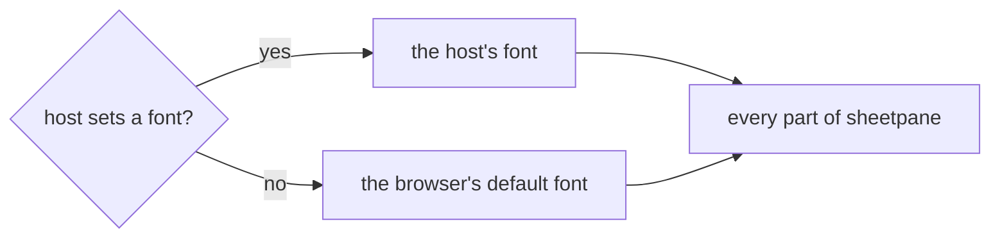

# SR-LAW-5 — L5, the font is the browser's default unless the host sets one

## §1 — For humans

**sheetpane has no font of its own.** It never bundles, downloads or names a
font. With nothing set, text appears in the browser's default font.

**The host decides.** When the host application sets a font — on the page, a
container, or the sheetpane element itself — sheetpane uses it.

**Everywhere inside.** Every part of sheetpane follows that one font: the
grid, the headers, the toolbar, the menus, the cell editor, the review notes.



<details>
<summary><b>ASCII twin</b> — the same diagram, for terminals and diffs</summary>

```text
   host sets a font? --yes--> the host's font ------------.
                     '--no--> the browser's default font --+--> every part of sheetpane
```

</details>

---

## §2 — For agents

### Context

A component that brings its own font clashes with the app it sits in and
adds a download. The decider ruled on 2026-10-18 that sheetpane uses the
browser's default font, and that the host application can set its own font
for sheetpane and everything inside it to use.

### Decision

1. **No font ships with sheetpane.** No font file, no `@font-face`, no web-font
   request, and no hard-coded `font-family` name in its styles.
2. **The default is the browser's default font** — what text renders in when
   neither sheetpane nor the host sets one.
3. **The host's font wins.** A font the host sets on the sheetpane element or
   any ancestor is the font sheetpane renders in.
4. **Every internal part follows it** — every element sheetpane renders,
   including form controls (which browsers do not let inherit fonts by
   default) and any text drawn on a `<canvas>` (which inherits nothing from
   CSS).
5. **A change to the host's font reaches sheetpane** without the host
   recreating the element.

### Consequences

- **How** the host's font reaches the internals — CSS inheritance, a named
  custom property, or both — is a component decision, owed by the first record
  that owns the element's styles.
- Decision 4 is a real cost: form controls need an explicit `font: inherit`,
  and canvas text must read the computed font and redraw when it changes.
- **Workbook fonts (ruled 2026-10-18, "resolve all the blockers"):** a font
  stored in a cell gives way to the host's font. sheetpane renders cells as
  plain text — merge-and-centre is the only formatting it keeps — so a
  workbook font is never read for display; export (patch mode) leaves the
  stored font untouched in the file.
- **With `@sheetpane/styles` installed (read in 2026-10-18 from the plugins
  verdict, decision 9, open to override):** a cell's font **weight, style,
  size, colour and decoration** may follow the workbook; the **family never
  does** — a `decorate` result naming `font-family` is refused at
  registration. Decisions 1–5 are unchanged.
- **Checked today:** no font file, `@font-face`, web-font URL or named `font-family` in any package source (SR-BUILD decision 7, run by `just check`).

### Alternatives considered

- Ship a default web font (Inter, Roboto) — rejected by the ruling: the host
  owns the look, and it adds a download.
- Hard-code a system font stack — rejected by the ruling: the browser's
  default is the default.

### Reference (required)

- The decider's ruling, 2026-10-18 session — `work/WORKLOG.md`, the entry of
  that date titled "law L5 filed".
- CSS Fonts Level 4, `font-family` — https://www.w3.org/TR/css-fonts-4/#font-family-prop

### Veto condition

**Reopen this decision if:** the package carries a font file, an `@font-face`
rule, a web-font URL, or a hard-coded `font-family` name.

**How to check it:** `grep -rnE "@font-face|\.(woff2?|ttf|otf)\b|fonts\.(googleapis|gstatic)|font-family:[^;]*[A-Za-z]" --exclude-dir=node_modules --exclude-dir=archive --exclude-dir=records --exclude-dir=work --exclude-dir=docs . | grep -v "font-family: *inherit" || echo clean`

---

## References

*Every source this record cites, gathered in one place. An archived document
is never listed here.*

**Records** — [SR-LAWS](0001_LAWS.md) · [SR-LAW-0](0002_LAW-0-authority.md) · [SR-LAW-4](0006_LAW-4-web-component.md)

**Project docs**

- [SR-BUILD](0102_BUILD.md) — decision 7, the check
- [`work/WORKLOG.md`](../work/WORKLOG.md)

**External**

- CSS Fonts Level 4 — https://www.w3.org/TR/css-fonts-4/
