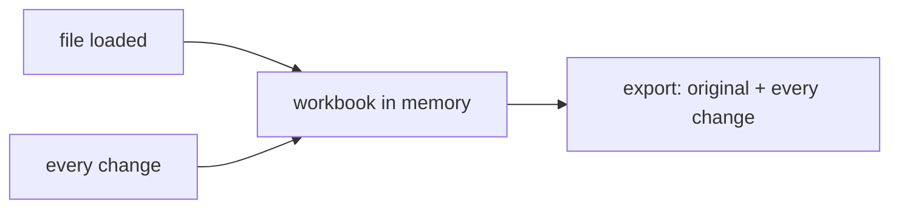

# SR-LAW-6 — L6, every change is held in memory and export carries it

## §1 — For humans

**Nothing is lost while the workbook is open.** From the moment a file is
loaded, every change the user makes is kept in memory.

**Export means "with my changes".** Exporting produces the workbook as it is
now — the original plus every change, none dropped.

**The original file is never touched.** Export always writes a new file.



<details>
<summary><b>ASCII twin</b> — the same diagram, for terminals and diffs</summary>

```text
   file loaded ---> workbook in memory ---> export: original + every change
                          ^
   every change ----------'
```

</details>

---

## §2 — For agents

### Context

An editor that loses a change, or exports the file as it was loaded, is
worse than a viewer. The decider ruled on 2026-10-18 that once a workbook is
loaded, every change is kept in memory and an export carries every change.

### Decision

1. **Every change is held in memory** from load until the workbook is closed
   or replaced — every cell edit and every other change sheetpane allows.
2. **Memory is the store.** sheetpane writes the changes nowhere else — no
   server, no browser storage. What "memory" means is
   [SR-LAW-9](0011_LAW-9-memory-is-a-javascript-object.md)'s.
3. **Export carries every change.** An export is the loaded workbook with
   every change held in memory applied — none dropped, none reordered.
4. **The original file is never modified.** Export produces a new file.
5. **Export formats are L3's** — XLSX or CSV ([SR-LAW-3](0005_LAW-3-xlsx-and-csv-only.md)).

### Consequences

- **Reload (ruled 2026-10-18, "resolve all the blockers"):** a page reload or a
  closed tab loses unexported changes, and that stays so until
  [SR-LAW-9](0011_LAW-9-memory-is-a-javascript-object.md) is rewritten for
  IndexedDB (backlog B-025). sheetpane warns on `beforeunload` when changes are
  held.
- **Fidelity (ruled 2026-10-18):** export keeps everything the workbook held
  that sheetpane does not show or edit. For an `.xlsx` source the export
  **patches the original bytes** — only changed cells are rewritten; charts,
  pivot tables, comments, defined names, styles and other parts are copied as
  they were. For a `.csv` source there is nothing beyond the cells to keep.
  Detail: [`work/compare/export-shape.compare.md`](../work/compare/export-shape.compare.md).
- Exporting a multi-sheet workbook to CSV, which holds one sheet, is a
  component decision, owed by the record that owns export.
- **Judgment today:** no code exists. The check is backlog B-017 (`ungated`).

### Alternatives considered

- Save changes to browser storage or a server — rejected by the ruling: the
  changes are kept in memory.
- Write changes back into the loaded file — rejected: the original is the
  user's and stays as it was.

### Reference (required)

- The decider's ruling, 2026-10-18 session — `work/WORKLOG.md`, the entry of
  that date titled "laws L6 and L7 filed".

### Veto condition

**Reopen this decision if:** an export of an edited workbook, loaded again,
differs from the in-memory workbook in any changed cell — or sheetpane writes
workbook data to storage or the network.

**How to check it:** `grep -rnE "localStorage|sessionStorage|indexedDB|fetch\(|XMLHttpRequest|sendBeacon" --exclude-dir=node_modules --exclude-dir=archive --exclude-dir=records --exclude-dir=work --exclude-dir=docs . || echo clean` — plus the round-trip test once B-017 lands.

---

## References

*Every source this record cites, gathered in one place. An archived document
is never listed here.*

**Records** — [SR-LAWS](0001_LAWS.md) · [SR-LAW-0](0002_LAW-0-authority.md) · [SR-LAW-3](0005_LAW-3-xlsx-and-csv-only.md) · [SR-LAW-7](0009_LAW-7-surfaces-always-in-sync.md) · [SR-LAW-9](0011_LAW-9-memory-is-a-javascript-object.md)

**Project docs**

- [`work/BACKLOG.md`](../work/BACKLOG.md) — B-017
- [`work/WORKLOG.md`](../work/WORKLOG.md)
