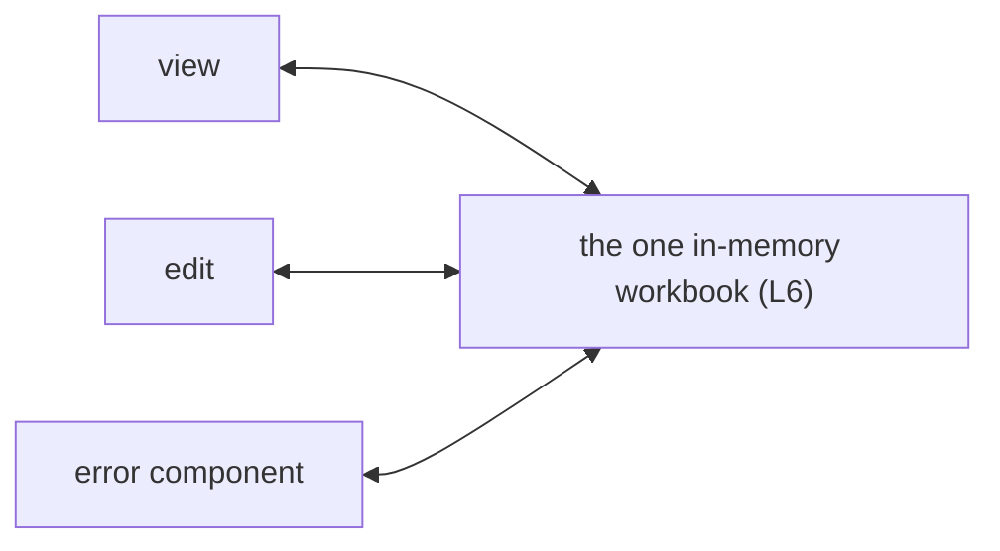

# SR-LAW-7 — L7, the view, edit and error components are always in sync

## §1 — For humans

**Three components, one truth.** The view, the editor and the error component
always show the same workbook.

**A change anywhere shows everywhere, at once.** Edit a cell and the view and
error component show the new value immediately. Flag an error and the view and
editor show it immediately. No refresh, no save, no button.

**No private copies.** All three read the one in-memory workbook of
[L6](0008_LAW-6-edits-in-memory-export-with-changes.md), so they cannot drift.



<details>
<summary><b>ASCII twin</b> — the same diagram, for terminals and diffs</summary>

```text
                 .--> view
   the one in-memory workbook (L6) <--+--> edit
                 '--> error component
```

</details>

---

## §2 — For agents

### Context

Separate components with separate copies of the data drift: an edit that
the error list never sees, an error the grid never marks. The decider ruled on
2026-10-18 that the view, edit and error components are always in sync.

### Decision

1. **The three components** are the view, the edit, and the error component
   (the review surface that marks incorrect data and its correction).
2. **One source.** All three read and write the one in-memory workbook of L6.
   No component keeps a private copy of workbook data or of its errors.
3. **Always in sync.** A change made through any component appears in the
   other two at once, with no user action.
4. **Errors are part of what is synced.** An error, and its correction, shows
   in the view and the editor as well as the error component.
5. **A component added later joins the same rule** — it reads the one
   workbook and stays in sync.

### Consequences

- **Selection (ruled 2026-10-18, "resolve all the blockers"):** the selected
  sheet and cell are part of the shared state and sync; picking an error in the
  error component selects its cell and the grid scrolls it into view. Scroll
  position itself, zoom and find text stay local to each element.
- **Matching edits (ruled 2026-10-18):** an edit that equals an error's
  suggested correction does **not** resolve the error; it marks it
  "matches suggestion". Resolving stays a human act, so a review can be
  audited. The error component shows the new value either way (decision 3).
  Detail: [`work/compare/workbook-and-error-contract.compare.md`](../work/compare/workbook-and-error-contract.compare.md).
- **Judgment today:** no code exists. The check is backlog B-020 (`ungated`).

### Alternatives considered

- Each component holds its own copy and syncs by messages — rejected: copies
  drift, and "always" cannot be proved.
- Sync on save or on a refresh — rejected by the ruling: always in sync.

### Reference (required)

- The decider's ruling, 2026-10-18 session — `work/WORKLOG.md`, the entry of
  that date titled "laws L6 and L7 filed".

### Veto condition

**Reopen this decision if:** a change made through one component is absent
from another after the change completes, or any component holds its own copy
of workbook data.

**How to check it:** the cross-component sync test, once B-020 lands; until
then, review — no code exists.

---

## References

*Every source this record cites, gathered in one place. An archived document
is never listed here.*

**Records** — [SR-LAWS](0001_LAWS.md) · [SR-LAW-0](0002_LAW-0-authority.md) · [SR-LAW-6](0008_LAW-6-edits-in-memory-export-with-changes.md)

**Project docs**

- [`work/BACKLOG.md`](../work/BACKLOG.md) — B-020
- [`work/WORKLOG.md`](../work/WORKLOG.md)
