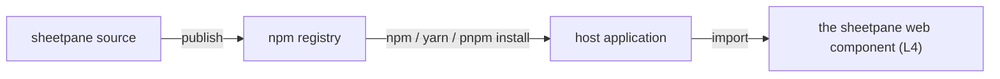

# SR-LAW-8 — L8, sheetpane is consumed as an npm package

## §1 — For humans

**sheetpane is an npm package.** A host application gets it the way it gets
any other JavaScript library: install it from the npm registry, import it.

**Any npm-compatible client works** — npm, yarn, pnpm, bun.

**One distribution.** What is published to npm is sheetpane. Nothing else is
a separate, second way of getting it.



<details>
<summary><b>ASCII twin</b> — the same diagram, for terminals and diffs</summary>

```text
   sheetpane source --publish--> npm registry --install--> host application --import--> web component (L4)
```

</details>

---

## §2 — For agents

### Context

sheetpane is a library other applications build on. The decider ruled on
2026-10-18 that it is consumed as an npm (Node) package.

### Decision

1. **sheetpane is distributed as an npm package**, published to the npm
   registry.
2. **Consumers install it with npm or any npm-compatible client** and import
   it as a module.
3. **The published package is the one distribution.** A CDN that serves files
   straight from the npm package (jsDelivr, unpkg) is the same package, not a
   second distribution.
4. **What the package exports is L4's web component**
   ([SR-LAW-4](0006_LAW-4-web-component.md)); its dependencies obey L2
   ([SR-LAW-2](0004_LAW-2-foss-dependencies.md)).

### Consequences

- The package name, module format (ESM, CommonJS), TypeScript types and
  `exports` map are component decisions, owed by the record that owns
  `package.json`.
- **Server-side import (ruled 2026-10-18, "resolve all the blockers"):**
  importing either package in Node without a browser must be safe.
  `@sheetpane/grid` registers its elements only when `customElements` exists;
  `@sheetpane/export` touches the DOM only inside `download()` (which throws a
  clear error without a `document`) and otherwise runs in Node 20+.
- **Publishing (ruled 2026-10-18):** the two packages are versioned in
  lockstep — one version number, released together — so `@sheetpane/grid@x.y.z`
  always pins `@sheetpane/export@x.y.z`. The root `package.json` is the
  private monorepo root (W-04); the packages meant for npm are under
  `packages/`, and the veto command below reads those. The check is backlog
  B-023 (`ungated`).

### Alternatives considered

- A downloadable script bundle as a separate distribution — rejected by the
  ruling: npm is the channel.

### Reference (required)

- The decider's ruling, 2026-10-18 session — `work/WORKLOG.md`, the entry of
  that date titled "laws L8 and L9 filed".
- npm, about packages and modules — https://docs.npmjs.com/about-packages-and-modules

### Veto condition

**Reopen this decision if:** a publishable package's `package.json` is missing
at release, is marked `"private": true`, or the package cannot be installed
from the npm registry.

**How to check it:** `for p in packages/sheetpane packages/export; do node -e "const p=require('./$p/package.json');console.log(p.private?'VIOLATION private '+p.name:'publishable '+p.name)"; done`

---

## References

*Every source this record cites, gathered in one place. An archived document
is never listed here.*

**Records** — [SR-LAWS](0001_LAWS.md) · [SR-LAW-0](0002_LAW-0-authority.md) · [SR-LAW-2](0004_LAW-2-foss-dependencies.md) · [SR-LAW-4](0006_LAW-4-web-component.md)

**Project docs**

- [`work/BACKLOG.md`](../work/BACKLOG.md) — B-023
- [`work/WORKLOG.md`](../work/WORKLOG.md)

**External**

- npm docs — https://docs.npmjs.com/about-packages-and-modules
