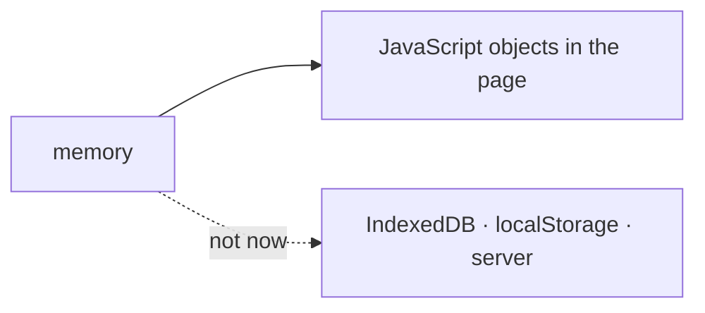

# SR-LAW-9 — L9, memory means a JavaScript object, for now

## §1 — For humans

**"Memory" means a JavaScript object.** When a record — L6 first — says the
workbook and its changes are held in memory, they live in JavaScript objects
in the page.

**Nothing else counts as memory.** Not IndexedDB, not localStorage, not a
file, not a server.

**"For now" is the point.** IndexedDB is the named next step (backlog B-025).
It arrives only by the decider rewriting this record.



<details>
<summary><b>ASCII twin</b> — the same diagram, for terminals and diffs</summary>

```text
   memory ---> JavaScript objects in the page
          ...> (not now) IndexedDB, localStorage, server
```

</details>

---

## §2 — For agents

### Context

L6 says every change is held in memory. "Memory" could mean a JavaScript
object, IndexedDB or a server. The decider ruled on 2026-10-18 that, for now,
memory means a JavaScript object.

### Decision

1. **Memory is JavaScript objects** held in the page's JavaScript heap. Every
   record that says "memory" means this.
2. **Not memory:** IndexedDB, localStorage, sessionStorage, the Cache API, the
   file system, a server.
3. **"For now" is entrenched like any law.** Adding a store — IndexedDB first —
   is a ruling by the decider that rewrites decisions 1 and 2.

### Consequences

- Memory lives and dies with the page: a reload loses unexported changes —
  ruled to stay so in [SR-LAW-6](0008_LAW-6-edits-in-memory-export-with-changes.md)
  Consequences until this record is rewritten for IndexedDB (B-025).
- Connecting to IndexedDB is backlog B-025 (`unruled`) — the decider's own
  request, deferred, not dismissed.
- A workbook is bounded by the tab's memory. The largest workbook sheetpane
  can hold is not measured — backlog B-026 (`unmeasured`).
- **Enforced by:** L6's veto command, which already refuses storage and
  network calls.

### Alternatives considered

- IndexedDB from day one — deferred by the ruling: B-025.

### Reference (required)

- The decider's ruling, 2026-10-18 session — `work/WORKLOG.md`, the entry of
  that date titled "laws L8 and L9 filed".
- [SR-LAW-6](0008_LAW-6-edits-in-memory-export-with-changes.md) — the law
  this one defines a word for.

### Veto condition

**Reopen this decision if:** workbook data is written anywhere other than
JavaScript objects in the page.

**How to check it:** `grep -rnE "indexedDB|localStorage|sessionStorage|caches\.|showSaveFilePicker" --exclude-dir=node_modules --exclude-dir=archive --exclude-dir=records --exclude-dir=work --exclude-dir=docs . || echo clean`

---

## References

*Every source this record cites, gathered in one place. An archived document
is never listed here.*

**Records** — [SR-LAWS](0001_LAWS.md) · [SR-LAW-0](0002_LAW-0-authority.md) · [SR-LAW-6](0008_LAW-6-edits-in-memory-export-with-changes.md)

**Project docs**

- [`work/BACKLOG.md`](../work/BACKLOG.md) — B-025, B-026
- [`work/WORKLOG.md`](../work/WORKLOG.md)
