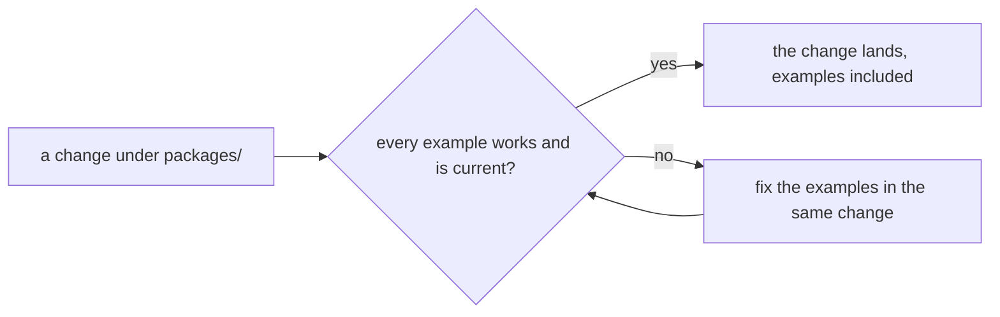

# SR-LAW-10 — L10, the examples are maintained with every package change

## §1 — For humans

**Change a package, maintain the examples.** Any change to any package
under `packages/` brings every example under `examples/` up to date in the
same change, never in a follow-up.

**Maintained means working and current.** Every example builds, runs
against the packages as they are now, and passes its checks. No example
uses an API the packages no longer have.

**A broken example blocks the change.** If an example cannot be brought
current, the package change does not land. An example is never deleted,
skipped or disabled to get a package change through.



<details>
<summary><b>ASCII twin</b> — the same diagram, for terminals and diffs</summary>

```text
   a change under packages/ ---> every example works and is current?
                                     |-- yes --> the change lands, examples included
                                     '-- no ---> fix the examples in the same change --.
                                                      ^                                |
                                                      '--------------------------------'
```

</details>

---

## §2 — For agents

### Context

The examples are how a host team first meets sheetpane: the demos, the
StackBlitz starters and the React recipes. An example that drifts from the
packages teaches a wrong API. The decider ruled on 2026-10-18 that the
examples are always maintained whenever any package changes.

### Decision

1. **The examples** are everything under `examples/`: the plain-HTML demo
   (`examples/html`), the React demo and its recipes (`examples/react`), and
   the StackBlitz starters (`examples/starters`). An example added later
   joins this law.
2. **A package change** is any change under `packages/`: source, exports,
   element attributes, properties and events, CSS parts and tokens,
   manifests, versions and the `create-sheetpane` templates.
3. **Same change.** A package change that affects what an example uses,
   shows or asserts updates that example in the same change.
4. **Always working.** After every package change, every example builds,
   runs against the current packages, and passes its checks.
5. **Always current.** No example uses a removed or renamed attribute,
   property, event, export or option, and none shows behaviour the packages
   no longer have.
6. **The checks move with their example.** The demo-check steps, the React
   recipe tests and the starters' freshness test are updated in the same
   change as the example they check.
7. **No escape hatch.** An example is never deleted, skipped or disabled to
   let a package change pass. Removing an example takes the decider's ruling.

### Consequences

- **Checked today: working.** `just demo-check` uses both demos in Chromium
  on every push (SR-BUILD decision 11); `just demo-packed` runs the same
  from packed tarballs nightly; `examples/react/test` runs the recipes;
  `test/starters.test.ts` fails when the starters are stale (`just starters`).
- **Not checked: current.** Nothing proves a package change was weighed
  against the examples (an old attribute that still silently works passes
  every check). Backlog B-035 (`ungated`).
- **Not required by this law:** a new example for every new feature. Which
  features the demos show stays SR-BUILD decisions 11 and 11a.
- **Owner:** SR-BUILD owns `examples/` and names L10.

### Alternatives considered

- Update the examples at release time — rejected by the ruling: "whenever
  there is a change".
- Maintain only the checked examples — rejected by the ruling: every
  example, checked or not.

### Reference (required)

- The decider's ruling, 2026-10-18 session — `work/WORKLOG.md`, the entry of
  that date titled "law L10 filed".
- [SR-BUILD](0102_BUILD.md) decisions 11, 11a — the demos and their check.
- [`test/starters.test.ts`](../test/starters.test.ts) ·
  [`scripts/demo-check.mjs`](../scripts/demo-check.mjs)

### Veto condition

**Reopen this decision if:** on any commit to `main`, an example fails its
check or uses a public API the packages no longer export.

**How to check it:** `just demo-check && pnpm exec vitest run test/starters.test.ts examples/react/test`

---

## References

*Every source this record cites, gathered in one place. An archived document
is never listed here.*

**Records** — [SR-LAWS](0001_LAWS.md) · [SR-LAW-0](0002_LAW-0-authority.md) · [SR-BUILD](0102_BUILD.md)

**Code**

- [`examples/`](../examples/) · [`scripts/demo-check.mjs`](../scripts/demo-check.mjs) · [`scripts/build-starters.mjs`](../scripts/build-starters.mjs) · [`test/starters.test.ts`](../test/starters.test.ts)

**Project docs**

- [`work/BACKLOG.md`](../work/BACKLOG.md) — B-035
- [`work/WORKLOG.md`](../work/WORKLOG.md)
