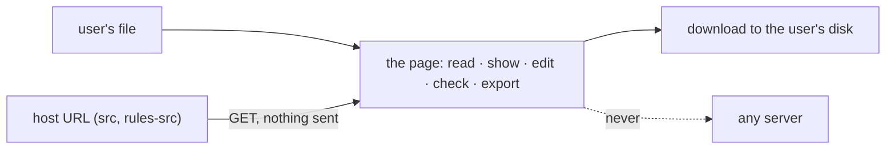

# SR-LAW-11 — L11, the workbook never leaves the browser

## §1 — For humans

**Everything happens in the browser.** When a user opens an `.xlsx` or a
`.csv`, sheetpane reads, shows, edits, checks and exports it inside the page.

**Nothing goes back to a server.** sheetpane sends no byte of the file, no
cell, no edit, no error and no export to any server — not its own, not the
host's, not a third party's. There is no telemetry.

**Reading is allowed; sending is not.** sheetpane may *fetch* a file the host
points it at (`src`, `rules-src`). What the host's own code does with the
data is the host's choice — sheetpane never does it for them.



<details>
<summary><b>ASCII twin</b> — the same diagram, for terminals and diffs</summary>

```text
   user's file ------------------------> the page: read, show, edit, check, export
   host URL (src, rules-src) --GET-----> the page            (nothing sent)
   the page ---------------------------> download to the user's disk
   the page ...........never...........> any server
```

</details>

---

## §2 — For agents

### Context

sheetpane is used to review files people may not share — holdings, payroll,
client lists. The decider ruled on 2026-10-19: *"Everything should be within
the browser. Nothing go back to the server… when you upload a CSV or an Excel
file, it does not go to the server. It just stays within the browser."*
Two follow-up rulings in the same session settled the edges: sheetpane may
read a host-given URL, and a host's own code may save to its own server.

### Decision

1. **The workbook stays in the browser.** Reading, parsing, rendering,
   editing, checking (rules, column rules, the workbook's validation,
   formulas) and exporting all run in the page. No step needs a server.
2. **sheetpane sends nothing.** No `@sheetpane/*` package — core or plugin —
   sends workbook data over the network: not the file's bytes, a cell value,
   an edit, an error, an export, a file name or anything derived from them.
   No request body, no query string, no header, no beacon, no socket.
3. **No telemetry.** sheetpane makes no analytics, crash-report, usage or
   "phone-home" request of any kind.
4. **Reads only, and only these:** a `GET` of the URL the host puts in `src`
   (the file to show) and in `rules-src` (the rules file), plus
   `@sheetpane/fixtures`' read of its own files for tests. Each carries nothing
   from the workbook. A new network read is a ruling that rewrites this
   decision.
5. **Export stays local.** Download hands the bytes to the browser's own save;
   `export()` and the `sheetpane-export` event hand them to the host's code in
   the page.
6. **The host's code is the host's.** A host may send an exported blob or the
   errors to its own server from its own listener. That is the host's choice
   and outside this law; sheetpane's docs and skills that show it say so.
7. **Node-side tools** (`@sheetpane/mcp`, `@sheetpane/skills`,
   `create-sheetpane`) work on local files and send no workbook data either.

### Consequences

- **Works offline** once the page and its code are loaded — a file opened from
  the user's disk never needs the network.
- A host that wants server-side storage builds it itself; sheetpane offers the
  blob and the errors as JSON (SR-GRID, the `sheetpane-backend` skill).
- `src` sends the page's cookies to a same-origin URL (`credentials:
  'same-origin'`) so a signed-in host can serve its file. Nothing from the
  workbook travels with it.
- **Enforced by:** `test/packages.test.ts` (SR-BUILD decision 7) — every
  network API in any package's shipped source must be one of the three reads
  in decision 4, else the test fails.

### Alternatives considered

- **No network at all** (drop `src` and `rules-src`) — rejected by the
  decider: a read of the host's own file sends nothing.
- **Strip server-save examples from the skills** — rejected by the decider:
  the host's code is the host's; the skills say it is the host's choice.
- **Opt-in telemetry** — not offered: decision 3.

### Reference (required)

- The decider's ruling, 2026-10-19 session — `work/WORKLOG.md`, the entry of
  that date titled "law L11 filed".
- [SR-LAW-6](0008_LAW-6-edits-in-memory-export-with-changes.md) and
  [SR-LAW-9](0011_LAW-9-memory-is-a-javascript-object.md) — the laws that
  keep changes in the page's memory.

### Veto condition

**Reopen this decision if:** any package's shipped source calls a network API
other than the three reads in decision 4.

**How to check it:** `pnpm vitest run test/packages.test.ts -t 'SR-LAW-11'`

---

## References

*Every source this record cites, gathered in one place. An archived document
is never listed here.*

**Records** — [SR-LAWS](0001_LAWS.md) · [SR-LAW-0](0002_LAW-0-authority.md) · [SR-LAW-6](0008_LAW-6-edits-in-memory-export-with-changes.md) · [SR-LAW-9](0011_LAW-9-memory-is-a-javascript-object.md) · [SR-BUILD](0102_BUILD.md) · [SR-GRID](0105_GRID.md) · [SR-SKILLS](0116_SKILLS.md)

**Project docs**

- [`test/packages.test.ts`](../test/packages.test.ts) — the check
- [`work/WORKLOG.md`](../work/WORKLOG.md)
