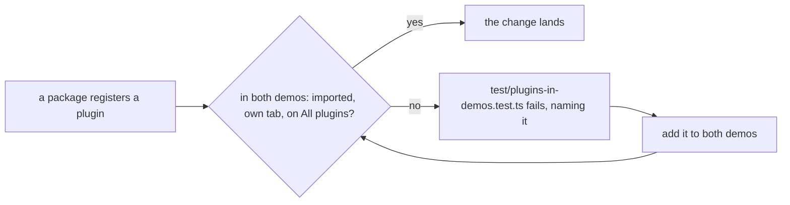

# SR-LAW-12 — L12, every plugin is in the demos, and All plugins has them all

## §1 — For humans

**All plugins means all of them.** The demos' *All plugins* tab turns on every
plugin sheetpane has, not only the ones that existed when the tab was made.

**A new plugin joins the demos in the change that adds it.** It gets its own
gallery tab, it is added to *All plugins*, and both demos import it: the
plain-HTML demo and the React demo.

**A test enforces it.** If a plugin is missing from either demo, the suite
fails and names the plugin.



<details>
<summary><b>ASCII twin</b> — the same diagram, for terminals and diffs</summary>

```text
   a package registers a plugin ---> in both demos: imported, own tab, on All plugins?
                                        |-- yes --> the change lands
                                        '-- no ---> the test fails, naming it ---> add it to both demos --.
                                                 ^                                                         |
                                                 '---------------------------------------------------------'
```

</details>

---

## §2 — For agents

### Context

The *All plugins* tab listed eight plugins. After it was written,
`visibility`, `tables`, `compare` and `review` shipped with tabs of their own,
but none of them joined *All plugins*, so the tab no longer showed what its
name promised. The decider ruled on 2026-10-19 that *All plugins* always has
every plugin, new ones included, and that this is a law.

### Decision

1. **A plugin** is any id that a package other than `@sheetpane/grid` passes
   to `registerPlugin`. Its package is the folder under `packages/` that
   registers it.
2. **The demos** are the plain-HTML demo (`examples/html/index.html`) and the
   React demo's gallery (`examples/react/src/PluginGallery.tsx`).
3. **In both demos, every plugin:**
   - **(a)** is imported from its package;
   - **(b)** has at least one gallery tab of its own that turns it on;
   - **(c)** is listed in the `plugins` of the *All plugins* tab (`id: 'all'`).
4. **Same change.** A change that adds a plugin meets decision 3 in that
   change. A change that removes or renames a plugin updates both demos in
   that change.
5. **The *All plugins* tab** comes after every one-plugin tab and opens the
   showcase workbook. Its blurb does not count the plugins, because the
   count changes.
6. **The gate.** `test/plugins-in-demos.test.ts` reads the plugin ids from
   the packages' source and fails for any plugin and demo that breaks
   decision 3. `just demo-check` opens *All plugins* in both demos and fails
   on any page error.

### Consequences

- **Checked:** decision 3, by `test/plugins-in-demos.test.ts` (the `repo`
  project). That *All plugins* runs every plugin together without a page
  error is checked by `just demo-check` (SR-BUILD decision 11).
- **Not checked:** that a tab's blurb describes its plugin well. That is
  judgment.
- **A plugin that needs a second input** (for example, `compare` needs
  `base`) is still listed in *All plugins*. On that tab it does what it can
  without the input, and its own tab shows it fully.
- **Owner:** SR-BUILD owns `examples/`. This law sits beside
  [L10](0012_LAW-10-examples-maintained.md), which keeps the examples
  working; L12 keeps them complete.

### Alternatives considered

- **Build the *All plugins* list from the registry at runtime.** Rejected:
  the demos are read as examples of how a host turns plugins on, and a
  literal `plugins="…"` attribute is the lesson.
- **Check only the HTML demo.** Rejected: the decider asked for every place
  that has *All plugins*, and both demos have one.

### Reference (required)

- **The decider's ruling** in the 2026-10-19 session: "should plugins should
  always have all plugins even the new ones create an sr law for the same".
  See `work/WORKLOG.md`, the 2026-10-19 entry titled "laws L12 and L13 filed".
- **SR-BUILD** decisions 11 and 11a: the demos and their check.
- **The code:**
  [`test/plugins-in-demos.test.ts`](../test/plugins-in-demos.test.ts) and
  [`scripts/demo-check.mjs`](../scripts/demo-check.mjs).

### Veto condition

**Reopen this decision if:** a package registers a plugin and either demo
lacks it on a tab of its own or on *All plugins*.

**How to check it:** `pnpm exec vitest run --project repo test/plugins-in-demos.test.ts && just demo-check`

---

## References

*Every source this record cites, gathered in one place. An archived document
is never listed here.*

**Records:** [SR-LAWS](0001_LAWS.md) · [SR-LAW-0](0002_LAW-0-authority.md) · [SR-LAW-10](0012_LAW-10-examples-maintained.md) · [SR-BUILD](0102_BUILD.md)

**Code**

- [`examples/html/index.html`](../examples/html/index.html)
- [`examples/react/src/PluginGallery.tsx`](../examples/react/src/PluginGallery.tsx)
- [`test/plugins-in-demos.test.ts`](../test/plugins-in-demos.test.ts)
- [`scripts/demo-check.mjs`](../scripts/demo-check.mjs)

**Project docs:** [`work/WORKLOG.md`](../work/WORKLOG.md)
