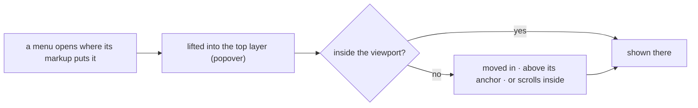

# SR-LAW-13 — L13, every dropdown is wholly visible, inside the viewport, on top

## §1 — For humans

**A dropdown is never hidden.** Every menu, list and pop-up card that
sheetpane opens is shown whole. This covers:
- the cell menu and the header menus;
- the sheet-tab menu and the hidden-sheets menu;
- the download and *More* menus and the format row's *More*;
- the list of choices, the size box, the error card, the new-error form and
  the keyboard help.

**Inside the viewport.** No part of it falls outside the browser window. Near
the right edge it moves left. Near the bottom it opens above what it hangs
under, if it fits there. If it does not fit, it stays where it opened and
scrolls inside.

**On top.** It sits above everything on the page: the host's own panels, the
grid's frozen panes, every scroll box and `overflow: hidden` parent. Nothing
covers it or cuts it off.



<details>
<summary><b>ASCII twin</b> — the same diagram, for terminals and diffs</summary>

```text
   a menu opens where its markup puts it ---> lifted into the top layer (popover)
                                                   |
                                          inside the viewport?
                                     yes --> shown there
                                     no  --> moved in / above its anchor / scrolls inside --> shown there
```

</details>

---

## §2 — For agents

### Context

The header menu of the last column ran past the sheet's right edge and was
cut off. A scroll box clips anything that is laid out inside it, and a host
can place sheetpane anywhere: next to a side panel, inside a scrolling page,
or in a narrow column. The decider ruled on 2026-10-19 that a dropdown is
always visible, inside the viewport and on top, and that this is a law.

### Decision

1. **A dropdown** is any menu, list, pop-up card or dialog that an element
   draws over its own content when the user opens it. Today these are the
   `.card` elements of `<sheetpane-excel>` whose classes are listed in
   `FLOATS` in `packages/grid/src/excel/float.ts`. A new one is added to
   that list in the change that adds it.
2. **On top.** A dropdown is shown in the browser's top layer, as a manual
   popover. No ancestor's `overflow`, `z-index` or stacking context can
   clip it or put it underneath. A `<dialog>` is already in the top layer
   and counts.
3. **Inside the viewport.** Every edge of a dropdown stays at least 8 px
   (`EDGE`) inside the viewport. When it would overflow:
   - **right or left:** it moves in;
   - **bottom:** it moves above its anchor if it fits there; otherwise it
     stays where it opened and scrolls inside, if at least `MIN_H` (160 px)
     is left below; otherwise it moves up and scrolls inside;
   - **taller than the viewport:** it scrolls inside.
4. **It follows its anchor.** On every render, page scroll and resize, a
   dropdown is placed again from where its markup puts it, so it moves with
   its cell or button.
5. **It never covers what opened it**, unless the viewport leaves no other
   room. A toggle stays reachable, so it can still close the dropdown.
6. **L5 holds.** A dropdown in the top layer still inherits the host's font
   and the element's tokens. It inherits through the DOM, not through the
   top layer.
7. **The gate.** `packages/grid/test/float.test.ts` checks that each of the
   following is open in the top layer, wholly inside the viewport, and not
   covered:
   - the header menu of the last column;
   - the cell menu on a low row, which must sit above its cell;
   - every card a menu opens.

   It also checks the placement arithmetic on its own.

### Consequences

- **Built:** `float.ts` (`floatAll`, `floatInViewport`, `placeInViewport`).
  The element calls it after every render and on page scroll and resize.
  The styles undo the popover's own margin, inset and padding.
- **Checked:** decision 7, in the grid's browser tests.
- **Not checked:** a dropdown left out of `FLOATS`. The gate test covers
  only the cards it opens. Adding a dropdown to `FLOATS` is owed by
  decision 1, and is judgment.
- **Owner:** SR-GRID owns `float.ts` and names L13.

### Alternatives considered

- **Keep each menu inside the sheet and clamp it there.** Rejected: a small
  sheet cannot hold a long menu, and the decider asked for *within the
  viewport and at the top*.
- **Move every menu to `document.body`.** Rejected: that leaves the shadow
  root, its styles and its tokens, and so L4 and L5. A popover stays in its
  own tree and still renders on top.

### Reference (required)

- **The decider's ruling** in the 2026-10-19 session: "the drop down is
  getting hidden make sure it is always visible, within viewport and at the
  top create a law sr for the same". See `work/WORKLOG.md`, the 2026-10-19
  entry titled "laws L12 and L13 filed".
- **SR-GRID** decisions 11e and 13: the menus.

### Veto condition

**Reopen this decision if:** any dropdown that sheetpane draws is cut off by
the viewport or by a parent, or is covered by another element.

**How to check it:** `pnpm exec vitest run --project grid packages/grid/test/float.test.ts`

---

## References

*Every source this record cites, gathered in one place. An archived document
is never listed here.*

**Records:** [SR-LAWS](0001_LAWS.md) · [SR-LAW-0](0002_LAW-0-authority.md) · [SR-LAW-4](0006_LAW-4-web-component.md) · [SR-LAW-5](0007_LAW-5-host-font.md) · [SR-GRID](0105_GRID.md)

**Code**

- [`packages/grid/src/excel/float.ts`](../packages/grid/src/excel/float.ts)
- [`packages/grid/test/float.test.ts`](../packages/grid/test/float.test.ts)

**Project docs:** [`work/WORKLOG.md`](../work/WORKLOG.md)
