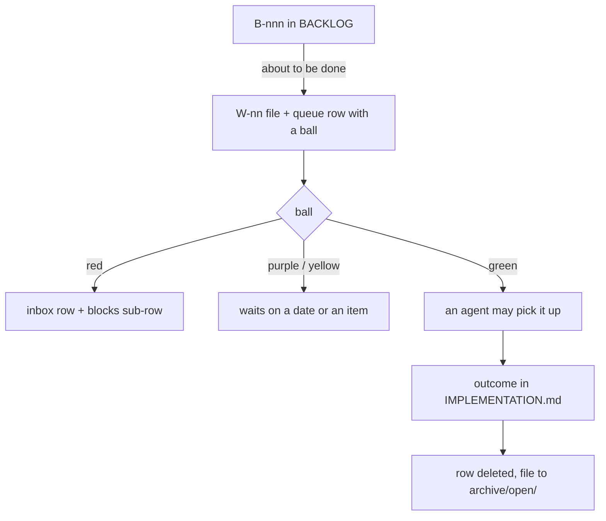

# SR-WORK-OPEN-QUEUE — how OPEN-WORK.md works

## §1 — For humans

**`work/OPEN-WORK.md` is the one list of what is being done.** One or two
lines per item, one ball per row; the detail lives in `work/open/W-nn-slug.md`.

**The inbox sits on top.** Every decision the decider owes is a row there,
with its age.

**Closed items leave entirely.** The row is deleted and the file moves to
`archive/open/`, in one change.



<details>
<summary><b>ASCII twin</b> — the same diagram, for terminals and diffs</summary>

```text
   B-nnn in BACKLOG --about to be done--> W-nn file + queue row with a ball
                                               |
         red ----> inbox row + "blocks:" sub-row
         purple / yellow ----> waits on a date or an item
         green --> an agent picks it --> outcome in IMPLEMENTATION.md
                                               |
                              row deleted, file to archive/open/
```

</details>

---

## §2 — For agents

### Context

A project with two places that say what to do next always has a stale one.
sheetpane has no code yet; the queue exists before the first item so the
first item lands in the right shape.

### Decision — the open-queue discipline (normative)

**A · What the file is**

1. `work/OPEN-WORK.md` is the single live queue. Ordering lives in it.
2. No second document names what to do next; a second one is the stale one.
3. Its length is the signal of how much is pending. It narrates no history.
4. It is an index: one or two lines per item; detail in `work/open/W-nn-slug.md`.

**B · An item's lifecycle**

5. Maintained **in the same change as the work**, never afterwards.
6. An item gets its file and id before it gets a row; the row gets its ball the
   day it is filed.
7. `W-nn` ids are never reused — including an id withdrawn before its file
   existed (the id is still spent; the rows are simply removed).
8. Completed items are **removed, never ticked**: the row is deleted and the
   detail file moves to `archive/open/`.
9. Closing is legal only once the outcome is in `work/IMPLEMENTATION.md`.
10. A resolved thing leaves the queue entirely — no tombstones, no DONE rows.
11. Before deleting a row, check what it was the only home of; move that
    statement to a record first.
12. On every execution — success, failure, blocked, interrupted, abandoned —
    the affected rows are updated before the session ends. A failed run records
    the failure with a one-line why. **Never mark an item done with failing
    checks.**

**C · The shape of a row**

13. One or two lines per item, always.
14. A row is: ball · optional 🧨 · optional 🔺 · `**W-nn**` · `` `lane` `` ·
    what is open · `Filed by <person> (<surface>).` (rule 63) ·
    `[detail](open/W-nn-slug.md)`.
15. At most 280 characters.
16. No body — no nested bullet, no table, no indented paragraph.
17. Every row links its own detail file, and the id in the row matches it.
18. A *Blocked on the decider* row is short too.
19. Everything else — status, evidence, records, rulings, hazards, history —
    goes in the item's file.

**D · The balls**

20. A ball on every row, always, and exactly one.
21. 🔴 blocked on the decider's decision — directly, or through any chain of items
    ending at one.
22. 🟣 gated on a named date — the row that owns the gate names `YYYY-MM-DD`;
    a row behind it names the item it waits on.
23. 🟡 waiting on another item whose chain ends at neither the decider nor a date —
    the row says `waiting on W-mm`, the bare id right after the verb.
23a. **A 🟡 row names a queue item; if none exists, the same edit files one.**
    *"Waiting on a run"*, *"waiting on an endpoint"* — each is an unfiled item
    wearing a blocker's clothes. The filed item states what the missing thing
    is, what producing it takes, and who or what can produce it. **A blocker
    that cannot be turned into an item is a reason to close**, or to put the
    fork to the decider — never a reason to stay 🟡.
24. 🟢 no blockers, good to go.
25. Red wins, then purple.
26. A date-gated item is not in the inbox.
27. **The chain is read from the row's own words, by a fixed verb list:**
    `blocked on` · `after` · `waiting on` · `waits on`, followed by the id.
28. When a state changes, re-ball that row and every row waiting on it.
29. 🧨 broken, or getting worse every day it waits. Any session sets or clears
    it, on any ball.
30. 🔺 do first — set and removed only by the decider. An agent never adds one.
31. Mark order: the ball, then 🧨, then 🔺, then the id.
32. **An agent picks from 🟢 only:** 🟢🧨🔺 → 🟢🔺 → 🟢🧨 → 🟢. 🔴, 🟣 and 🟡
    wait. A Claude Code session never picks from the `research` section.
33. A session names every 🔴 decision in its first output, 🔺 first.
34. A 🔺 item waiting on an item without 🔺 is flagged to the decider, never fixed by
    giving the blocker a 🔺.

**E · Ordering**

35. Three lanes, ordered independently: `arpit` · `agent` · `cowork`.
36. Priority is damage that accrues with elapsed time, above damage that is
    merely present.
37. Grouped by what closing it takes — `build` (code) · `testing` (a run or a
    harness) · `record update` (a ruling or a record; no code) · `research`
    (a proposal or compare doc reached by reading; no code; closes on the decider
    picking a shape).
37a. **The `research` section runs in a chat/Cowork session, never in Claude
    Code.** Its rows' lane is `cowork`; its files say `**Model:** Cowork`.
38. Each item's file names the record its change will update, or says
    **"no SR affected"** out loud.

**F · The Blocked-on-the-decider inbox**

39. The header carries the inbox; each item's file carries its `filed` date.
40. `age` is arithmetic — today minus `filed`, recomputed on every read, never
    copied.
41. Any inbox row older than 5 days is named, with its age, in the session's
    first output.
42. Every inbox row is followed by a `↳ **blocks:**` sub-row naming every item
    the decision holds up, or `nothing else in the queue`.
43. An item waiting on a decision joins that sub-row in the same edit.
44. An inbox row is always 🔴.
45. A row points only at things that exist.
45a. **The inbox section carries its table and nothing else.** When rulings are
    owed, the table has rows and the section closes. When none is owed, the
    table stays (header + separator only) and the line directly beneath it
    begins `*Empty since YYYY-MM-DD` and names the next gate. **Nothing else
    follows the table** — no recap, no summary. (Enforced in-session by
    `.claude/hooks/guard-open-work-inbox.sh`.)

**G · Standing, and forbidden**

46. The markers are assertions, not evidence. Reconcile against
    `work/IMPLEMENTATION.md` and the repo before treating anything as pending
    or done.
47. **No git housekeeping, ever.** Nothing in the queue says what is or is not
    committed, staged or pushed. If repo state blocks work, name what the work
    needs.
48. A WORKLOG entry per substantive exchange — a chat-only session counts.
49. The queue and the item file on any status change; INTERVIEW kept current
    *during* the session.
50. Reconcile before you report.
51. Records are cited by name, never by number.
52. No behaviour change lands without its record updated in the same change.

**H · Closing an item — archive, never delete**

53. An item's detail file is **never deleted**. Closing moves
    `work/open/W-nn-slug.md` to `archive/open/`, byte for byte, in the same
    change that deletes its row.
54. Every closure archives, whatever the outcome — shipped, superseded,
    renumbered, merged, withdrawn, won't-do. A closure with no code is still a
    closure, and its file is the one worth most.
55. The mover is the noticer: an item some other change already closed is
    archived by the session that notices it.
56. Archiving is not done until `archive/README.md` §`open/` names a
    successor — the file, the close date, and where the live answer lives now.
57. `archive/open/` is history, not evidence.

**I · An item's file opens with its meeting view**

58. **The first thing under an item file's `# W-nn` title is `## At a glance`,
    and the first thing under that is a table or a diagram** — a Markdown
    table, a fenced `mermaid` or `text` diagram, or an image. Nothing comes
    before it, not the ruling and not the `**Model:**` line.
59. The view says **what we are going to do, in plain English, fit to put on a
    screen in a meeting.** Default shape: `| step | what we do | what it gives
    us | state |`, state ✅ done · ⏳ not yet · 🔴 the decider decides. Ids, metric
    names and paths go in the body below.
60. The view changes in the same change as the item; a view that disagrees
    with its body is wrong, and the body wins.

**J · Who filed it, and who last updated it**

61. An item file's frontmatter carries `filed_by`, `updated` and `updated_by`
    beside `filed`. Each `_by` is `"<person> (<surface>, <model>)"` — the person
    whose ask it is, then the session that wrote it. The model is left out only
    when no record of it survives; never guessed.
62. Every change to an item file re-sets `updated` and `updated_by`; `updated`
    is never earlier than `filed`.
63. An *Open items* row ends `Filed by <person> (<surface>).` — the file's
    `filed_by` without the model — just before its detail link. Inbox rows do
    not carry it.

**The legend** — the one rule text the queue carries, exactly these two lines
under its header:

```text
**A ball on every row, always one:** 🔴 blocked on the decider, directly or through another item · 🟣 gated on a named date, directly or through another item · 🟡 waiting on another item · 🟢 no blockers.
**Optional, after the ball:** 🧨 broken or getting worse · 🔺 do first (the decider only). Full legend: [SR-WORK-OPEN-QUEUE](../records/0051_WORK-open-queue.md) rules 20–34.
```

### Consequences

- **Enforced today:** rule 45a — `.claude/hooks/guard-open-work-inbox.sh` runs
  `scripts/check-open-work-inbox.py` after every write.
- **Judgment today:** every other rule.
- **Owed:** the row rules (13–19, 42, 45) are checked by nothing — backlog
  B-001. A `W-nn` that resolves to neither `work/open/` nor `archive/open/` is
  caught by nobody — backlog B-004.

### Alternatives considered

- An external tracker as the queue — rejected: a cold session cannot read it,
  and it drifts from the repo.
- Ticked DONE rows — rejected: the queue's length stops being the signal
  (rule 3).

### Reference (required)

- [`work/OPEN-WORK.md`](../work/OPEN-WORK.md) — the queue.
- [`scripts/check-open-work-inbox.py`](../scripts/check-open-work-inbox.py) —
  rule 45a's check.

### Veto condition

**Reopen this decision if:** the inbox fails its shape check, or a second live document names what to do next.

**How to check it:** `python3 scripts/check-open-work-inbox.py && echo inbox-ok`

---

## References

*Every source this record cites, gathered in one place. An archived document
is never listed here.*

**Records** — [SR-WORK-BACKLOG](0052_WORK-backlog.md) · [SR-WORK-BLOCKERS](0056_WORK-blockers.md) · [SR-WORK-ARCHIVE](0057_WORK-archive.md)

**Code**

- [`scripts/check-open-work-inbox.py`](../scripts/check-open-work-inbox.py)
- [`.claude/hooks/guard-open-work-inbox.sh`](../.claude/hooks/guard-open-work-inbox.sh)

**Project docs**

- [`work/OPEN-WORK.md`](../work/OPEN-WORK.md) · [`work/open/README.md`](../work/open/README.md)
