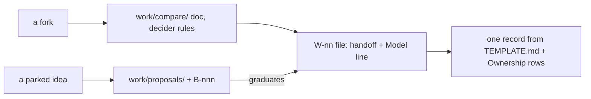

# SR-WORK-LIFECYCLE — how a feature travels

## §1 — For humans

**A feature travels one path.** A fork gets a compare doc; a parked idea gets
a proposal; the work gets a `W-nn` whose file holds the handoff; the finished
feature gets one record.

**The record is updated before building.** The design of record is the record
itself.

**Every handoff names the model** that should execute it, with one sentence
of why.



<details>
<summary><b>ASCII twin</b> — the same diagram, for terminals and diffs</summary>

```text
   fork ------> compare doc (decider rules) --\
   parked idea -> proposal + B-nnn --graduates--> W-nn file (handoff + Model)
                                                       |
                                  one record from TEMPLATE.md + Ownership rows
```

</details>

---

## §2 — For agents

### Context

Design reasoning scattered across chats and handoff folders is lost; keeping
it in the item file and then the record gives each thing one home.

### Decision — the lifecycle discipline (normative)

1. **On a fork, a compare doc first** — `work/compare/<name>.compare.md`:
   verdict block on top, context, options, matrix, consequences, references,
   **reopen-trigger** (a condition, not a date). The decider accepts or overrides the
   verdict.
2. **On a parked idea, a proposal** — `work/proposals/<name>.md`, `status:
   proposed`, with a **graduation trigger**. Every proposal has one `B-nnn` row.
3. The design of record is the record itself, updated **before** building.
4. **The handoff lives in the item's own detail file** — context, definition
   of done, constraints, key files, edge cases, open questions. There is no
   handoff directory.
5. The prompt is paste-ready and sits beside its handoff: explore → plan →
   implement → verify.
6. **Every handoff names the model that should execute it** — a `**Model:**`
   line with one sentence of why. `**Model:** NONE — <who, and why>` is legal;
   a blank is the only wrong answer.
7. By task: **Opus** when the output quality *is* the deliverable and no test
   catches a bad one (design, debate, ambiguous diagnosis, calling a gate,
   anything touching a law) · **Sonnet** for a written definition of done with
   checks to verify it · **Haiku** for mechanical bulk edits with an exact rule.
8. When borderline, say Opus and say why it was close.
9. One feature, one record, written from `records/TEMPLATE.md` on completion,
   with its components added to the ownership table in the same change.
10. Every rule, record and material decision carries a reference.
11. An implemented proposal is archived in the change that writes its record.

### Consequences

- **Judgment today:** all of it — nothing checks the `**Model:**` line or that
  a record is written on completion.
- sheetpane's first feature record takes `0101` and adds its code directory to
  the Ownership table in the same change.

### Alternatives considered

- A separate `handoffs/` directory — rejected: a second home for the item's
  spec (rule 4).
- Leaving the model choice to whoever picks the item — rejected: the choice is
  part of the spec (rule 6).

### Reference (required)

- [`records/TEMPLATE.md`](TEMPLATE.md) — the shape a finished feature's record
  takes.
- [`work/open/README.md`](../work/open/README.md) — the item-file shape.

### Veto condition

**Reopen this decision if:** an open item file lacks a Model line.

**How to check it:** `grep -L '^[*][*]Model:[*][*]' work/open/W-*.md 2>/dev/null  # no output = holds`

---

## References

*Every source this record cites, gathered in one place. An archived document
is never listed here.*

**Records** — [SR-WORK-OPEN-QUEUE](0051_WORK-open-queue.md) · [SR-WORK-BACKLOG](0052_WORK-backlog.md)

**Project docs**

- [`records/TEMPLATE.md`](TEMPLATE.md) · [`work/open/README.md`](../work/open/README.md) · [`work/compare/README.md`](../work/compare/README.md) · [`work/proposals/README.md`](../work/proposals/README.md)
