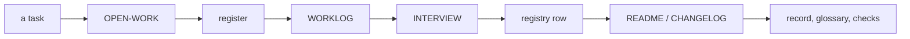

# SR-WORK-DOCS — the documentation contract

## §1 — For humans

**Docs are short, roomy and lead with the takeaway.** A wall of text you
touch, you split.

**An agent may edit the steering files, `CLAUDE.md` included** — and says so
out loud.

**Every task updates a fixed list of documents, in order, before it is done.**
`docs/` is what sheetpane *is*; `work/` is what is *happening* to it.



<details>
<summary><b>ASCII twin</b> — the same diagram, for terminals and diffs</summary>

```text
   task -> OPEN-WORK -> register -> WORKLOG -> INTERVIEW -> registry row
        -> README / CHANGELOG -> record, glossary, checks
```

</details>

---

## §2 — For agents

### Context

Long prose hides the rule, and documents not updated with the task are stale
by the next session.

### Decision — the documentation discipline (normative)

1. No large paragraphs: 3–4 lines, one idea per point.
2. Roomy: blank lines, tables for comparisons, headings.
3. Lead each point with the takeaway, bolded where it helps scanning.
4. Fix form on contact — a wall of text you touch, you split.
5. Chat answers follow the same rule.
6. **An agent may edit the agent-steering files directly**, `CLAUDE.md`
   included — no proposal step.
7. Under two obligations, both judgment: **(a) say it out loud** — a change to
   `CLAUDE.md` is named in the session output and the worklog entry; **(b) a
   ruling of the decider's, or a fact** — never latitude you were not given.
8. Statements of fact are exempt from every ceremony: fixed on contact.
9. The split is `docs/` (what the project *is*) and `work/` (what is
   *happening* to it). `work/README.md` is the map.
10. **Every task updates, before it is done, in this order:** (1)
    `work/OPEN-WORK.md` · (2) the register · (3) `work/WORKLOG.md` · (4)
    `work/INTERVIEW.md` · (5) the registry row of any doc touched · (6)
    `README.md` / `CHANGELOG.md` when public-facing · (7) the relevant record,
    the glossary for any new term, every check the change needs.
11. The registry's rules are `SR-WORK-REGISTRY`'s.
12. Every relative link in a live document resolves (judgment until a link
    test exists).
13. Durable repo-wide knowledge is folded into `CLAUDE.md` concisely, as a
    pointer to its record.

### Consequences

- **Judgment today:** all of it — form (1–5), the two obligations (7), the
  update order (10), links resolving (12; no link test yet).

### Alternatives considered

- A proposal step before editing `CLAUDE.md` — rejected: it slows fact fixes;
  obligation (a) keeps changes visible instead.

### Reference (required)

- [SR-WORK-REGISTRY](0060_WORK-registry.md) §3 — the rows decision 10 bumps.
- [`work/README.md`](../work/README.md) — the map of `work/`.

### Veto condition

**Reopen this decision if:** a relative link in CLAUDE.md does not resolve.

**How to check it:** `grep -oE '[]][(][^)#]+[)]' CLAUDE.md | sed -E 's/^[]][(]//; s/[)]$//' | grep -v '^http' | xargs ls >/dev/null && echo links-ok`

---

## References

*Every source this record cites, gathered in one place. An archived document
is never listed here.*

**Records** — [SR-WORK-REGISTRY](0060_WORK-registry.md) · [SR-WORK-SESSION](0054_WORK-session.md)

**Project docs**

- [`CLAUDE.md`](../CLAUDE.md) · [`work/README.md`](../work/README.md) · [`docs/GLOSSARY.md`](../docs/GLOSSARY.md)
