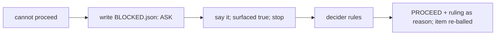

# SR-WORK-BLOCKERS — a blocker is a file, not a remark

## §1 — For humans

**A blocker is a file, not a remark.** When a session cannot proceed without
the decider, it writes `work/BLOCKED.json` and stops.

**Three hooks make that hard to skip:** the blocker and inbox are injected into
every prompt; a turn cannot end while a blocker is unsurfaced; writes take a
per-file lock.



<details>
<summary><b>ASCII twin</b> — the same diagram, for terminals and diffs</summary>

```text
   cannot proceed -> BLOCKED.json (ASK) -> say it, surfaced:true, stop
      -> decider rules -> PROCEED + ruling as reason, item re-balled
```

</details>

---

## §2 — For agents

### Context

A blocker mentioned in passing scrolls away; the session then works around it
and builds on a guess.

### Decision — the blocker discipline (normative)

1. **A blocker is a file, not a remark.** The moment you cannot proceed
   without the decider, write `work/BLOCKED.json` and stop.
2. Shape:
   ```json
   {"decision":"ASK","reason":"one line","questions":["the minimum question"],
    "safe_alternative":"what you can do meanwhile, or \"\"","surfaced":false,"filed":"YYYY-MM-DD"}
   ```
3. `decision` takes exactly four values — `ASK` (the decider can unblock you) ·
   `REFUSE` (disallowed or unsafe) · `UNKNOWN` (out of scope to answer
   reliably) · `PROCEED` (nothing is blocked).
4. `questions` carries the **minimum** question.
5. `safe_alternative` is what can be done meanwhile — never a guess at what the decider
   would have said.
6. **Do not work around a blocker.** Say it, set `surfaced: true`, stop.
7. Three hooks enforce it: `UserPromptSubmit` injects the blocker and the
   inbox into every prompt (`inject-inbox.sh`); `Stop` refuses to end a turn
   while a blocker is unsurfaced, three times, then relents
   (`stop-if-blocked.sh`); `PreToolUse` on writes is a **per-asset** lock
   (`session-lock.sh`, TTL 900 s).
8. The `Stop` hook relents after three refusals deliberately — a hook that
   never relents is a hang. Taking the third exit while still blocked breaks
   rule 6.
9. The lock is per asset, not per session; two sessions are expected.
10. When the decider rules, the file is set back to `PROCEED` with the ruling as
    `reason` and the resulting item re-balled in the same change.

### Consequences

- **Enforced today:** decision 7 — `inject-inbox.sh` (UserPromptSubmit),
  `stop-if-blocked.sh` (Stop), `session-lock.sh` (PreToolUse, TTL 900 s). All
  need `jq`.
- **Accepted cost:** the Stop hook relents after three refusals (decision 8) —
  backlog B-007.
- **Judgment today:** the minimum question (4), the safe alternative (5), not
  working around (6).

### Alternatives considered

- A blocker as a queue row only — rejected: nothing stops the session.
- A Stop hook that never relents — rejected: it hangs the session.

### Reference (required)

- [`work/BLOCKED.json`](../work/BLOCKED.json) — the blocker file.
- [`.claude/hooks/inject-inbox.sh`](../.claude/hooks/inject-inbox.sh) · [`.claude/hooks/stop-if-blocked.sh`](../.claude/hooks/stop-if-blocked.sh) · [`.claude/hooks/session-lock.sh`](../.claude/hooks/session-lock.sh)

### Veto condition

**Reopen this decision if:** work/BLOCKED.json is not valid JSON carrying one of the four decisions.

**How to check it:** `jq -e '.decision | IN("ASK","REFUSE","UNKNOWN","PROCEED")' work/BLOCKED.json`

---

## References

*Every source this record cites, gathered in one place. An archived document
is never listed here.*

**Records** — [SR-WORK-OPEN-QUEUE](0051_WORK-open-queue.md)

**Code**

- [`.claude/hooks/inject-inbox.sh`](../.claude/hooks/inject-inbox.sh)
- [`.claude/hooks/stop-if-blocked.sh`](../.claude/hooks/stop-if-blocked.sh)
- [`.claude/hooks/session-lock.sh`](../.claude/hooks/session-lock.sh)
- [`.claude/settings.json`](../.claude/settings.json)
