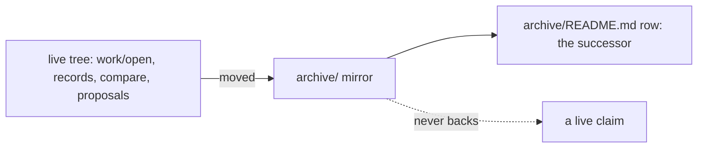

# SR-WORK-ARCHIVE — one archive; named, never cited

## §1 — For humans

**There is one archive, `archive/`, at the repo root.** Closed items, retired
records, decided forks and finished proposals move there, mirroring where they
came from.

**Every archived thing is mapped** in `archive/README.md` to its live
successor. **Archived means named, never cited.**



<details>
<summary><b>ASCII twin</b> — the same diagram, for terminals and diffs</summary>

```text
   live tree ---moved---> archive/ (mirror) ---> archive/README.md row
                              .
                              ...never backs...> a live claim
```

</details>

---

## §2 — For agents

### Context

Deleted history cannot be checked; history left in the live tree gets cited as
current.

### Decision — the archive discipline (normative)

1. Exactly one archive: `archive/` at the repo root.
2. Anything archived is **moved** there into a directory mirroring where it
   came from (`archive/open/`, `archive/records/`, `archive/compare/`, …).
3. Every archived document gets a row in `archive/README.md` naming its live
   successor, or saying it has none.
4. An archived document may be **named** in prose, with a link.
5. It may **never back a live claim** — nothing guarantees it was not
   overwritten after retirement.
6. When repointing a citation away from an archived doc, point at the live
   successor; never just delete the link.
7. If an archived doc was a claim's only support, the claim needs new
   grounding.
8. A superseded record is never archived (rewritten or deleted); a **retired**
   record is archived (L1).
9. Links inside `archive/` are never repaired; the tree is frozen.

### Consequences

- **Judgment today:** all of it.
- **Owed:** a second `archive/` directory is caught by nobody — backlog B-005.
- Links inside `archive/` are never repaired (decision 9).

### Alternatives considered

- Per-directory `old/` folders — rejected: many archives and no single map.
- Rely on git history — rejected: a session cannot name what it cannot see.

### Reference (required)

- [`archive/README.md`](../archive/README.md) — the map.

### Veto condition

**Reopen this decision if:** a second directory named archive exists.

**How to check it:** `find . -type d -name archive -not -path ./archive -not -path './.git/*' -not -path './node_modules/*'  # no output = holds`

---

## References

*Every source this record cites, gathered in one place. An archived document
is never listed here.*

**Records** — [SR-LAW-1](0003_LAW-1-retired-records-archived.md)

**Project docs**

- [`archive/README.md`](../archive/README.md)
