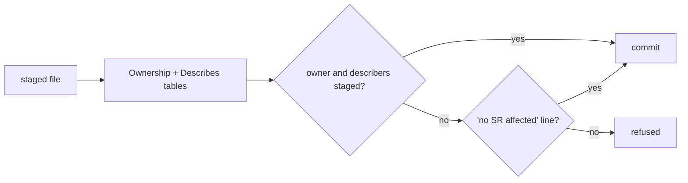

# SR-WORK-OWNERSHIP — owns, describes, and the commit guard

## §1 — For humans

**Every component has exactly one owning record.** Any number of other records
may *describe* it.

**A commit that changes a component touches its owner and every describer** —
or says `no SR affected` on its own line. `scripts/sr-guard.sh` (which first runs `scripts/rename-only-guard.sh` and `scripts/shrink-guard.sh`, SR-WORK-SESSION decision 13) enforces it as
a `commit-msg` hook.



<details>
<summary><b>ASCII twin</b> — the same diagram, for terminals and diffs</summary>

```text
   staged file -> Ownership + Describes tables -> records staged? --yes--> commit
                                                     |no
                                     "no SR affected"? --yes--> commit
                                                     |no
                                                  refused
```

</details>

---

## §2 — For agents

### Context

Records go stale when code changes and nobody is asked to update them; a
prompt at commit time makes the update the default.

### Decision — the ownership discipline (normative)

1. Two relations: `owns` (exactly one record per component) and `describes`
   (any number). `describes` never substitutes for `owns`.
2. Both are declared in the register, in two marked tables.
3. **The guard demands the owner and every describer** be staged in the same
   commit as a change to the component — or the commit message carries
   `no SR affected` on its own line.
4. A `describes` row states **why**, in its note cell.
5. Most specific wins, for `owns` only.
6. `scripts/sr-guard.sh` runs as a **`commit-msg`** hook — never `pre-commit`,
   because the escape line has to be read from the message, which does not
   exist at `pre-commit` time. Install once:
   `ln -sf ../../scripts/sr-guard.sh .git/hooks/commit-msg`.
7. `--no-verify` leaves no trace; when CI exists it runs the same check from
   history (`records/RULE-SINCE` is its baseline).
8. The guard proves a record was **touched**, never that it is coherent.

### Consequences

- **Enforced today:** decisions 3 and 6, once the decider installs the hook:
  `ln -sf ../../scripts/sr-guard.sh .git/hooks/commit-msg`.
- **Owed:** `owns:` ↔ Ownership table agreement (decision 2) is unchecked —
  backlog B-002.
- **Accepted cost:** touched, never coherent (decision 8) — backlog B-006.
- The package code (`packages/`, the root build files) is owned by open
  `W-nn` items until each writes its record; the guard resolves a `W-nn`
  owner to its file in `work/open/`.

### Alternatives considered

- A `pre-commit` hook — rejected: the escape line lives in the message, which
  does not exist yet (decision 6).
- Ownership as judgment — rejected: the guard needs a table to read.

### Reference (required)

- [`scripts/sr-guard.sh`](../scripts/sr-guard.sh) — the guard.
- [`records/README.md`](README.md) §Ownership · [`records/RULE-SINCE`](RULE-SINCE)

### Veto condition

**Reopen this decision if:** the guard is installed and a commit after RULE-SINCE still changes an owned component without its record or the escape line.

**How to check it:** `readlink .git/hooks/commit-msg; git log --name-only --format='-- %h %s' "$(grep -v '^#' records/RULE-SINCE)"..HEAD`

---

## References

*Every source this record cites, gathered in one place. An archived document
is never listed here.*

**Records** — [SR-LAW-0](0002_LAW-0-authority.md)

**Code**

- [`scripts/sr-guard.sh`](../scripts/sr-guard.sh)

**Project docs**

- [`records/README.md`](README.md) · [`records/RULE-SINCE`](RULE-SINCE)
