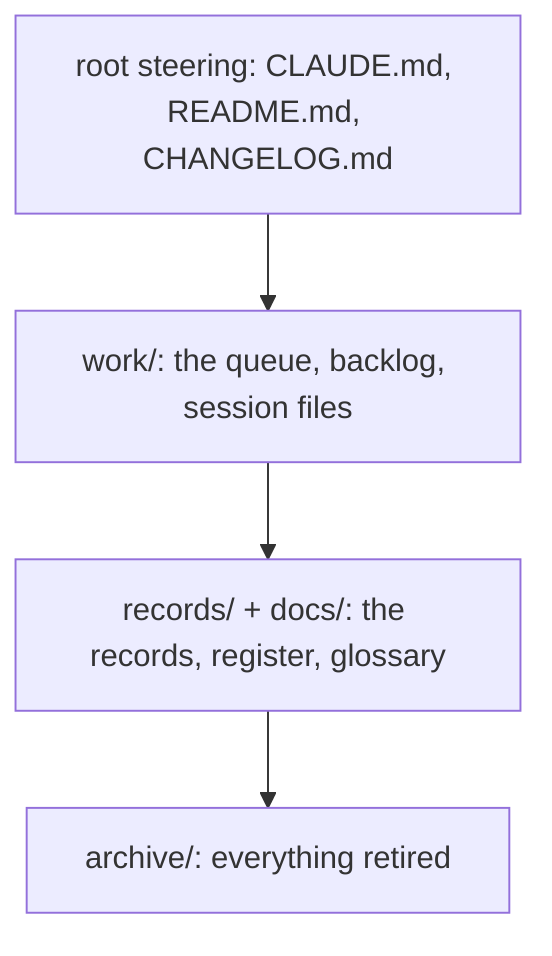

# SR-WORK-GOVERNANCE — which file governs what

## §1 — For humans

**Every governing file sits in exactly one of four layers:** root steering,
`work/`, `records/` + `docs/`, and `archive/`.

**The map names each file's home**, audience, enforcer and update trigger.
**It carries no counts** — a count is a fact with an expiry date.



<details>
<summary><b>ASCII twin</b> — the same diagram, for terminals and diffs</summary>

```text
   root steering   CLAUDE.md, README.md, CHANGELOG.md
   work/           the queue, backlog, session files
   records/+docs/  the records, register, glossary
   archive/        everything retired
```

</details>

---

## §2 — For agents

### Context

Without a map, a new governing file appears with no trigger and no enforcer,
and nobody knows it governs anything.

### Decision — the governance map (normative)

Four layers; every governing file sits in exactly one. The map names homes
and restates no rule. **It carries no counts** — a count in prose is a fact
with an expiry date.

| layer | files | audience | enforced by | update trigger |
|---|---|---|---|---|
| root steering | `CLAUDE.md` · `README.md` · `CHANGELOG.md` | agent / human | hooks + guard | any rule or pointer changes |
| `work/` | `OPEN-WORK.md` · `BACKLOG.md` · `open/` · `BLOCKED.json` · `NOW.md` · `WORKLOG.md` · `INTERVIEW.md` · `IMPLEMENTATION.md` · `LESSONS.md` · `MACHINE.md` · `compare/` · `proposals/` | both | hooks (`inject-inbox`, `stop-if-blocked`, `require-progress`, `session-lock`, `guard-open-work-inbox`) | the same change as the work |
| `records/` + `docs/` | `records/README.md` (register) · `records/NNNN_*.md` · `records/TEMPLATE.md` · `records/RULE-SINCE` · `docs/GLOSSARY.md` | both | `scripts/sr-guard.sh` | the owning code or the decision changes |
| `archive/` | everything retired, mirroring the live tree | both | judgment (no second `archive/` anywhere) | a closure or a retirement |

A governing file gets its row in the change that adds it and loses it in the
change that retires it.

### Consequences

- **Judgment today:** all of it — no check compares the map with the tree.
- `README.md` and `CHANGELOG.md` are named in the root layer and do not exist
  yet; they arrive with sheetpane's first public surface.

### Alternatives considered

- Fold the map into `CLAUDE.md` — rejected: it would restate homes the records
  own (L0).

### Reference (required)

- [`CLAUDE.md`](../CLAUDE.md) · [`work/README.md`](../work/README.md) · [`records/README.md`](README.md)

### Veto condition

**Reopen this decision if:** a work/ or records/ file the map names does not exist.

**How to check it:** `ls CLAUDE.md work/OPEN-WORK.md work/BACKLOG.md work/BLOCKED.json work/NOW.md work/WORKLOG.md work/INTERVIEW.md work/IMPLEMENTATION.md work/LESSONS.md work/MACHINE.md records/README.md records/TEMPLATE.md records/RULE-SINCE docs/GLOSSARY.md >/dev/null && echo map-ok`

---

## References

*Every source this record cites, gathered in one place. An archived document
is never listed here.*

**Records** — [SR-WORK-REGISTRY](0060_WORK-registry.md) · [SR-WORK-DOCS](0055_WORK-docs.md)

**Project docs**

- [`CLAUDE.md`](../CLAUDE.md) · [`work/README.md`](../work/README.md) · [`records/README.md`](README.md) · [`archive/README.md`](../archive/README.md)
