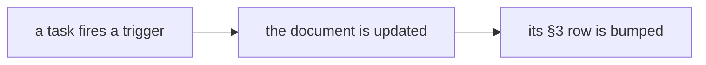

# SR-WORK-REGISTRY — the doc registry

## §1 — For humans

**Every maintained document has a row:** an update trigger and a last-verified
date.

**A task that fires a trigger updates the document and bumps its row**, in the
same change. The table is §3 of this record.



<details>
<summary><b>ASCII twin</b> — the same diagram, for terminals and diffs</summary>

```text
   a task fires a trigger -> the document is updated -> its §3 row is bumped
```

</details>

---

## §2 — For agents

### Context

Documents rot silently; a trigger and a date make staleness visible.

### Decision — the registry discipline (normative)

1. The registry is §3 of this record — a table, no other file.
2. Every maintained document has an **update trigger** and a **last verified**
   date; a task that fires a trigger updates the document *and* bumps its row
   in the same change.
3. A row is `| Document | Update trigger | Last verified | Notes |`.
4. Live documents only; an archived document loses its row in the same change.
5. No row points into `archive/`. 6. Every row's target exists. 7. One row
   per document. 8. A new maintained document gets its row in the same change.
9. A row older than about thirty days is a review prompt, not a failure.
10. At task end, scan the trigger column.

### Consequences

- **Judgment today:** all of it.
- **Owed:** decisions 5–8 are checked by nothing — backlog B-003.
- A row older than about thirty days is a review prompt (decision 9).

### Alternatives considered

- A separate registry file — rejected: decision 1.

### Reference (required)

- §3 below — the registry itself.

### Veto condition

**Reopen this decision if:** a registry row's target does not exist.

**How to check it:** `sed -n '/^## §3/,$p' records/0060_WORK-registry.md | grep -oE '^[|] [^ ]+' | tr -d '| ' | tr -d '\140' | grep -v '^Document$' | grep -v '^-' | xargs ls >/dev/null && echo registry-ok`

---

## §3 — The registry

| Document | Update trigger | Last verified | Notes |
|---|---|---|---|
| `CLAUDE.md` | any rule or pointer changes | 2026-10-18 | 2026-10-18 — §The laws: the L10 line |
| `work/README.md` | a file is added to or removed from `work/` | 2026-10-18 | 2026-10-18 — `reference/` added to the map |
| `work/OPEN-WORK.md` | the same change as the work it tracks | 2026-10-20 | 2026-10-20 — W-71 filed (🔴, templates) |
| `work/BACKLOG.md` | a record names something nobody is doing | 2026-10-18 | 2026-10-18 — B-035 (examples current, ungated) |
| `work/open/README.md` | the item-file contract changes | 2026-10-18 | 2026-10-18 — created at setup |
| `work/INTERVIEW.md` | direction, a decision or the live state changes — during the session | 2026-10-20 | 2026-10-20 — W-71 in §1 and §2 |
| `work/IMPLEMENTATION.md` | something lands | 2026-10-20 | 2026-10-20 — W-71 (part) |
| `work/LESSONS.md` | a failure teaches something durable | 2026-10-18 | 2026-10-18 — the rename-only commit, twice; the gate |
| `work/MACHINE.md` | a surface breaks in a way the code did not cause | 2026-10-18 | 2026-10-18 — Firefox does not launch on macOS 27 |
| `work/compare/README.md` | a fork opens, closes, or its trigger fires | 2026-10-18 | 2026-10-18 — the contract verdict's decision 9 rewritten (undo built) |
| `work/proposals/README.md` | an idea is filed, graduates, or is rejected | 2026-10-18 | 2026-10-18 — second proposal: Dismiss for workbook errors (B-029) |
| `docs/GLOSSARY.md` | a term is coined or redefined | 2026-10-19 | 2026-10-19 — static table (W-67) |
| `docs/ARCHITECTURE.md` | a package, element, flow or contract changes; a verdict is reopened | 2026-10-19 | 2026-10-19 — the static entry (W-67) |
| `records/README.md` | a record's state, ownership or number changes | 2026-10-19 | 2026-10-19 — SR-LAW-12 (0014) and SR-LAW-13 (0015) registered |
| `records/TEMPLATE.md` | the convention changes | 2026-10-18 | 2026-10-18 — created at setup |
| `work/reference/README.md` | a reference document is added, removed or refreshed | 2026-10-18 | 2026-10-18 — plugin boards row for W-14–W-24, W-29 |
| `work/reference/design/README.md` | the design canvas changes — synced the same session (§Keeping this folder in sync) | 2026-10-18 | 2026-10-19 — synced to canvas v51 (W-50 results board); the open-work prototype added |
| `packages/export/README.md` | `@sheetpane/export`'s public API changes | 2026-10-18 | 2026-10-18 — the API: toXlsx, patchXlsx, toCsv, download |
| `packages/grid/README.md` | `@sheetpane/grid`'s public API changes | 2026-10-19 | 2026-10-19 — `@sheetpane/grid/static` (W-67) |
| `packages/import/README.md` | its content changes | 2026-10-18 | 2026-10-18 — created: the API, CSV, refusals |
| `README.md` | the packages, the commands or the demos change | 2026-10-20 | 2026-10-20 — W-71: 0.5.0 on npm; plain words, who it is for, roadmap, FAQ; links to the new docs |
| `docs/readme/` | the grid's look or `examples/html/sample.xlsx` changes — rerun `node docs/readme/capture.mjs` | 2026-10-19 | 2026-10-19 — created: logo, screenshots, demo GIF, the rules file they show, the capture script |
| `packages/images/README.md` | its API changes | 2026-10-18 | 2026-10-18 — created: the images plugin |
| `packages/validation/README.md` | its API changes | 2026-10-19 | 2026-10-19 — `@sheetpane/validation/check` (W-54) |
| `packages/numfmt/README.md` | its API changes | 2026-10-18 | 2026-10-18 — created: the numfmt plugin |
| `CHANGELOG.md` | a public-facing change lands | 2026-10-20 | 2026-10-20 — W-71: the new repo docs under Unreleased |
| `RELEASING.md` | the release flow, a workflow it names, or the one-time npm steps change | 2026-10-19 | 2026-10-19 — created: GitHub Release → `publish.yml`, OIDC, no token |
| `docs/ERRORS.md` | a code is added, retired or its docs change | 2026-10-19 | 2026-10-19 — SP-3027, SP-3028 (W-67) |
| `CONTRIBUTING.md` | the build, test or contribution steps, or a law it names, change | 2026-10-20 | 2026-10-20 — created (W-71) |
| `SECURITY.md` | the reporting channel, the scope or the supported versions change | 2026-10-20 | 2026-10-20 — created (W-71) |
| `CODE_OF_CONDUCT.md` | the code or its contact changes | 2026-10-20 | 2026-10-20 — created (W-71) |

---

## References

*Every source this record cites, gathered in one place. An archived document
is never listed here.*

**Records** — [SR-WORK-DOCS](0055_WORK-docs.md) · [SR-WORK-GOVERNANCE](0059_WORK-governance.md)
