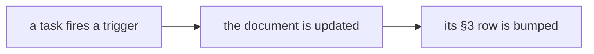

# SR-WORK-REGISTRY — the doc registry

## §1 — For humans

**Every maintained document has a row:** an update trigger and a last-verified
date.

**A task that fires a trigger updates the document and bumps its row**, in the
same change. The table is §3 of this record.



<details>
<summary><b>ASCII twin</b> — the same diagram, for terminals and diffs</summary>

```text
   a task fires a trigger -> the document is updated -> its §3 row is bumped
```

</details>

---

## §2 — For agents

### Context

Documents rot silently; a trigger and a date make staleness visible.

### Decision — the registry discipline (normative)

1. The registry is §3 of this record — a table, no other file.
2. Every maintained document has an **update trigger** and a **last verified**
   date; a task that fires a trigger updates the document *and* bumps its row
   in the same change.
3. A row is `| Document | Update trigger | Last verified | Notes |`.
4. Live documents only; an archived document loses its row in the same change.
5. No row points into `archive/`. 6. Every row's target exists. 7. One row
   per document. 8. A new maintained document gets its row in the same change.
9. A row older than about thirty days is a review prompt, not a failure.
10. At task end, scan the trigger column.

### Consequences

- **Judgment today:** all of it.
- **Owed:** decisions 5–8 are checked by nothing — backlog B-003.
- A row older than about thirty days is a review prompt (decision 9).

### Alternatives considered

- A separate registry file — rejected: decision 1.

### Reference (required)

- §3 below — the registry itself.

### Veto condition

**Reopen this decision if:** a registry row's target does not exist.

**How to check it:** `sed -n '/^## §3/,$p' records/0060_WORK-registry.md | grep -oE '^[|] [^ ]+' | tr -d '| ' | tr -d '\140' | grep -v '^Document$' | grep -v '^-' | xargs ls >/dev/null && echo registry-ok`

---

## §3 — The registry

| Document | Update trigger | Last verified | Notes |
|---|---|---|---|
| `CLAUDE.md` | any rule or pointer changes | 2026-10-18 | 2026-10-18 — layout line: a pnpm workspace run by just (W-10) |
| `work/README.md` | a file is added to or removed from `work/` | 2026-10-18 | 2026-10-18 — `reference/` added to the map |
| `work/OPEN-WORK.md` | the same change as the work it tracks | 2026-10-18 | 2026-10-18 — W-03, W-12 red on the decider (inbox rows); W-13 green |
| `work/BACKLOG.md` | a record names something nobody is doing | 2026-10-18 | 2026-10-18 — B-015, B-023 closed by SR-BUILD's package checks; B-012 narrowed to the element half |
| `work/open/README.md` | the item-file contract changes | 2026-10-18 | 2026-10-18 — created at setup |
| `work/INTERVIEW.md` | direction, a decision or the live state changes — during the session | 2026-10-18 | 2026-10-18 — §1 pnpm workspace; §2 W-25–W-28 |
| `work/IMPLEMENTATION.md` | something lands | 2026-10-18 | 2026-10-18 — W-03, W-12 landed |
| `work/LESSONS.md` | a failure teaches something durable | 2026-10-18 | 2026-10-18 — first lesson: two sessions, one tree |
| `work/MACHINE.md` | a surface breaks in a way the code did not cause | 2026-10-18 | 2026-10-18 — Firefox does not launch on macOS 27 |
| `work/compare/README.md` | a fork opens, closes, or its trigger fires | 2026-10-18 | 2026-10-18 — plugins verdict filed (sixth doc) |
| `work/proposals/README.md` | an idea is filed, graduates, or is rejected | 2026-10-18 | 2026-10-18 — first proposal: live pivot tables (B-028) |
| `docs/GLOSSARY.md` | a term is coined or redefined | 2026-10-18 | 2026-10-18 — plugin, hook, slot, derived cell, column rules |
| `docs/ARCHITECTURE.md` | a package, element, flow or contract changes; a verdict is reopened | 2026-10-18 | 2026-10-18 — the law-checks line |
| `records/README.md` | a record's state, ownership or number changes | 2026-10-18 | 2026-10-18 — SR-EXPORT (0103); SR-DOWNLOAD owns packages/export/src/download/ |
| `records/TEMPLATE.md` | the convention changes | 2026-10-18 | 2026-10-18 — created at setup |
| `work/reference/README.md` | a reference document is added, removed or refreshed | 2026-10-18 | 2026-10-18 — created: specs and design snapshot for W-01–W-08 |
| `work/reference/design/README.md` | the design canvas changes | 2026-10-18 | 2026-10-18 — created: snapshot of the canvas |
| `packages/export/README.md` | `@sheetpane/export`'s public API changes | 2026-10-18 | 2026-10-18 — the API: toXlsx, patchXlsx, toCsv, download |
| `packages/grid/README.md` | `@sheetpane/grid`'s public API changes | 2026-10-18 | 2026-10-18 — renamed from `packages/sheetpane/` (package `sheetpane` → `@sheetpane/grid`) |

---

## References

*Every source this record cites, gathered in one place. An archived document
is never listed here.*

**Records** — [SR-WORK-DOCS](0055_WORK-docs.md) · [SR-WORK-GOVERNANCE](0059_WORK-governance.md)
