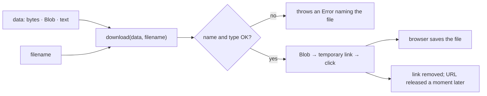

# SR-DOWNLOAD — download(): export output in, a saved .xlsx or .csv out

## §1 — For humans

**One call saves an export.** `@sheetpane/export` makes the file's contents
(`toXlsx` gives bytes, `toCsv` gives text). `download()` hands them to the
browser as a real file in the Downloads folder. That replaces the Blob, link
and click code every host would otherwise write, and usually get slightly
wrong.

**It is strict on purpose.** It saves only `.xlsx` and `.csv` (L3). It fixes
file names that Windows or macOS would reject. It never changes the bytes it is
given (L6). It throws a clear error instead of failing silently.

**It lives in `@sheetpane/export`**, beside the writers whose output it
saves; `@sheetpane/grid`'s Export button calls the same function.



<details>
<summary><b>ASCII twin</b> — the same diagram, for terminals and diffs</summary>

```text
   data (bytes|Blob|text) --+
                            +--> download(data, filename) --> name & type OK?
   filename ----------------+                                  |no    |yes
                                                               v      v
                                                  throws Error   Blob -> temp link -> click
                                                                        |-> browser saves the file
                                                                        |-> link removed; URL released later
```

</details>

### Examples

**1 · Excel file**
```ts
import { toXlsx, download } from '@sheetpane/export';
download(await toXlsx(book), 'sales.xlsx');
// saves sales.xlsx, type application/vnd.openxmlformats-officedocument.spreadsheetml.sheet
```

**2 · CSV text**
```ts
download(toCsv(sheet, { bom: true }).text, 'sales.csv');
// saves sales.csv, type text/csv;charset=utf-8; the BOM is kept so Excel shows "José" correctly
```

**3 · A Blob you already have**
```ts
download(new Blob([bytes]), 'report.xlsx');
```

**4 · Missing extension gets added**
```ts
download(await toXlsx(book), 'Q3 report');   // → Q3 report.xlsx  (bytes)
download(toCsv(sheet).text, 'Q3 report');         // → Q3 report.csv   (text)
```

**5 · Unsafe file names get cleaned**
```ts
download(bytes, 'FY26: North/South?.xlsx');  // → FY26_ North_South_.xlsx
```

**6 · Overriding the file type**
```ts
download(text, 'data.csv', { type: 'text/csv;charset=utf-8;header=present' });
```

**7 · Errors are explicit, never silent**
```ts
download(bytes, 'sales.pdf');
// ✗ Error: "sales.pdf" — sheetpane saves .xlsx or .csv only

download(new Blob([bytes]), 'mystery');
// ✗ Error: "mystery" — add .xlsx or .csv; the type can't be told from this Blob

download('a,b\n1,2', 'sales.xlsx');
// ✗ Error: "sales.xlsx" — text can't be saved as .xlsx; use .csv

download(bytes, 'sales.xlsx');   // in Node or a web worker
// ✗ Error: download() needs a browser page (no document); write the bytes yourself
```

**8 · Inside a button click, after the async export**
```ts
button.addEventListener('click', async () => {
  const bytes = await toXlsx(book);
  download(bytes, 'sales.xlsx');
});
```

**9 · With the grid's Export button**: no code needed.
```html
<sheetpane-excel src="sales.xlsx"></sheetpane-excel>
<!-- Export → object built from memory, edits included → toXlsx → download -->
```

**10 · Inside an iframe**: the host must allow downloads.
```html
<iframe src="app.html" sandbox="allow-scripts allow-downloads"></iframe>
```

---

## §2 — For agents

### Context

Arpit asked on 2026-10-18 for a downloader (W-12). `toXlsx` and `toCsv` return
data, not files. Saving them in a browser takes a Blob, an object URL, a
temporary `<a download>` and a correctly timed release of the URL. Each host
writing that itself would duplicate it and get the timing wrong.

### Decision

1. **One function:** `download(data: Uint8Array | Blob | string, filename: string, options?: { type?: string }): void`.
   It is synchronous and returns nothing. It has exactly one implementation,
   in **`@sheetpane/export`** (ruled 2026-10-18 — the package a host uses to
   make a file is the package that saves it; `@sheetpane/grid` imports it for
   its Export button); no other package re-implements it.
2. **Input.** `Uint8Array` and `Blob` are saved as given. A `string` is encoded
   as UTF-8, and a leading BOM (U+FEFF) is kept. **The bytes are never
   altered** (L6).
3. **File type.** The MIME type comes from the extension:

   | extension | MIME type |
   |---|---|
   | `.xlsx` | `application/vnd.openxmlformats-officedocument.spreadsheetml.sheet` |
   | `.csv` | `text/csv;charset=utf-8` |

   `options.type` overrides it.
4. **Extensions (L3).** The extension is matched case-insensitively.
   - **What counts as an extension:** the letters and digits after the
     last `.` of the cleaned name (`/\.([A-Za-z0-9]+)$/`); a name like
     `Q3 report` has none.
   - **Other extensions:** anything except `.xlsx` or `.csv` throws.
   - **No extension:** one is added. `Uint8Array` → `.xlsx`, `string` → `.csv`.
     For a `Blob`, its `type` decides when it is one of the two MIME types
     above; otherwise the call throws.
   - **Text as `.xlsx`:** a `string` saved as `.xlsx` throws.
5. **File names.** Each of `\ / : * ? " < > |` is replaced with `_`. Control
   characters (U+0000–U+001F, U+007F) are removed. Leading and trailing spaces
   and trailing dots are trimmed. The name is capped at 200 characters with
   the extension kept. A name left empty by cleaning throws.
6. **Mechanism.** Blob → `URL.createObjectURL` → a hidden `<a download>`
   appended to `document.body`, clicked, and removed at once. The URL is
   revoked on a later task after **30 seconds** (`REVOKE_DELAY_MS`), never in
   the same task as the click. **Measured 2026-10-18** (W-12,
   `download.browser.test.ts`, a 64 MB file): Chromium 156 and WebKit (Safari
   27.2, macOS) save the whole file even when the URL is revoked in the
   click's own task; so does Firefox 157 (Linux, nightly run 39124283729) —
   it could not be launched on the measuring Mac (`work/MACHINE.md`). The
   30-second margin stays until iOS Safari is measured — it costs only the
   Blob's memory for that long.
7. **No page, no download.** Where `document` is undefined (Node, a worker),
   the call throws an `Error` saying a browser page is needed. Never a silent
   no-op.
8. **Errors.** Every throw is an `Error` (a `TypeError` for a wrong argument
   type). The message names the filename as given and the rule it broke.
9. **No runtime dependency** (L2; the zero-dependency default).
10. **Out of scope:**
    - Whether the host can intercept or cancel the Export button's download
      (W-07's events).
    - The iframe `sandbox` attribute (the host's).
    - Any save location or save dialog (decision 6 uses the browser's default).

### Consequences

- **Built and tested:** `packages/export/src/download/index.ts`; Node tests
  for decisions 4, 5, 7, 8 (`download.test.ts`) and real downloads caught by
  Playwright for examples 1–5, 7 and 8 (`download.browser.test.ts`) — Chromium
  on every push, WebKit and Firefox nightly (all three green, run 39124283729).
- **iOS Safari: not tested.** No iOS device or simulator is reachable from the
  build machine; the decider tests it on a phone (W-12 DoD 7). Desktop WebKit
  passes every example.
- **Hosts in sandboxed iframes** must add `allow-downloads`. The README says so.
- **Easier:** a host saves an export in one line. The grid's Export button
  uses the same call.

### Alternatives considered

- **File System Access API (`showSaveFilePicker`).** Rejected as the default:
  Chromium only, and it adds a dialog. It may come back as an opt-in later.
- **FileSaver.js.** Rejected: a runtime dependency against the
  zero-dependency default, for about 15 lines of code.
- **`data:` URLs.** Rejected: size limits, and the whole file is held twice as
  a string.
- **`window.open`.** Rejected: popup blockers, and it opens a tab instead of
  saving.
- **Leave it to each host.** Rejected: every host repeats the code and the
  revoke timing.

### Reference (required)

- [`work/open/W-12-downloader.md`](../work/open/W-12-downloader.md): the item
  this record specifies.
- [`work/reference/specs/web/mdn-url-createobjecturl.md`](../work/reference/specs/web/mdn-url-createobjecturl.md)
  · [`mdn-blob.md`](../work/reference/specs/web/mdn-blob.md) — the mechanism
  in decision 6.

### Veto condition

**Reopen this decision if:**
- more than one source file under `packages/` creates an object URL for a
  download, or
- `download` accepts an extension other than `.xlsx` or `.csv`.

**How to check it:** `grep -rlE 'createObjectURL' packages/*/src | wc -l` prints `1`; and `just test-export -t 'file names'` passes.

---

## References

*Every source this record cites, gathered in one place. An archived document
is never listed here.*

**Records** — [SR-LAW-2](0004_LAW-2-foss-dependencies.md) · [SR-LAW-3](0005_LAW-3-xlsx-and-csv-only.md) · [SR-LAW-6](0008_LAW-6-edits-in-memory-export-with-changes.md)

**Project docs**

- [`work/open/W-12-downloader.md`](../work/open/W-12-downloader.md) · [`work/compare/export-shape.compare.md`](../work/compare/export-shape.compare.md) decision 4 (the home) · [`work/compare/workbook-and-error-contract.compare.md`](../work/compare/workbook-and-error-contract.compare.md) (events) · [`work/compare/testing.compare.md`](../work/compare/testing.compare.md) (the runner)
- [`work/reference/specs/web/mdn-url-createobjecturl.md`](../work/reference/specs/web/mdn-url-createobjecturl.md) · [`work/reference/specs/web/mdn-blob.md`](../work/reference/specs/web/mdn-blob.md)

**External**

- MDN, `<a download>`: https://developer.mozilla.org/en-US/docs/Web/HTML/Element/a#download
- MDN, iframe `sandbox`: https://developer.mozilla.org/en-US/docs/Web/HTML/Element/iframe#sandbox
