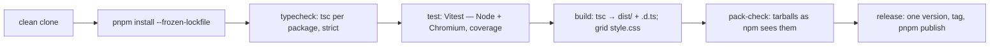

# SR-BUILD — the monorepo build

## §1 — For humans

**One command per job, from a clean clone.** `just install`, `just typecheck`,
`just test`, `just build`, `just check` (all three). The `justfile` only wraps
the pnpm scripts, so nothing *needs* just.

**Every package is published at the same version.** `just release 1.2.3`
bumps every package under `packages/`, runs the checks and pushes a tag; CI
publishes them together from that tag. A plugin always pins the exact grid it was tested with.

**Tests run where the code runs.** `@sheetpane/export` in Node; every package
that touches the DOM in a real browser (Chromium on every push, Firefox and
WebKit nightly). No simulated DOM.



<details>
<summary><b>ASCII twin</b> — the same diagram, for terminals and diffs</summary>

```text
   clean clone -> pnpm install --frozen-lockfile -> typecheck (tsc, strict)
     -> test (Vitest: Node + Chromium, coverage) -> build (tsc -> dist/, style.css)
     -> pack-check (tarballs as npm sees them) -> release (one version, tag, publish)
```

</details>

---

## §2 — For agents

### Context

W-04 asked for a repo that builds, tests and type-checks every package from a
clean clone, locally and in CI, before feature code lands. W-10 moved it to
pnpm and a justfile; the testing verdict chose the runner.

### Decision

1. **Package manager:** pnpm, pinned by `packageManager` in the root
   `package.json`; the workspace is `packages/*` (`pnpm-workspace.yaml`).
   Internal dependencies and peers use `workspace:*`; `pnpm publish` rewrites
   them to the exact version.
2. **Commands:** the root `package.json` scripts are the real commands
   (`build`, `test`, `typecheck`); the `justfile` wraps them and adds
   `check`, `test-pkg`, `test-export`, `test-grid`, `test-browsers`,
   `pack-check`, `release`, `clean`.
3. **Build:** plain `tsc` per package (`tsconfig.build.json`, `src/` →
   `dist/`, ESM with `.d.ts` and maps). No bundler: consumers bundle; the
   output is native ESM with `.js` import specifiers, so it also loads from
   plain HTML (SR-LAW-4). `@sheetpane/grid` also writes `dist/style.css` from
   its token module.
4. **Type-check:** `tsc --noEmit` per package over `src/` and `test/`, and
   at the root over `test/` and `vitest.config.ts`; `tsconfig.base.json` is
   strict, with `noUncheckedIndexedAccess` and `exactOptionalPropertyTypes`.
5. **Source condition:** every `exports` entry carries a `source` condition
   pointing at `src/`, so type-check and tests read sibling packages without a
   build. `publishConfig.exports` drops it from the published manifest. The
   grid's framework typings (W-37) are generated `.d.ts` files
   committed in `src/frameworks/`: `source` points at the `.d.ts`, the build
   copies them into `dist/frameworks/` with an empty `.js` for `import`.
6. **Tests:** Vitest, one root config. Project `repo` and `export` run in
   Node; every other package runs in browser mode on Playwright, and so do
   `@sheetpane/export`'s `*.browser.test.ts` files (project `export-browser`,
   the engine-determinism proof), and so do the React hook recipes'
   tests under `examples/react/test` (project `react-recipes`, against the
   demo's own React). `SP_BROWSERS` selects the engines.
   Browser tests run at a 1280 × 800 viewport. Node projects carry the
   `source` condition in `ssr.resolve` as well, so
   they never read a stale `dist/`. `.xlsx` and `.csv` fixtures load as assets
   (`?inline`). `coverage/` and `.vitest/` are ignored output. Two browser
   commands (`test/commands.ts`), `armDownload` and `takeDownload`, let a test
   catch a real download through Playwright. Dev-only readers
   for read-back tests (ExcelJS, PapaParse, fflate) are dev dependencies of
   the package that uses them; so is any `@sheetpane/*` package a test
   imports (`workspace:*`). Coverage (v8) is reported on every run; 90 % lines on
   `packages/export/src/**` fails the run.
7. **Package checks** (`test/packages.test.ts`): each package is public,
   `@sheetpane/<dir>`, MIT, ESM with types; one version across all (lockstep);
   `workspace:*` for `@sheetpane/*`; no UI framework as a dependency or peer;
   no third-party runtime dependency except `numfmt` and `@ironcalc/wasm`,
   each pinned exactly; no font file, `@font-face`, web-font URL or named
   `font-family` in any package source. Each package ships `dist` only —
   except `@sheetpane/fixtures`, which ships `files/` too, so that `url()`
   reaches them from `src/` and `dist/` alike (W-42), and `@sheetpane/skills`,
   which ships `skills/`, `entry/` and `bin/`, has no build and is a
   dependency of every other package (W-35, SR-SKILLS) — and
   `@sheetpane/grid`, which ships `custom-elements.json` beside `dist` (W-37).
   **`create-sheetpane`** (W-43, SR-CREATE) is the one unscoped package — `npm
   create sheetpane` resolves that name — with `files: ['bin', 'templates']`,
   a bin, no dependencies and no build; the font scan walks its `bin/` and
   `templates/`.
   Grid's build is `tsc` → `build-grid-css.mjs` → `build-manifest.mjs` (the
   manifest, the editor data, the framework typings; no dependency); grid has
   `@types/react` as a dev dependency so the React augmentation type-checks in
   the workspace. `test/types/` type-checks a usage per framework — React
   against the real `@types/react`, Vue, Svelte and Solid against stubs (none
   is installed in the repo); the root `tsconfig.json` excludes it.
7a. **TSDoc (W-36):** every symbol reachable from a package's `exports`
    carries TSDoc that survives into the built `.d.ts` (`removeComments`
    stays off): a summary; for a function `@param` per top-level parameter
    and `@returns` unless it returns `void`; a custom element class lists its
    Attributes, a `@fires` per event it dispatches, an `@example` and a `@see`
    to its record. `test/tsdoc.test.ts` reads the built declaration files —
    TypeScript 7 has no stable JavaScript compiler API, so `test/tsdoc-walk.ts`
    follows `export … from`, `export *`, aliases, re-exported imports and
    `@sheetpane/<pkg>` re-exports itself — and fails naming each symbol; it
    also type-checks every `@example` code block against the built packages.
8. **CI:** `.github/workflows/ci.yml` runs install, `just check` and
   `just pack-check` on every push to `main` and every PR (Chromium), and a
   `create` job — a matrix over the six `create-sheetpane` templates running
   `just create-check <template>` (SR-CREATE decision 5);
   `nightly.yml` runs the browser suites in Chromium, Firefox and WebKit;
   `pages.yml` (W-44) on a release tag builds the live playground — `just
   site` → `site/` (`scripts/build-site.mjs`: the HTML gallery at `/` with
   every file its import map names copied in, the React gallery at `/react/`
   with a relative base, the version in both headers, no third-party script)
   — checks it with `demo-check`, and deploys it to GitHub Pages;
   `release.yml` on the same tag publishes the packages (decision 9).
8b. **Starters and links (W-44):** `scripts/build-starters.mjs` (`just
    starters`) scaffolds every `create-sheetpane` template with the CLI itself
    into `examples/starters/<template>` (not workspace members) with an index
    of **Open in StackBlitz** links pinned like `llms.txt` (`v<version>`, `main`
    before the first release); `release.mjs` reruns it; `test/starters.test.ts`
    fails when they are stale and checks each has `dev` and `build`. StackBlitz
    installs from npm, so a starter runs once its version is published — the
    test checks the folders, not StackBlitz. The root README, the grid and
    `create-sheetpane` READMEs, `llms.txt` and the setup skill link the live
    playground (`https://arpitarya.github.io/sheetpane/`, decision 8) and the
    starters.
9. **Release:** `just release <version>` — clean tree required; every package
   set to the version (`scripts/release.mjs`); `just check pack-check`; a
   commit and an annotated tag `v<version>`, both pushed. Nothing is published
   from a laptop: the tag runs `.github/workflows/release.yml`, which fails
   unless every package carries the tag's version, runs `just check`,
   `pack-check` and `demo-check`, then `pnpm -r publish --access public` with
   npm provenance (the `NPM_TOKEN` repository secret) and opens a GitHub
   release with every package's tarball attached. `pnpm -r publish` skips a
   version already on npm, so a failed run is re-run, not re-tagged. Never
   `npm publish`: npm ships `workspace:*` literally.
9a. **llms.txt (W-38):** `scripts/build-llms.mjs` (`just llms`, no
    dependencies, deterministic) writes `llms.txt` (llmstxt.org: an H1, a
    summary, sections Start · Elements · Plugins · Rules and errors · Testing
    and tooling · Skills · Records of absolute links) and `llms-full.txt` (the
    package READMEs, the docs, the laws and the component records inlined,
    each under its source path — never `work/` or `archive/`) at the repo
    root; the grid build copies both into `dist/` (`@sheetpane/grid/llms.txt`).
    Links are GitHub URLs pinned to `v<version>` (`main` before the first
    release); `release.mjs` rewrites them with the version, and
    `test/llms.test.ts` fails when either is stale (it prints the full file's
    size — over 200 KB is a hint to split per package).
10. **Pack check:** `scripts/pack-check.mjs` packs each package as publish
    would and fails on a surviving `workspace:` or `source` entry or a missing
    exported file (for a subpath pattern such as `./files/*`, its folder).
11. **Demos:** `examples/html` (one `index.html`, an import map onto the
    packages' `dist/`, served by `scripts/serve.mjs`) and `examples/react`
    (Vite + React 19) are workspace members that depend on the packages by
    name and import only their public exports. `scripts/demo-check.mjs` uses
    both in Chromium (flag, resolve, edit + Download read back, font, pop-up,
    CSV, refusal; in React also the hooks strip and the column rules; the
    review steps driven by `@sheetpane/testing`, SR-TESTING) —
    `just demo-check`, on every push; `scripts/demo-packed.mjs`
    installs both from `pnpm pack` tarballs (every package, the eight plugins
    included) outside the workspace and runs the same check — `just
    demo-packed`, nightly.
11a. **The plugin gallery (W-32):** both demos carry a second tab row —
    Review (the demo above) · Vanilla · Number formats · Styles · Formulas ·
    Validation · Conditional formats · Images · Charts · Comments · All
    plugins · Hide and show (W-49: `@sheetpane/visibility` — hide a row from
    its header menu, the marker unhides it) · Rules file (W-33: the showcase's rules sample — `rules-src` in
    HTML, the `rules` prop in React — with `flagging="off"`). Every gallery
    tab opens one showcase workbook from `@sheetpane/fixtures` (SR-FIXTURES:
    the HTML import path `./node_modules/@sheetpane/fixtures/files/…`, a
    `?url` import in React; W-42) on its
    own `pane`, mounted when the tab first opens and kept after; a plugin's
    peer loads with it (condfmt with styles, charts with images). Both demos
    depend on all eight plugins, and the HTML import map lists them with
    `numfmt` (its ESM build, `dist/index.mjs`) and `@ironcalc/wasm`.
    `demo-check` asserts per tab: Vanilla plain (1.25, no overlay, no errors);
    1 1/4; the yellow fill; B6 recalculated; two rule errors; a data bar; the
    picture; both charts; the note and the thread; all of them together; lazy
    mounting and edits kept; the Rules file tab's six errors with no Flag issue
    and no card on F or a click.

### Consequences

- **Codes (W-40):** `test/error-codes.test.ts` and its append-only `test/error-codes.lock.json` are SR-CODES' (carved out of `test/`); `test/ssr.test.ts` asserts the SSR refusal's code.
- **Enforced today:** decisions 6, 7 and 10 by `just check` / `just
  pack-check`, locally and in CI.
- **Owed by the decider:** the `NPM_TOKEN` repository secret (an npm granular
  token with publish rights on `@sheetpane/*` and `create-sheetpane`), before
  `release.yml` can publish; the `@sheetpane` organisation exists.
- **Still open:** the licence check over the whole lockfile (backlog B-008);
  decision 7 checks only the runtime allow-list.
- **Plugins must keep `@sheetpane/grid` as a dev dependency too** (a peer is
  not installed for the package's own tests).

### Alternatives considered

- A bundler (tsup, Vite library mode) — rejected: `tsc` output is already
  valid ESM; a bundler adds a tool and hides import mistakes.
- Building before type-checking siblings (project references) — rejected for
  the `source` condition: no build step in the edit–test loop.
- jsdom/happy-dom for DOM tests — rejected by the testing verdict.
- Changesets — rejected: lockstep needs one version, not per-package bumps.

### Reference (required)

- [`justfile`](../justfile) · [`vitest.config.ts`](../vitest.config.ts) ·
  [`test/packages.test.ts`](../test/packages.test.ts) ·
  [`.github/workflows/ci.yml`](../.github/workflows/ci.yml)
- [`work/compare/testing.compare.md`](../work/compare/testing.compare.md) — the runner.

### Veto condition

**Reopen this decision if:** a clean clone cannot run `just check` and
`just pack-check` green, or two packages carry different versions.

**How to check it:** `pnpm install --frozen-lockfile && just check pack-check`

---

## References

*Every source this record cites, gathered in one place. An archived document
is never listed here.*

**Records** — [SR-LAW-10](0012_LAW-10-examples-maintained.md) · [SR-LAW-2](0004_LAW-2-foss-dependencies.md) · [SR-LAW-4](0006_LAW-4-web-component.md) · [SR-LAW-5](0007_LAW-5-host-font.md) · [SR-LAW-8](0010_LAW-8-npm-package.md)

**Code**

- [`package.json`](../package.json) · [`pnpm-workspace.yaml`](../pnpm-workspace.yaml) · [`justfile`](../justfile) · [`tsconfig.base.json`](../tsconfig.base.json)
- [`vitest.config.ts`](../vitest.config.ts) · [`test/packages.test.ts`](../test/packages.test.ts)
- [`scripts/pack-check.mjs`](../scripts/pack-check.mjs) · [`scripts/release.mjs`](../scripts/release.mjs) · [`scripts/build-grid-css.mjs`](../scripts/build-grid-css.mjs)
- [`.github/workflows/ci.yml`](../.github/workflows/ci.yml) · [`.github/workflows/nightly.yml`](../.github/workflows/nightly.yml) · [`.github/workflows/release.yml`](../.github/workflows/release.yml)

**Project docs**

- [`work/compare/testing.compare.md`](../work/compare/testing.compare.md)
