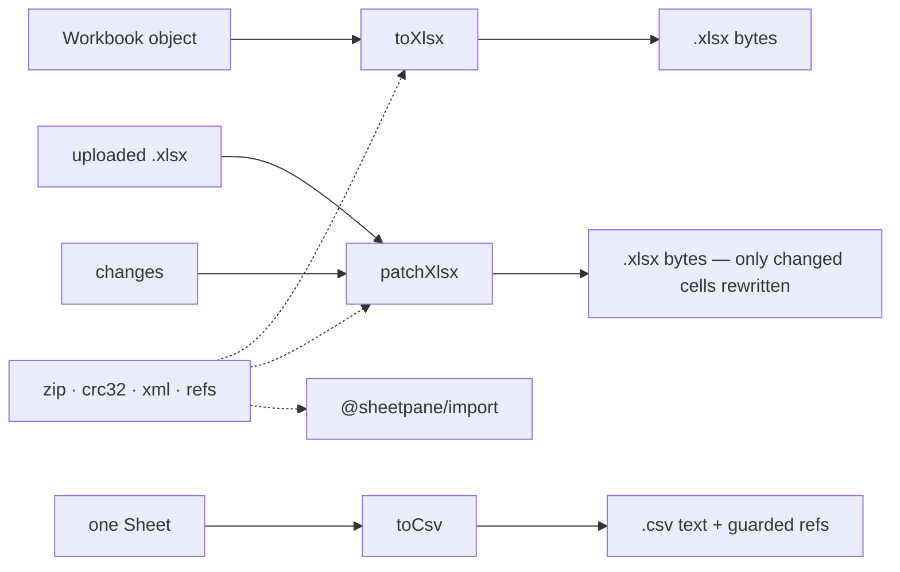

# SR-EXPORT — @sheetpane/export

## §1 — For humans

**Three writers, no dependencies.** `toXlsx(book)` builds a new `.xlsx` from
a plain object. `patchXlsx(original, changes)` takes the uploaded file and
rewrites only the cells that changed, so charts, styles, comments, names and
everything else survive. `toCsv(sheet)` writes one sheet as CSV that Excel
opens with accents intact and formulas defused.

**The same input gives the same bytes**, on every engine, in `store` mode —
the audit mode. The default compresses with what the platform ships.

**One ZIP and XML implementation for the whole project.** The reader
(`@sheetpane/import`) and the plugins import it from here.



<details>
<summary><b>ASCII twin</b> — the same diagram, for terminals and diffs</summary>

```text
   Workbook object ---------------> toXlsx ----> .xlsx bytes
   uploaded .xlsx + changes ------> patchXlsx -> .xlsx bytes (only changed cells rewritten)
   one Sheet ---------------------> toCsv -----> .csv text + guarded refs
   zip · crc32 · xml · refs  ... used by the writers and by @sheetpane/import
```

</details>

---

## §2 — For agents

### Context

W-03 asked for "a JavaScript object in, an Excel or CSV file out", the
dependency of the Excel component. The export verdict
([`export-shape.compare.md`](../work/compare/export-shape.compare.md)) fixed
the shape; SR-LAW-6 requires export to carry every change and keep everything
else.

### Decision

1. **Input:** `Cell = string | number | boolean | null`;
   `Sheet { name, rows, merges?, columnWidths?, hidden? }`; `SheetState =
   'visible' | 'hidden' | 'veryHidden'` (W-49);
   `Workbook { sheets }`; `Change { sheet, ref, value }`; `Sheet.freeze?:
   { rows, cols }` (W-24). `columnWidths` are
   Excel character units (`<col width>`), index 0 = column A.
   `Sheet.dataValidations?: DataValidation[]`, `Sheet.conditionalFormats?:
   ConditionalFormat[]` and `Workbook.dxfs?: Dxf[]` (W-57) — the shapes
   `@sheetpane/import` reads (`DataValidation`, `ConditionalFormat`,
   `CfRule`, `Cfvo`, `Dxf`, `Font`, `Fill`, `Border`, `BorderSide`,
   `Alignment`, `Color` are defined here and re-exported by import), so a
   rule read is a rule written; a rule's `dxfId` indexes `Workbook.dxfs`.
2. **`toXlsx(book, { compression?, onStripped? }): Promise<Uint8Array>`**
   writes exactly `[Content_Types].xml`, `_rels/.rels`, `xl/workbook.xml`,
   `xl/_rels/workbook.xml.rels`, `xl/worksheets/sheetN.xml`, `xl/styles.xml`.
   Text → `t="inlineStr"`; numbers → `<v>`; booleans → `t="b"`; `null` → no
   `<c>`. Style 1 is the only format written: centred, on each merge's
   top-left cell. Hidden sheets get `state="hidden"`; the first visible sheet
   is the active tab. The file's default font in `styles.xml` is Excel's
   (Calibri 11) — a property of the file for Excel, never read for display
   (SR-LAW-5). `toXlsx` writes no formulas and takes no change list, so it
   writes no `<calcPr>`. **Rules (W-57):** each sheet's
   `conditionalFormats` as one `<conditionalFormatting>` per format and its
   `dataValidations` as one `<dataValidations>`, in schema order after
   `<mergeCells>` (`conditionalFormatting` before `dataValidations`);
   `Workbook.dxfs` as `<dxfs>` after `<cellStyles>` in `styles.xml` (a dxf's
   children in CT_Dxf order: font, numFmt, fill, alignment, border). A
   validation with a `prompt` or `promptTitle` gets `showInputMessage="1"`
   (the shape has no flag for it, and Excel shows no prompt without it);
   `type="none"` and false flags are left out; attribute line breaks and tabs,
   and a carriage return in a formula, are written as character references so
   both readers give them back. A workbook with no rules and no dxfs is
   written byte for byte as before.
3. **`patchXlsx(original, changes, { compression?, exportPatch?, onStripped?, maxEntrySize?, maxTotalSize? })`**
   - rewrites only the changed `<c>` elements of the touched sheets, keeping
     each cell's `s` (style); new text goes in as inline strings; shared
     strings stay in place;
   - copies every other ZIP entry's **compressed bytes** unchanged, in the
     original order, directory entries included;
   - writes `<calcPr fullCalcOnLoad="1"/>` (in schema order) whenever any
     cell changed;
   - sets `refreshOnLoad="1"` on every pivot cache whose `worksheetSource`
     meets a changed cell, and on any cache whose source is a name or table;
   - drops `xl/calcChain.xml` (part, relationship, content type) when a
     formula cell became a value — Excel rebuilds it;
   - when the master of a shared formula is overwritten, the first remaining
     dependent becomes the master, its formula shifted (`shiftFormula`);
   - reads rows and cells without `r`, self-closing rows and prefixed
     namespaces; widens `<dimension>` to new values; drops `spans` on touched
     rows;
   - `freeze: [{ sheet, rows, cols }]` rewrites that sheet's first view's
     `<pane>` (with `topLeftCell` and `state="frozen"`; `0, 0` removes it);
     sheets not named keep theirs byte for byte; `toXlsx` writes `<pane>`
     for `Sheet.freeze` (W-24);
   - `merges: [{ sheet, ranges }]` rewrites that sheet's `<mergeCells>` to
     exactly those ranges (in schema position; removed when empty);
   - `dataValidations: [{ sheet, rules }]` and `conditionalFormats: [{ sheet,
     formats }]` (W-57) rewrite that sheet's `<dataValidations>` and every
     top-level `<conditionalFormatting>` to exactly those (the new formats
     where the first old block stood, else in schema position after
     `mergeCells` / `phoneticPr`; `dataValidations` after them; removed when
     empty); Excel 2010's `x14:` rules inside `<extLst>` are left as they are
     (import does not read them). `dxfs: Dxf[]` is appended to the file's
     `<dxfs>` (count updated; created before `tableStyles` / `colors` /
     `extLst` when missing; a package with no style sheet gets sheetpane's,
     with its relationship and content type); a rule's `dxfId` counts the
     file's formats first, then the appended ones. Everything is checked
     before anything is written; sheets not named stay byte for byte.
     `setDataValidations(xml, rules)` and `setConditionalFormats(xml,
     formats, dxfCount)` are exported for an `exportPatch` hook;
   - `hidden: [{ sheet, rows?, cols?, state?, outline?: { rows?, cols? } }]`
     (W-49): each list and outline map is the sheet's whole set after the
     edit (0-based); fields not given are left alone. Rows: the listed rows
     get `hidden="1"` (a missing `<row>` is created empty, `sheetData` kept in
     order), every other row loses `hidden`, and a zero `ht` loses
     `ht`/`customHeight`. Columns: `<col>` spans are split and merged so
     exactly the listed columns carry `hidden="1"`, width, style and
     `customWidth` kept on every piece; a shown zero-width column loses
     `width`; `<cols>` is created before `<sheetData>` and removed when
     empty. Outline: `outlineLevel` (0–7) per row and column, `sheetFormatPr
     outlineLevelRow/Col` the deepest level (`sheetFormatPr` added when
     missing); `collapsed` is never written. Sheets: `state` sets `<sheet
     state>` (`visible` removes it); when the active sheet ends up hidden,
     `activeTab` and `firstSheet` move to the first visible sheet and
     `tabSelected` moves with it, or Excel opens a blank window. Refusals: an
     unknown sheet → `no-sheet`, a bad index → `bad-ref`, a bad level or
     state → `bad-value`, no visible sheet left → `sheet-count`. Sheets not
     named stay byte for byte. Checked through ExcelJS and the import
     package; not yet opened in Excel or LibreOffice (W-30's files);
   - runs each `exportPatch` hook after its own writes, with a
     `PatchContext` (`list`, `has`, `readText`, `readBytes`, `write`,
     `remove`, `workbookPath`, `sheetNames`, `sheetPath`, `relsPathOf`,
     `addRelationship`, `setContentType`, `setDefaultContentType`).
4. **`toCsv(sheet, { delimiter?, bom?, eol?, guardFormulas? }): { text, guarded }`**
   — defaults `,`, CRLF, BOM on, guard on. Fields with the delimiter, `"`, CR
   or LF are quoted, inner quotes doubled; ragged rows are padded to one
   width; the last line ends with the line ending. **The guard** prefixes `'`
   to text starting `=` `+` `-` `@` tab or CR, **unless the text is a plain
   numeral** (`-150`, `+1`, `1,200.50`, `-2e3`) — data, not a formula — and
   returns the guarded refs. Booleans are `TRUE` / `FALSE`.
5. **Strings:** SpreadsheetML's own escape — CR as `_x000D_`, a literal
   `_xHHHH_` protected as `_x005F_xHHHH_`; `xml:space="preserve"` when
   whitespace would be lost. Characters XML forbids are stripped and the
   cells reported through `onStripped`.
6. **Rules** (errors are `ExportError` with a `code` and the `sheet` /
   `ref`): sheet names 1–31 characters, none of `[ ] : * ? / \`, no leading
   or trailing `'`, unique ignoring case; at least one sheet, at least one
   visible; ≤ 1,048,576 rows and ≤ 16,384 columns, naming the first cell
   over; finite numbers; ≤ 32,767 characters of text; merges of two or more
   cells that do not overlap. **Rules** (`bad-rule`, SP-2015, W-57): every
   `sqref` non-empty and each entry a cell or range; a known validation
   `type`, `operator` and `errorStyle`; `errorTitle` / `promptTitle` ≤ 32
   characters, `error` / `prompt` ≤ 255, a quoted list ≤ 255 — Excel's own
   limits, past which it repairs the file; a conditional format with at
   least one rule, a known `type`, `operator` and `timePeriod`, a whole
   `priority`, ≤ 3 formulas, a `dxfId` the workbook has; a colour scale with
   2–3 thresholds and one colour each, a data bar with 2 and a colour, an
   icon set with 2–5 and a known set name; `dxfs` a list of objects.
   Characters XML forbids are dropped from a rule's text.
7. **ZIP:** central-directory walk, sizes from the central directory, ZIP64
   and encrypted entries refused, methods 0 and 8 only, CRC-32 checked on
   every inflate; inflated size capped (512 MB per entry, 1 GB per archive by
   default); new entries get 1980-01-01, no extra fields, UTF-8 names.
8. **Compression:** `deflate` (default) through `zlib.deflateRawSync` in Node
   and `CompressionStream('deflate-raw')` in browsers; `store` is
   byte-identical on every engine. No DOM is touched (SR-LAW-8).
9. **Shared exports** for `@sheetpane/import` and plugins: `readZip`,
   `inflateEntry`, `rawData`, `writeZip`, `isZip`, `crc32`, the XML and
   OOXML-string helpers, `getAttr` / `setAttr` / `parseRels` /
   `resolveTarget` / `relsPathOf`, the A1 helpers, `shiftFormula`,
   `checkSheetName`, `resolveStructuredRef`.
9a. **Structured references (W-61):** `resolveStructuredRef(formula,
    sheets)` turns a table reference into `{ sheet, table, range, ref }`
    from the tables each sheet carries (SR-IMPORT decision 13; any `{ name,
    ref, headerRowCount, totalsRowCount, columns }` fits — `TableShape`):
    `Table[Column]` and `[[#Data],[Column]]` are the column's data rows;
    `#Headers`, `#Totals`, `#All` and touching pairs of them
    (`#Headers,#Data`, `#Data,#Totals`) name the bands; `[[A]:[B]]` a
    column span; `Table[]`, `Table[#Data]` and the bare `Table` the data
    body. Table and column names are case-insensitive; `'` escapes `[ ] #
    '`. `[#This Row]` / `@`, a union of columns, bands that do not touch and
    a band the table does not have resolve to `undefined`. `patchXlsx`
    leaves table parts as they are (a test reads both tables back after an
    edit); moving a table's `ref` when rows are inserted is W-52's.
10. **No runtime dependencies** (SR-LAW-2). `download()` lives in this
    package too — [SR-DOWNLOAD](0101_DOWNLOAD.md).

**Codes (W-40):** `@sheetpane/export` owns the code registry (SR-CODES: `CODES`, `spError`, `spMessage`, `codeOf`, `detailOf`, `codeUrl`); `ExportError` gains `spCode` and `spDetail` (`code` unchanged, the message prefixed `SP-2xxx`); `download()` refuses with SP-2101 to SP-2107. W-57 adds SP-2015 (`bad-rule`).

### Consequences

- **Enforced today:** the Node tests (`just test-export`) and the browser
  tests (`just test-pkg export-browser`, which also catch real downloads —
  SR-DOWNLOAD): independent read-back through ExcelJS,
  PapaParse and fflate; fast-check properties (CSV identity, `toXlsx`
  identity, `patchXlsx` changes exactly the named cells, string escape;
  W-57: `import(toXlsx(x))` and `import(patchXlsx(upload, x))` give the
  validation, conditional-format and dxf tables `x` back, through DOMParser
  and the built-in XML reader — `packages/import/test/rules*.test.ts`);
  the committed golden `sheetpane-sample.store.xlsx` reproduced in Node and
  Chromium; coverage gate 90 % lines.
- **Opened by the decider, 2026-10-18:** `sheetpane-sample.xlsx` and
  `sheetpane-sample.store.xlsx` open in Excel and LibreOffice with no repair
  prompt, and `sheetpane-sample.csv` shows its accents correctly in Excel. "Excel
  opens it" is backed by Excel and LibreOffice as well as three independent
  readers.
- **Rules are checked for structure, not against the schema** (W-57): the
  tests read what is written back through ExcelJS and the import package;
  ECMA-376 schema validation is B-033. Opening a generated file with working
  dropdowns and formats in Excel and LibreOffice is W-30 DoD 3.
- `patchXlsx`'s `dxfs` are appended, never deduplicated or removed: a format
  no rule names any more stays in `styles.xml` (harmless, like orphaned
  shared strings).
- Shared strings orphaned by a patch stay in the table (harmless; keeps the
  patch small); the table's `count` is not recomputed.

### Alternatives considered

- Patch via `DOMParser` — rejected: Node has no DOM, and this package must
  run in Node 22+.
- Re-compressing untouched parts — rejected: copying the compressed bytes is
  faster and provably byte-identical.
- A shared-string table in `toXlsx` — rejected by the verdict (inline strings
  are simpler and deterministic).

### Reference (required)

- [`packages/export/src/`](../packages/export/src/) — the code;
  [`packages/export/test/`](../packages/export/test/) — the tests.
- [`work/compare/export-shape.compare.md`](../work/compare/export-shape.compare.md) — the verdict.

### Veto condition

**Reopen this decision if:** a fixture fails to read back, the store-mode
golden differs between engines, or the package gains a runtime dependency.

**How to check it:** `just test-export && just test-pkg export-browser && node -e "const p=require('./packages/export/package.json');console.log(Object.keys(p.dependencies||{}).length?'VIOLATION':'zero-dep')"`

---

## References

*Every source this record cites, gathered in one place. An archived document
is never listed here.*

**Records** — [SR-LAW-2](0004_LAW-2-foss-dependencies.md) · [SR-LAW-3](0005_LAW-3-xlsx-and-csv-only.md) · [SR-LAW-5](0007_LAW-5-host-font.md) · [SR-LAW-6](0008_LAW-6-edits-in-memory-export-with-changes.md) · [SR-LAW-8](0010_LAW-8-npm-package.md) · [SR-DOWNLOAD](0101_DOWNLOAD.md)

**Code**

- [`packages/export/src/index.ts`](../packages/export/src/index.ts) · [`patch.ts`](../packages/export/src/patch.ts) · [`xlsx.ts`](../packages/export/src/xlsx.ts) · [`rules.ts`](../packages/export/src/rules.ts) · [`csv.ts`](../packages/export/src/csv.ts) · [`zip.ts`](../packages/export/src/zip.ts)

**Project docs**

- [`work/compare/export-shape.compare.md`](../work/compare/export-shape.compare.md) · [`work/reference/specs/zip/zip-subset-notes.md`](../work/reference/specs/zip/zip-subset-notes.md) · [`work/reference/specs/csv/owasp-csv-injection.md`](../work/reference/specs/csv/owasp-csv-injection.md)
