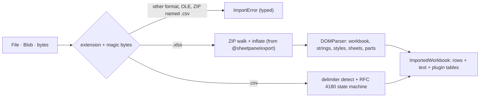

# SR-IMPORT — @sheetpane/import

## §1 — For humans

**Upload in, plain object out.** `read(file)` turns an `.xlsx` or `.csv` into
the same object `@sheetpane/export` writes, so a file round-trips. The grid
never parses a file itself; it asks this package.

**Two views of every cell.** `rows` keeps what the file stored (export writes
it back, L6); `text` is what a person sees — a date serial becomes
`30-Sep-2026`.

**It refuses loudly.** Anything that is not `.xlsx` or `.csv` is refused by
name and by its first bytes before anything is parsed (L3), with a typed error
the grid turns into "Can't open this file" or the password state.



<details>
<summary><b>ASCII twin</b> — the same diagram, for terminals and diffs</summary>

```text
   File/Blob/bytes -> extension + magic bytes --other--> ImportError (typed)
        |.xlsx -> ZIP walk + inflate (export) -> DOMParser -> ImportedWorkbook
        |.csv  -> delimiter detect + RFC 4180 ----------------> ImportedWorkbook
```

</details>

---

## §2 — For agents

### Context

W-13 moved the reader out of `@sheetpane/grid` into its own package (Arpit,
2026-10-18, overriding the reading verdict's decision 5). Decisions 1–4 and 6
of [`xlsx-csv-reading.compare.md`](../work/compare/xlsx-csv-reading.compare.md)
carry over unchanged; the plugins verdict added what plugins read.

### Decision

1. **API:** `read(source, { name?, maxEntrySize?, maxTotalSize? })`,
   `fromXlsx(bytes | Blob)`, `fromCsv(text | Blob, { name?, delimiter? })` →
   `ImportedWorkbook`. Also exported: `detectDelimiter`, `parseCsv`,
   `sheetNameFrom`, `formatCode`, `general`, `inSubset`, `subsetCode`,
   `serialToParts`, `BUILTIN_FORMATS`, `ImportError`, and every type.
2. **Shape:** each sheet is `@sheetpane/export`'s `Sheet` (`name`, `rows`,
   `merges`, `columnWidths`, `hidden`) plus `text` (same shape as `rows`),
   `path`, `styleIndex`, `formulas`, `freeze`, `hiddenRows`, `hiddenCols`,
   `state`, `rowOutline`, `colOutline`, `outline`, `autoFilter?` (W-49;
   `hidden` is deprecated in favour of `state`),
   `rowHeights`, `defaultRowHeight`, `defaultColWidth`, `dataValidations`,
   `conditionalFormats`, `drawings`, `notes`, `threadedComments`,
   `pivotTables`, `tables` (W-61, decision 11). The workbook adds `source`, `activeSheet`, `date1904`,
   `styles` (`numFmts`, `cellXfs`, `fonts`, `fills`, `borders`, `dxfs`,
   `indexedColors`), `themeColors` (by SpreadsheetML theme index),
   `persons`, `definedNames`, `delimiter` (CSV) and `part(path)`.
3. **Cells:** `t="s"` / `inlineStr` → the text, phonetic runs left out,
   `_xHHHH_` decoded; `str` → the text; `b` → a boolean shown `TRUE` /
   `FALSE`; `e` → the error text; `d` → the ISO string; otherwise a number. A
   formula cell holds its **cached `<v>`**, never evaluated; its formula text
   is in `formulas`, shared formulas expanded with `shiftFormula`.
4. **Display:** a number is formatted when its style's format is a built-in
   id 0–4, 9–22, 37–40, 45–49, or a custom code whose tokens are only
   `0 # , . % y m d h s AM/PM / - : space "literal"` (and `\` escapes,
   sections); otherwise `text` is the stored `<v>` exactly. Known limits of
   the subset, measured against `numfmt` (SR-NUMFMT): scaling commas after the
   decimals (`0.0,,`), digit masks split by literals (`00-00-00`), the padding
   of `# ??/??`. Dates honour the
   1900 leap-year bug and the 1904 system. `General` shows up to 10
   significant digits, scientific past 1e11.
5. **CSV:** delimiter detected among `,` `;` tab from the first 20 records
   (the most consistent split into more than one field; `,` when none);
   BOM dropped; CRLF, LF and CR; `""` inside quotes; a stray quote mid-field
   kept as text. Every cell is text; an empty field is `null`; an empty line
   is an empty row. The sheet is named after the file (extension dropped,
   forbidden characters → `_`, 31 characters at most, `Sheet1` when empty).
6. **Refusals** (`ImportError.code`): an extension other than `.xlsx` /
   `.csv` → `unsupported-format` before reading; an OLE header `D0 CF 11 E0`
   → `password-or-legacy`, with `detail: 'password'` when the file holds an
   `EncryptedPackage` stream and `'legacy'` otherwise; a ZIP named `.csv` or a workbook part whose
   content type is not `…sheet.main+xml` (`.xlsm`, `.xltx`) →
   `unsupported-format`; no workbook part, or `.xlsx` bytes that are not a ZIP
   → `not-workbook`; ZIP64, over 512 MB in a part or 1 GB in all, past
   1,048,576 rows or 16,384 columns → `too-large`; bad DEFLATE, CRC or XML →
   `corrupt` (`needs-dom`, SP-1008, is retired — decision 8). No name and no ZIP:
   NUL bytes in the first 8 KB → `unsupported-format`, else CSV.
7. **Sheets:** every worksheet in workbook order. `state` is `<sheet state>`
   (`visible`, `hidden`, `veryHidden`; anything else is `visible`); `hidden`
   is kept, equal to `state !== 'visible'` and deprecated, for one minor
   release (W-49). Chartsheets and dialog sheets are skipped (they hold no
   cells); `activeSheet` follows the kept list.
8. **Runtimes:** CSV and `.xlsx` read anywhere. `.xlsx` parts are parsed
   with `DOMParser` where the runtime has it, else with the built-in reader
   (`minixml.ts`): the DOM subset the reader touches, prefixes kept, a DOCTYPE
   refused so no entity is ever expanded, malformed XML → `corrupt`. W-39
   (the MCP server reads workbooks in Node) retired `needs-dom` / SP-1008.
   Importing the package in Node is safe (SR-LAW-8).
9. **One implementation:** ZIP, inflate, CRC-32, A1 helpers and
   `shiftFormula` come from `@sheetpane/export` — the only runtime dependency.

10. **What a sheet hides (W-49):** `hiddenRows` / `hiddenCols` are 0-based
    and sorted; a row is hidden by `hidden="1"` or `ht="0"`, a column by
    `hidden="1"` or `width="0"` on its `<col>`, spans expanded per column.
    `rowOutline` / `colOutline` are sparse `{ level, collapsed? }` arrays
    (index 0 = row 1 / column A), an entry only when the level is above 0 or
    `collapsed="1"`, levels clamped to 0–7. `outline` is `{ levelRow,
    levelCol, summaryBelow, summaryRight }` — the levels from `sheetFormatPr
    outlineLevelRow/Col` (else the deepest read), the flags from
    `sheetPr/outlinePr` (default `true`). `autoFilter` is `<autoFilter ref>`,
    absent when there is none, so the grid can tell a filtered row from a
    hidden one. A CSV hides nothing (`state: 'visible'`, empty lists, outline
    `{0, 0, true, true}`). The built-in XML reader reads the same (a parity
    test).

11. **Excel tables (W-61):** `tables` lists the sheet's tables in
    `<tableParts>` order, each read from its own part
    (`xl/tables/tableN.xml`) through the sheet's relationship; a part or
    relationship that is missing is skipped. A `Table` is `{ name, id, ref,
    headerRowCount, totalsRowCount, columns, style, autoFilter?, path }`:
    `name` is `displayName` (the name structured references use; `name`
    when it is absent), `ref` the whole table, header and totals rows
    included, `headerRowCount` default 1, `totalsRowCount` default 0;
    `columns` are `{ name, totalsRowFunction?, totalsRowLabel? }` with
    `_xHHHH_` decoded; `style` is `tableStyleInfo`'s `name?` and its four
    switches (`showFirstColumn`, `showLastColumn`, `showRowStripes`,
    `showColumnStripes`, default `false`). A CSV has none. The built-in XML
    reader reads the same (a parity test).

**Codes (W-40):** `ImportError` gains `spCode` and `spDetail` (`code` unchanged); `password-or-legacy` maps to SP-1002, SP-1003 or SP-1004 by what the reader found (SR-CODES).

### Consequences

- **Enforced today:** `just test-pkg import` — Chromium per push, WebKit and
  Firefox nightly: the design sample and a round-trip property through
  `toXlsx`; an ExcelJS-written fixture (formats, dates, shared formulas,
  merges, hidden sheet / row / column, freeze, validations, conditional
  formats, a note, a picture), a 1904 fixture; hand-written edge packages
  (every refusal, prefixed namespaces, phonetic runs, `x14` validations,
  threaded comments and persons, a pivot location, a chartsheet); CSV
  dialects, a round-trip property with `toCsv`, the 250,000-row CSV (136 ms in
  Chromium on Arpit's MacBook). `test/ssr.test.ts` imports it in Node.
- **Owed by the decider:** files saved by Excel, Google Sheets, LibreOffice
  and Numbers (W-30) — none of those programs is on the build machine.
  Until then the reader is proven on ExcelJS output and hand-written XML, and
  the reading verdict's "1 in 100" trigger cannot be measured.
- Non-UTF-8 CSV (Windows-1252) decodes with replacement characters; the
  verdict names UTF-8 only.

### Alternatives considered

- A library reader (SheetJS, ExcelJS) — rejected by the reading verdict.
- Typed CSV cells (numbers from numerals) — rejected: "plain text, as stored";
  a typed reading is a plugin's job.

### Reference (required)

- [`packages/import/src/`](../packages/import/src/) · [`packages/import/test/`](../packages/import/test/)
- [`work/compare/xlsx-csv-reading.compare.md`](../work/compare/xlsx-csv-reading.compare.md)

### Veto condition

**Reopen this decision if:** a real file from Excel, Google Sheets or
LibreOffice is refused or misread and the fix is not a bounded bug, or the
subset misreads more than 1 in 100 numeric cells across the fixtures.

**How to check it:** `just test-pkg import`

---

## References

*Every source this record cites, gathered in one place. An archived document
is never listed here.*

**Records** — [SR-EXPORT](0103_EXPORT.md) · [SR-LAW-3](0005_LAW-3-xlsx-and-csv-only.md) · [SR-LAW-6](0008_LAW-6-edits-in-memory-export-with-changes.md) · [SR-LAW-8](0010_LAW-8-npm-package.md)

**Code**

- [`packages/import/src/read.ts`](../packages/import/src/read.ts) · [`xlsx.ts`](../packages/import/src/xlsx.ts) · [`csv.ts`](../packages/import/src/csv.ts) · [`numfmt.ts`](../packages/import/src/numfmt.ts)

**Project docs**

- [`work/compare/xlsx-csv-reading.compare.md`](../work/compare/xlsx-csv-reading.compare.md) · [`work/compare/plugins.compare.md`](../work/compare/plugins.compare.md) · [`packages/import/test/fixtures/FIXTURES.md`](../packages/import/test/fixtures/FIXTURES.md)
