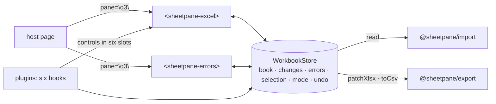

# SR-GRID — @sheetpane/grid

## §1 — For humans

**One workbook per pane, shared by every element.** `<sheetpane-excel
pane="q3">` and `<sheetpane-errors pane="q3">` find the same in-memory
workbook by the `pane` id, wherever they sit on the page. Everything — the
cells, every change, every error, the selected cell, the mode — lives there,
so the two are always in step (L7).

**The sheet shows the file as stored and edits it in memory.** View or Edit,
in a tab or a pop-up; every change is held in memory and Export writes it
into a copy of the uploaded file, which is never touched (L6). It draws only
the rows on screen, so a 250,000-row file scrolls at full frame rate.

**Plugins add features through named doors, not by reaching in.** Six hooks
(format, decorate, derive, validate, overlay, exportPatch) and six slots
(format row, selection bar, cell bar, status line, cell, overlay). With no
plugin the grid is the plain review tool the design shows.



<details>
<summary><b>ASCII twin</b> — the same diagram, for terminals and diffs</summary>

```text
   host page --pane="q3"--> <sheetpane-excel>  <-->  ( WorkbookStore )  <-->  <sheetpane-errors> <--pane="q3"-- host
                                                     book · changes · errors · selection · mode · undo
                             reads files through @sheetpane/import; exports through @sheetpane/export
   plugins --six hooks--> store ; --controls in six slots--> the sheet
```

</details>

---

## §2 — For agents

### Context

W-01 asked for the sheet and the workbook it shares; W-14 for the plugin
host; W-23 for undo; W-24 for freeze panes. The decisions they build on are
the grid, contract, plugins and testing verdicts in `work/compare/`.

### Decision — the store

1. **`createWorkbook({ plugins })` → `WorkbookStore`**, framework-free:
   `subscribe(fn)`, `getSnapshot()` (immutable; a new object per change, with
   a `version`), `on(fn)` for store events. One store per `pane` id from a
   module registry, created by the first element that names it and released
   when the last one disconnects; an element with no `pane` gets its own; a
   host may assign a store to `el.workbook`.
2. **Snapshot:** `load` (`empty` · `loading` · `ready` · `error` with the
   reader's code and `detail`), `source` (name, kind, size, the uploaded bytes
   — never modified — and the read time), `book` (the `ImportedWorkbook`),
   `changes`, `derived`, `errors`, `selection`, `mode`, `composing`,
   `canUndo`, `canRedo`. Selection and mode are shared (contract decision 2);
   scroll, zoom, find and form drafts are per element.
3. **Changes:** a map `sheet!ref → { kind, was, now }` with kinds `value`,
   `style`, `numFmt`, `formula`, `merge`, `freeze` (freeze keys are
   `sheet!#freeze`). `setCell` parses typed text as the cell stores it (a
   number stays a number in `.xlsx`; a `.csv` cell stays text); typing the
   uploaded value back removes the change. `setChange` serves plugin kinds
   and `setChanges` a batch as one undo step; `revert` removes every kind at
   a cell. **`style` and `numFmt` have their own slot**
   (`sheet!#style:A1`, `sheet!#numFmt:A1` — `kindRef`, `baseRef`), so a value
   edit, a style and a format on one cell are three changes; `changeOf(sheet,
   ref, kind?)` and `changesAt` read them. The change count is the map's size.
4. **Every mutation goes through one commit:** the undo entry, `matchesExpected`
   recomputed, one notification, then `validate` for the touched sheets and
   `derive` for the touched cells.
5. **Errors** are SheetpaneError v1, exactly the contract verdict's schema:
   ids `ERR-0001…`, never reused in a session (a restored review moves the
   counter past its highest id); `found` frozen from the uploaded display text
   (`(blank)` when empty; `row N` for a row range); a matching edit sets
   `matchesExpected`, never resolves; deleting an error keeps a cell change it
   made; "Also change the cell" writes `expected` in as a change in the same
   undo step; `isStale` flags a saved error whose cell no longer shows `found`.
6. **Export:** `exportFile({ options })` — `options` (from the element's
   `export(options)`, e.g. `{ comments: false }`) reach every `exportPatch`
   hook as `ctx.exportOptions`; `.xlsx`: `patchXlsx(upload, value changes,
   { exportPatch: plugin hooks, freeze })`; `.csv`: `toCsv` of the sheet with
   its changes, in the detected delimiter. `exportChanges()` and
   `currentRows()` are public.
7. **Undo / redo (W-23):** one stack per pane, 500 entries; an entry holds the
   state of `changes` and `errors` before and after; typing in one cell is one
   entry (coalesced until Enter, Tab, Esc or blur); selection and mode are not
   undone; ids stay reserved; undo re-runs `derive` and `validate`;
   `setErrors()` is a host restore, not a user action, and clears the stack
   with a `history` event; it then re-runs `validate`, which adopts a
   restored error only when its sheet, range, type and author match a draft
   (ids alone never match: a restored person's error with a reused id is
   never overwritten).
8. **Stale marks (W-01 DoD 15):** with no `derive` plugin, a formula cell whose
   formula reads a changed cell (`formulaRefs`) is "may be stale".

### Decision — `<sheetpane-excel>`

9. **The element** registers on import where `customElements` exists; open
   shadow root; plain DOM. Attributes `pane`, `src` (URL — read with a GET,
   nothing is sent — data URL or base64), `mode`, `display` (`tab` ·
   `popup`), `open`, `author`, `plugins`; properties `workbook`, `errors`,
   `errorTypes`, `file`, `mode`, `open`, `src`; methods `load()`, `export()`,
   `select()`, `getErrors()`, `setErrors()`, `undo()`, `redo()`,
   `shortcuts()`, `column()`; attribute `header-row` (default 1); events
   `sheetpane-load`, `-change {sheet, ref, kind, was, now}`, `-errors
   {errors, plugins}`, `-select {sheet, ref, column, value}`, `-editstart
   {…, value}` (cancellable: the cell stays read-only), `-input {…, draft,
   was}`, `-beforechange {…, was, now}` (cancellable: the value is refused
   before the change map, undo, derive or validate see it), `-editcancel`,
   `-sheet {sheet}`, every payload naming `column: {index, letter, header}`
   (W-26, the events verdict); `-mode`, `-history`,
   `-close`, `-export {blob, kind, name, guarded, format, converted,
   original?}` (cancelable: the Download control downloads only when no
   listener prevents it; `original: true` when it hands back the file as
   opened; `converted` when the format differs from the upload's), all
   bubbling and
   composed. An action's event fires once, on the element where it happened;
   an action with no element fires on the pane's first sheet. Setting `src`
   to `null`, `undefined` or `''` removes the attribute (React 19 sets
   properties); setting `workbook` applies the element's `mode` to it, as
   connecting does; `export(options?, { format?, sheet? })` converts when the
   format differs (`store.exportFile`: `.xlsx` → `.csv` is one sheet's
   `latestRows()`, `.csv` → `.xlsx` one sheet with numeric text as numbers,
   the upload's base name kept). `package.json` declares `dist/index.js` a side effect, so a
   bundler keeps `import '@sheetpane/grid'` and its registration.
10. **Layout:** toolbar (file, kind and size, View/Edit, open counts, find,
    zoom, undo, redo, freeze, change count, **Download** — a neutral split
    button in View and Edit (W-34): the main part in the upload's format with
    the change count as a neutral badge; **▾** (`aria-label="Choose download
    format"`) opens a `role="menu"`: Download as .xlsx / .csv, the upload's
    first and marked *default*, a line under the other saying what it holds,
    then — under a separator — each plugin's `exportOptions` as
    `menuitemcheckbox`es; Esc returns focus to ▾ — keyboard help, close in a pop-up), cell bar (ending in the
    docked selection actions, decision 13), the format row, the grid,
    sheet tabs (`.xlsx` only; hidden sheets italic), status line. States: the
    upload drop zone (file, link, base64), reading, "Can’t open this file",
    "Password protected" (no unlocking — the reader cannot decrypt).
11. **The grid:** DOM cells, rows absolutely placed, only the visible rows
    (±20) and — past 60 columns — the visible columns; merged ranges drawn
    once, also when they start above or left of the window; column headers,
    row headers, frozen rows and frozen columns are `position: sticky`. Rows
    are 28 px, headers 24 px, the row-header column 52 px, at 100 %. **Zoom
    scales the geometry and the font size**, not a CSS transform (see
    *Alternatives*). Column widths come from the file (Excel character units
    × 7 + 5 px), else from the text in the first 200 rows of a CSV.
11a. **The cell bar edits a draft:** Enter, Tab and blur commit it through
    `sheetpane-beforechange`; Esc restores it (`sheetpane-editcancel`).
    Paste (Ctrl/⌘+V, Edit) writes tab- and line-separated text from the
    active cell: `beforechange` once per cell, refused cells skipped, the
    rest one undo step (`store.setCells`). There is no fill gesture yet.
12. **Keyboard (APG grid):** focus stays on the `role="grid"` element and
    `aria-activedescendant` names the active cell; arrows, Shift+arrows,
    Home/End, Ctrl+Home/End, PageUp/PageDown; Enter or F2 edits; a printable
    key replaces the cell; Delete clears; F flags; Esc cancels the innermost
    thing or closes the pop-up; Ctrl/⌘+Z, Ctrl+Y, ⌘+Shift+Z; Ctrl/⌘+C copies;
    Shift+F10 and the Menu key open the selection actions (decision 13).
    `aria-rowcount` / `aria-colcount` give the sheet's true size.
13. **Review — nothing floats over the cells (W-31):** the selection actions
    are **docked at the right end of the cell bar** — Flag issue with its F
    hint (Edit, a cell with no error), the `selbar` plugin controls (Edit),
    then **⋯** (View and Edit) opening Copy ref and Copy value; the group
    hides while the cell-bar draft is edited and while composing, and at a
    narrow cell bar (≤ 720 px) the plugin buttons fold into ⋯ before Flag
    issue moves. **Right-click, Shift+F10 and the Menu key** on a cell select
    it and open the same actions as a `role="menu"` just under it (Flag
    issue · Copy ref · Copy value · the `selbar` controls); arrows move, Enter
    runs, Esc closes and returns focus to the grid; the browser's menu is
    suppressed on cells only. A copy without a secure context says so in the
    status line. **Download** (decision 10): the main part's file is the
    original bytes when untouched (no change, and no review a plugin would
    write), else `export()` with the menu's plugin options, the change count
    on the button and in its tooltip. Also: numbered pins (✓ when resolved) and row glyphs ✕ ! i; the callout (Found →
    Should be, message, tags, Resolve/Reopen, Delete, previous/next); Flag
    issue sets `composing` and the inline form opens **only when no
    `<sheetpane-errors>` is connected to the pane** (contract decision 4).
14. **Placement:** `display="popup"` moves the root into a modal `<dialog>`
    (`open` shows it); Esc and the close button close it, dispatch
    `sheetpane-close` and return focus.
15. **Font (L5):** no font family anywhere; tokens are `--sp-*` on `:host`;
    every control is `font: inherit`; a change of the host's font shows at
    once. The cell text size is `--sp-cell-font-size` (default `.93em`).
15a. **Theme (W-29):** both elements take `theme` = `light` (the default) ·
    `dark` · `auto` (follows `prefers-color-scheme`), also a `theme`
    property. `TOKENS` (light) and `DARK_TOKENS` (every colour, as hex — no
    `color-mix()` at runtime) are exported; the tokens are `ground`,
    `surface`, `sunken`, `cell`, `head`, `grid`, `line`, `line-strong`, `ink`,
    `ink-2`, `ink-3`, `accent`, `accent-ink`, `accent-soft`, `pass`, `fail`,
    `warn` and `changed` (each with `-soft`), `note`, `ref-1`…`ref-3`,
    `on-solid`, `hit`, `hit-current`, the radii and two shadows. The grid's
    CSS names no colour literal. A host's `--sp-*` on the element wins.
    **The file's colours are data:** a `decorate` result (styles, condfmt,
    chart fills) renders as saved in both themes. Contrast in both themes:
    text 4.5:1 on its ground; glyphs, pins, the changed mark, reference
    colours and the focus ring 3:1 on the cell.
15b. **Cell layout:** a cell is a one-column flex box holding its text in
    `<span class="v">`, so `text-align`, wrapping and `vertical-align` (mapped
    to `justify-content`) from `decorate` show; the state tints (range,
    find hits, error marks) are `::before` overlays above a `decorate` fill,
    never instead of it; the changed corner carries a cell-coloured outline.
16. **`beforeunload`** warns while the pane holds changes.

### Decision — the plugin host (W-14)

17. **A plugin** is `{ id, provides, after?, format?, decorate?, derive?,
    validate?, overlay?, exportPatch?, controls?, exportOptions? }`
    (`exportOptions`: `{ key, label, default }` switches shown in the Download
    menu, reaching `exportPatch` as `ctx.exportOptions[key]` — W-34). `format` and `derive`
    have one provider per pane (a second throws, naming both); a provided hook
    without its function throws; `decorate` providers run in `after` order,
    later winning per property, and a result naming `font-family` throws;
    `validate` errors keyed by plugin, sheet, range and type — a
    `workbook`- or `host`-authored error resolves itself when the cell passes
    and reopens when it fails again (W-18, W-27; people's errors never do); `file` errors never do;
    `overlay` items are placed in sheet space under the pins with a
    `Geometry`; `exportPatch` runs inside `patchXlsx` after the core.
18. **Registration:** `registerPlugin(id, factory)` (a package does it on
    import); the `plugins` attribute names the enabled ids — an unknown id
    throws; the set is fixed per pane at creation.
19. **Slots:** controls `{ id, slot, group, label, icon?, shortcut?, mode,
    isActive?, disabled?, labelFor?, run?, text?, appliesTo?, options?,
    value?, choose?, cellOptions? }` (a button's `aria-label` and `title`
    both name its shortcut) render as labelled buttons — or a labelled `<select>`
    when the control has `options` and `choose` — in group
    order — `format-row` (Edit only, shown only when a plugin or the host's
    light-DOM `<slot name="format-row">` puts something in it), `selbar`
    (docked in the cell bar and an item in the context menu, decision 13),
    `cellbar`, `status` (text), `cell` (a mark in cells `appliesTo` accepts),
    `overlay`. Duplicate ids throw. Shortcuts run from the grid and are listed
    in the keyboard help. A `cell` control with `cellOptions` opens a menu of
    choices at the cell; picking calls `choose` (W-18's list arrow). A
    control with `text` and no `run` outside `status` renders as read-only
    dashed text (W-16's `fx` in View), absent when the text is empty.
19a. **Overlay items** are rendered once per `sheet|id` and kept while the
    workbook stays; loading a workbook drops every one. Each pass re-reads an
    item's `alt` (its name may change) and `role` (`img`, the default, or
    `group` for an item holding controls); `passThrough` lets pointer events
    reach the cells below. The `Geometry` keeps growing past the drawn
    columns (64 px a column), and the grid widens to the far cell of every
    drawing anchor (up to 26 columns past the data).
19b. **Machine-authored errors** (`author` `workbook`, `file` or `host`) are
    read-only in both elements; `workbook` and `host` ones resolve themselves
    when the cell passes and reopen with `found` refreshed; their pin is a
    square ⚠ at the range's right edge; `BUILTIN_TYPE_NAMES` names their
    types. `validate` re-runs on every sheet after every change and after
    `derive`. A typed formula reads as its derived result. The grid
    re-exports `@sheetpane/export`'s `shiftFormula` for plugins whose rules
    are written against a range's top-left (validation, condfmt). The grid widens to
    the columns validation and conditional-format ranges name (up to 26 past
    the data). Alt+↓ opens a cell control's menu.
20. **Derived cells** are drawn with a mark and never enter the change map or
    the count.

### Decision — column rules (W-27)

22. **Column rules** (events verdict decisions 5–14) are the pane's, set by
    `<sheetpane-excel>`'s `columns`, `validate` and `onInvalid` (attribute
    `on-invalid`) or `store.setColumnRules({ columns, validate, onInvalid,
    headerRow })`; `header-row` gives the titles. They run as a **built-in
    `validate` provider** (`host-rules`, outside the frozen plugin set);
    their errors are `type: 'column-rule'`, `author: 'host'`, `expected` the
    rule in words (`describeRule`), the message naming the column and the
    rule (`Age: must be at least 18 (min)`) unless the rule gives one.
22a. **Vocabulary:** `required`, `type` (`text` · `number` · `integer` ·
    `date` · `boolean`), `min`, `max`, `minLength`, `maxLength`, `pattern`
    (not tested over 10,000 characters; an invalid one throws at once),
    `oneOf`, `unique`, `message`, `severity`, `onInvalid`. Titles match trimmed
    and case-insensitive, an exact title first. A title the file lacks is one
    `note`; a duplicated title checks the first column plus one `note`.
22b. **Findings are cached per cell** and updated for the cells a commit or
    undo touches (a `unique` column re-checks the rows sharing the old and
    new value; a title-row edit re-runs everything), so `validate` stays
    cheap. **`load`** checks every row in 8 ms slices with the progress in
    the status line (`store.ruleProgress`). **`input`** (`store.checkInput`)
    runs 150 ms after typing stops: an outline and a message at the cell bar,
    nothing stored. **`commit`:** `flag` stores and adds an error; `block`
    (`store.ruleBlocks`, checked inside the element's `beforechange` gate)
    refuses the value and fires `sheetpane-editcancel {reason: 'blocked',
    message}` — only a JSON rule or a synchronous result can block.
22c. **`validate(ctx, signal)`** runs for every cell of a titled column;
    `ctx.rowValues` is keyed by title and an edit asks its whole row again; a
    newer check on a cell aborts the older (`signal`) and a stale result is
    dropped. Setting the rules again re-checks every row and removes host
    errors no longer produced; people's errors are never touched; a rule
    never edits a cell. `<sheetpane-errors>`' author filter shows "Column
    rules".

### Decision — freeze panes (W-24)

20a. **`setChanges(list)`** applies many plugin-kind changes as one undo step
    (a format applied to a range).
21a. **Merged ranges are core:** `store.merges(sheet)` is the file's merges
    with `merge` changes applied (key `sheet!#merge:A1:C1`, `now` true or
    false; `setMerge()` makes one, undoable); the grid draws them; export
    rewrites that sheet's `<mergeCells>` (SR-EXPORT). A plugin's merge
    control only calls `setMerge()`.
21b. **Formula input:** with a `derive` plugin installed, a typed value
    starting `=` is a change of kind `formula` (W-16 evaluates and exports it);
    without one it is text. With one, the cell bar's input in Edit holds the
    cell's formula (`store.formula()`, `store.input()`), and retyping the
    file's own formula restores the cell. A `DerivedChange` with `clear: true`
    removes a cell's derived entry.
21. The reader's `freeze` is the starting point; Freeze / Unfreeze in Edit
    freezes the rows above and the columns left of the selected cell, as a
    change of kind `freeze` with its own undo entry — a toolbar button, not a
    format-row control. Export writes `<pane>` through `patchXlsx`'s `freeze`
    option (SR-EXPORT). Arrow keys move through frozen and scrolling cells as
    one grid.

### Consequences

- **Enforced today** (`just test-pkg grid`, Chromium per push, WebKit and
  Firefox nightly): store tests (changes, undo with a fast-check property and
  the cap, errors, export round-trip property, freeze, stale marks); element
  tests (contract, states, edit, export, flag, keyboard, font, pop-up, axe on
  View and Edit); plugin-host tests (a fake plugin per hook, the throwing
  rules, slots, shortcuts, the no-plugin grid); undo across elements; freeze
  rendering; the L7 sync test; `actions.test.ts` (W-31: nothing floats
  after a click, the docked order in View and Edit, folding at a narrow
  width, the context menu by mouse and keyboard, the copy notice, one
  Download button, an untouched workbook downloaded byte for byte); `theme.test.ts` (every token has a hex dark
  value, the contrast table in both themes, the attribute restyling chrome
  while a `decorate` fill stays as saved, a host override winning);
  `rules.test.ts` (the four-column example: every rule kind, commit, undo,
  `unique`, `setErrors`, sync and async `validate` with aborts, headers,
  `header-row`, rules changed after load, the input phase, flag and block in
  the element, the Column rules filter, 250,000 rows).
- **Measured** (Arpit's MacBook, headless Chromium 156, 10 cores, 2026-10-18):
  the 250,000-row CSV loads in 173–194 ms; a 5-second scroll at 900 px per
  frame paints 301 frames, none dropped, no long task — with and without two
  frozen rows. Headless and programmatic, not a wheel in headed Chrome.
- **Measured — column rules** (Arpit's MacBook, headless Chromium 156, load
  average ≈ 5, 2026-10-18): a 250,000-row CSV with four rules (required,
  pattern + unique, integer range, oneOf) — read 250 ms, then every row
  checked in 1.3 s across 79 painted frames, the longest gap 44 ms (the
  `unique` index is built in one go).
- **Owed:** files saved by Excel, Google Sheets, LibreOffice and Numbers, opened
  by the grid and read with their frozen panes — W-30 (the decider's files).
- **SR-LAW-6's veto command lists one hit:** the `src` loader's `fetch(` in
  `packages/grid/src/excel/element.ts` — a read, with nothing sent (backlog
  B-030).

### Alternatives considered

- **Zoom by CSS `transform`** (grid verdict decision 1) — rejected in the
  build: sticky headers and frozen panes inside a transformed layer are placed
  by the main thread while the compositor scrolls, so they jitter. Scaling the
  geometry keeps `position: sticky` exact; re-rendering the window is cheap.
- Roving `tabindex` on cells — rejected for `aria-activedescendant`: the
  virtualiser replaces cells while scrolling and would drop focus.
- One element per cell kept between frames — rejected: string rendering of
  the window measured well inside the frame budget.
- A provider element — rejected by the contract verdict.

### Reference (required)

- [`packages/grid/src/`](../packages/grid/src/) · [`packages/grid/test/`](../packages/grid/test/)
- [`work/compare/grid-rendering.compare.md`](../work/compare/grid-rendering.compare.md) · [`workbook-and-error-contract.compare.md`](../work/compare/workbook-and-error-contract.compare.md) · [`plugins.compare.md`](../work/compare/plugins.compare.md)

### Veto condition

**Reopen this decision if:** two elements on one pane are seen out of step, a
plugin needs a seventh hook, or the 250,000-row scroll drops frames on the
reference machine.

**How to check it:** `just test-pkg grid`

---

## References

*Every source this record cites, gathered in one place. An archived document
is never listed here.*

**Records** — [SR-EXPORT](0103_EXPORT.md) · [SR-IMPORT](0104_IMPORT.md) · [SR-ERRORS](0106_ERRORS.md) · [SR-DOWNLOAD](0101_DOWNLOAD.md) · [SR-LAW-4](0006_LAW-4-web-component.md) · [SR-LAW-5](0007_LAW-5-host-font.md) · [SR-LAW-6](0008_LAW-6-edits-in-memory-export-with-changes.md) · [SR-LAW-7](0009_LAW-7-surfaces-always-in-sync.md)

**Code**

- [`packages/grid/src/pane/store.ts`](../packages/grid/src/pane/store.ts) · [`excel/element.ts`](../packages/grid/src/excel/element.ts) · [`plugins/host.ts`](../packages/grid/src/plugins/host.ts) · [`plugins/types.ts`](../packages/grid/src/plugins/types.ts)

**Project docs**

- [`work/compare/grid-rendering.compare.md`](../work/compare/grid-rendering.compare.md) · [`work/compare/workbook-and-error-contract.compare.md`](../work/compare/workbook-and-error-contract.compare.md) · [`work/compare/plugins.compare.md`](../work/compare/plugins.compare.md) · [`work/compare/testing.compare.md`](../work/compare/testing.compare.md)
