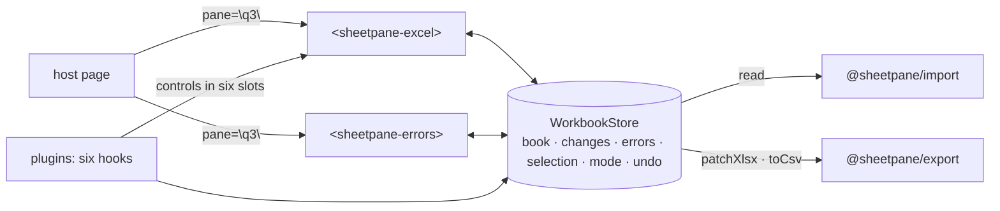

# SR-GRID — @sheetpane/grid

## §1 — For humans

**One workbook per pane, shared by every element.** `<sheetpane-excel
pane="q3">` and `<sheetpane-errors pane="q3">` find the same in-memory
workbook by the `pane` id, wherever they sit on the page. Everything — the
cells, every change, every error, the selected cell, the mode — lives there,
so the two are always in step (L7).

**The sheet shows the file as stored and edits it in memory.** View or Edit,
in a tab or a pop-up; every change is held in memory and Export writes it
into a copy of the uploaded file, which is never touched (L6). It draws only
the rows on screen, so a 250,000-row file scrolls at full frame rate.

**Plugins add features through named doors, not by reaching in.** Six hooks
(format, decorate, derive, validate, overlay, exportPatch) and six slots
(format row, selection bar, cell bar, status line, cell, overlay). With no
plugin the grid is the plain review tool the design shows.



<details>
<summary><b>ASCII twin</b> — the same diagram, for terminals and diffs</summary>

```text
   host page --pane="q3"--> <sheetpane-excel>  <-->  ( WorkbookStore )  <-->  <sheetpane-errors> <--pane="q3"-- host
                                                     book · changes · errors · selection · mode · undo
                             reads files through @sheetpane/import; exports through @sheetpane/export
   plugins --six hooks--> store ; --controls in six slots--> the sheet
```

</details>

---

## §2 — For agents

### Context

W-01 asked for the sheet and the workbook it shares; W-14 for the plugin
host; W-23 for undo; W-24 for freeze panes. The decisions they build on are
the grid, contract, plugins and testing verdicts in `work/compare/`.

### Decision — the store

1. **`createWorkbook({ plugins })` → `WorkbookStore`**, framework-free:
   `subscribe(fn)`, `getSnapshot()` (immutable; a new object per change, with
   a `version`), `on(fn)` for store events. One store per `pane` id from a
   module registry, created by the first element that names it and released
   when the last one disconnects; an element with no `pane` gets its own; a
   host may assign a store to `el.workbook`.
2. **Snapshot:** `load` (`empty` · `loading` · `ready` · `error` with the
   reader's code and `detail`), `source` (name, kind, size, the uploaded bytes
   — never modified — the read time, and `sha256`, the bytes' SHA-256 from
   `read()`, W-65), `book` (the `ImportedWorkbook`),
   `changes`, `derived`, `errors`, `layers`, `visibleLayers`,
   `visibleErrors` (W-51, decision 5d), `selection`, `mode`, `composing`,
   `canUndo`, `canRedo`. Selection, mode and the visible layers are shared (contract decision 2);
   scroll, zoom, find and form drafts are per element.
3. **Changes:** a map `sheet!ref → { kind, was, now }` with kinds `value`,
   `style`, `numFmt`, `formula`, `merge`, `freeze` (freeze keys are
   `sheet!#freeze`). `setCell` parses typed text as the cell stores it (a
   number stays a number in `.xlsx`; a `.csv` cell stays text); typing the
   uploaded value back removes the change. `setChange` serves plugin kinds
   and `setChanges` a batch as one undo step; `revert` removes every kind at
   a cell. **`style` and `numFmt` have their own slot**
   (`sheet!#style:A1`, `sheet!#numFmt:A1` — `kindRef`, `baseRef`), so a value
   edit, a style and a format on one cell are three changes; `changeOf(sheet,
   ref, kind?)` and `changesAt` read them. The change count is the map's size.
4. **Every mutation goes through one commit:** the undo entry, `matchesExpected`
   recomputed, one notification, then `validate` for the touched sheets and
   `derive` for the touched cells.
5. **Errors** are SheetpaneError v1, exactly the contract verdict's schema,
   `severity` one of `error` · `warning` · `note` — or, additive to v1 (W-50),
   a result: `pass` · `skipped` (decision 23); ids `ERR-0001…`, never reused in a session (a restored review moves the
   counter past its highest id); `found` frozen from the uploaded display text
   (`(blank)` when empty; `row N` for a row range); a matching edit sets
   `matchesExpected`, never resolves; deleting an error keeps a cell change it
   made; "Also change the cell" writes `expected` in as a change in the same
   undo step; `isStale` flags a saved error whose cell no longer shows `found`.
   **5a. An error with no cell (W-55):** `range: ""` is about the whole
   sheet; `sheet: ""` with `range: ""` about the whole workbook
   (`errorScope(e)` → `cell` · `sheet` · `workbook`, exported with the
   `ErrorScope` type). It is never placed on A1: `found` is `""`, it is never
   stale and never matches, "Also change the cell" writes nothing, and the
   sheet draws no pin or mark for it and skips it when stepping errors. A
   whole-sheet error counts on its tab (the count's label says how many are
   about the whole sheet). A `validate` draft may be about the whole sheet it
   is called for, and resolves itself like any other. A workbook-level error
   comes from the host (`setErrors`, `addError`), not from a provider, because
   `validate` runs once per sheet.
   **5b. The host's data on an error (W-68):** `SheetpaneError.meta` is
   optional and holds any JSON value (`ErrorMeta`), up to `ERROR_META_MAX`
   (64 KiB of JSON text, counted in UTF-8). `addError`, `updateError` and
   `setErrors` keep it as its JSON round trip, so a save gives back what was
   kept. One that is not JSON or is over the cap is dropped with SP-3016 and
   the error is kept without it; `updateError` then leaves the error's own
   `meta`, and `meta: undefined` removes it. `getErrors()` and the
   `sheetpane-errors` envelope carry a copy. `meta` is never written into the
   file: no export path reads it, and the comments plugin writes only the
   fields SR-COMMENTS 3 names. What the host draws from it is SR-ERRORS
   decision 13.
   **5c. Accepted deviations (W-69):** `status` is `open` · `resolved` ·
   `accepted` (`ErrorStatus`). An accepted error is a known deviation
   someone approved: it stays in the review and the download, carries
   `acceptedBy` (who — `""` when nobody was named), `acceptedAt` (ISO 8601)
   and `reason` (required, never blank), and is never counted as open — not
   in the toolbar's counts, a tab's count or a row's worst severity; its pin
   reads **A** and its cell mark is quiet. `acceptError(id, reason, { by })`
   and `updateError(id, { status: 'accepted', reason, acceptedBy })` set it
   as one undo step and stamp `acceptedAt`; any other status drops the three
   fields. A blank reason, or an error authored `workbook` or `file` (B-029's,
   not this one's), is refused with SP-3018 and nothing changes. `setErrors`
   restores an older envelope as it was; an accepted error without a reason
   comes back `open` with SP-3018, and the three fields on any other status
   are dropped. A `host` rule's error stays accepted while its cell fails the
   same way; a different finding reopens it and a pass resolves it, each
   without the acceptance (decision 19b). `ErrorDraft` cannot carry them: a
   provider never accepts.
   **5d. Review layers (W-51):** every error the store holds carries a
   `layer` — a name of 1–64 characters with no space (`isLayerName`;
   `layerOf(e)` reads one); an error given without it (a review saved
   before W-51) is in `review` (`DEFAULT_LAYER`). `setErrors(list, { layer
   })` replaces that layer only, stamping each error with it; the other
   layers are untouched; an id another layer holds, or a blank one, gets a
   new id; the undo stack is kept and every step in it is rebased onto the
   new layer, so undo neither brings back the replaced errors nor removes
   the new ones; a layer set to `[]` stays a layer. `setErrors(list)` and
   `setErrors(envelope)` restore the whole review as before (decision 7),
   each error in its own layer, the envelope's `layers` — an empty one
   included — first. `getErrors({ layer })` reads one layer, `getErrors()`
   every layer. `snapshot.layers` lists the layers in the order first named
   (by `setErrors`, by `setVisibleLayers`, or by an error);
   `setVisibleLayers(names | null)` chooses the ones shown (view state,
   never undone; `null` or `[]` is every layer; a name with no errors joins
   `layers`), and `visibleErrors` holds their errors — the one list the
   sheet's marks, pins, toolbar and tab counts, error stepping and card, the
   error list and the comments export read (SR-LAW-7). A person's new error
   goes into `review` while it is shown, else the first shown layer
   (`defaultLayer`), so it stays in sight; `addError({ layer })` names one.
   A `validate` draft lands in `review` unless it names a `layer`; its key
   and the adoption after a restore include the layer, so a provider never
   takes over another layer's error. No edit moves an error between layers:
   `updateError` ignores `layer`. The `errors` store event carries `layers`,
   the layers whose errors changed. `envelope(changed)` is what
   `sheetpane-errors` carries: `{ v: 2, errors, plugins, layers, changed }`
   (`ErrorsEnvelope`). An unusable layer name is logged as SP-3021 and
   changes nothing — or, on an error restored or added, puts it in `review`.
6. **Export:** `exportFile({ options })` — `options` (from the element's
   `export(options)`, e.g. `{ comments: false }`) reach every `exportPatch`
   hook as `ctx.exportOptions`; `.xlsx`: `patchXlsx(upload, value changes,
   { exportPatch: plugin hooks, freeze })`; `.csv`: `toCsv` of the sheet with
   its changes, in the detected delimiter. `exportChanges()` and
   `currentRows()` are public. The result carries `sha256`, the SHA-256 of
   the blob's bytes (W-65; `@sheetpane/import`'s `sha256`), taken once per
   export — an edit never hashes; `undefined` without Web Crypto (SP-1009,
   SR-IMPORT decision 11), never a substitute.
7. **Undo / redo (W-23):** one stack per pane, 500 entries; an entry holds the
   state of `changes` and `errors` before and after; typing in one cell is one
   entry (coalesced until Enter, Tab, Esc or blur); selection and mode are not
   undone; ids stay reserved; undo re-runs `derive` and `validate`;
   `setErrors()` is a host restore, not a user action, and clears the stack
   with a `history` event (replacing one layer does not — decision 5d); it then re-runs `validate`, which adopts a
   restored error only when its sheet, range, type and author match a draft
   (ids alone never match: a restored person's error with a reused id is
   never overwritten).
8. **Stale marks (W-01 DoD 15):** with no `derive` plugin, a formula cell whose
   formula reads a changed cell (`formulaRefs`) is "may be stale".

### Decision — `<sheetpane-excel>`

9. **The element** registers on import where `customElements` exists; open
   shadow root; plain DOM. Attributes `pane`, `src` (URL — read with a GET,
   nothing is sent — data URL or base64), `mode`, `display` (`tab` ·
   `popup`), `open`, `author`, `plugins`, `ref` and `link` (W-66, decision
   11d), `results` (W-50, decision 23); properties `workbook`, `errors`,
   `errorTypes`, `file`, `mode`, `open`, `src`, `ref`, `link`, `results`, `sizes` (W-47: `{ [sheet]:
   { cols: { B: 120 }, rows: { 4: 40 } } }`, px at 100 %, get and set),
   `renderDetail` (W-68: the error card's host region, SR-ERRORS decision 13),
   `layers` (W-51: the attribute `layers`, space-separated, sets the pane's
   visible layers — decision 5d; the property reads them);
   methods `load()`, `export()`,
   `select()`, `getErrors({ layer? })`, `setErrors(list | envelope, { layer? })`, `undo()`, `redo()`,
   `shortcuts()`, `column()`, `reveal()`, `unreveal()` (W-49), `highlight()`,
   `clearHighlight()` (W-56, decision 11c); attribute `header-row` (default 1); events
   `sheetpane-load` (ready: `{status, name, kind, sheets, readMs, sha256}`
   — `sha256` the file's SHA-256, W-65), `-change {sheet, ref, kind, was, now}`, `-errors
   {v, errors, plugins, layers, changed}` (the v2 envelope, W-51), `-layers {visible, layers}`, `-select {sheet, ref, range, column, value}` (`range`
   when more than one cell is selected; it fires when the selection settles —
   a drag fires once, on release), `-editstart
   {…, value, richText?}` (cancellable: the cell stays read-only; `richText:
   true` on a rich-text cell — W-53, decision 15c), `-input {…, draft,
   was}`, `-beforechange {…, was, now}` (cancellable: the value is refused
   before the change map, undo, derive or validate see it), `-editcancel`,
   `-sheet {sheet}`, `-resize {sheet, axis, indexes, px, via}` (W-47: on
   release; `via` is `drag`, `fit`, `menu` or `reset`), `-visibility {sheet,
   axis, indexes, hidden, via}` (W-49, decision 21c), `-hover {sheet, ref,
   column}` or `null` (W-56, decision 11c), every payload naming `column: {index, letter, header}`
   (W-26, the events verdict); `-mode`, `-history`,
   `-close`, `-export {blob, kind, name, guarded, format, converted, sha256,
   original?}` (cancelable: the Download control downloads only when no
   listener prevents it; `original: true` when it hands back the file as
   opened — its `sha256` is then the load's, not hashed again; `converted`
   when the format differs from the upload's; `sha256` is the blob's SHA-256,
   W-65 — in both events the key is always present and `undefined` without
   Web Crypto, SP-1009), all
   bubbling and
   composed. An action's event fires once, on the element where it happened;
   an action with no element fires on the pane's first sheet. Setting `src`
   to `null`, `undefined` or `''` removes the attribute (React 19 sets
   properties); setting `workbook` applies the element's `mode` to it, as
   connecting does; `export(options?, { format?, sheet? })` converts when the
   format differs (`store.exportFile`: `.xlsx` → `.csv` is one sheet's
   `latestRows()`, `.csv` → `.xlsx` one sheet with numeric text as numbers,
   the upload's base name kept). `package.json` declares `dist/index.js` a side effect, so a
   bundler keeps `import '@sheetpane/grid'` and its registration.
9a. **Committed test hooks (W-41)** — public API a host's tests rely on;
    renaming one is a breaking change: cells `role="gridcell"` with
    `data-sp-ref="B3"`; sheet tabs `role="tab"` with `data-sp-sheet`; the cell
    bar input `data-sp="cell-input"`; `data-sp="download"`,
    `"download-menu"`, `"undo"`, `"redo"`, `"flag"` (the docked Flag issue);
    the context menu `data-sp="menu"` (`role="menu"`), the callout
    `data-sp="callout"`, the inline form `data-sp="composer"` and its
    `data-sp="add-error"`; in `<sheetpane-errors>` each row
    `data-sp-error="<id>"` and `data-sp-ref="<sheet>!<range>"`, its
    `data-sp="resolve"`, the form's `data-sp="add-error"`, and the form fields
    `data-field="type" | "message" | "expected"`; the column headers
    `data-hc="<index>"`, row headers `data-hr="<index>"`, the corner
    `data-hall` and the status line's totals `data-sp="totals"` (W-46); the
    header edges `data-rz-c` / `data-rz-r` and the header menu
    `data-sp="header-menu"` (W-47); the cell bar's rich-text warning
    `data-sp="rich-text"` (W-53).
    `@sheetpane/testing`
    (SR-TESTING) uses only these, roles and labels.
10. **Layout:** toolbar (file, kind and size, View/Edit, open counts, find,
    zoom, undo, redo, freeze, change count, **Download** — a neutral split
    button in View and Edit (W-34): the main part in the upload's format with
    the change count as a neutral badge; **▾** (`aria-label="Choose download
    format"`) opens a `role="menu"`: Download as .xlsx / .csv, the upload's
    first and marked *default*, a line under the other saying what it holds,
    then — under a separator — each plugin's `exportOptions` as
    `menuitemcheckbox`es; Esc returns focus to ▾ — keyboard help, close in a pop-up), cell bar (ending in the
    docked selection actions, decision 13), the format row, the grid,
    sheet tabs (`.xlsx` only; a sheet the file hides is not a tab — decision
    21c), status line. **One toolbar row** (design, 2026-10-19): as the
    element narrows it sheds the change-count label (≤ 1240 px; the Download
    badge keeps the count), find's width (≤ 1140 px), the open counts
    (≤ 1040 px; the errors panel and tab counts keep them) and the
    kind-and-size chip (≤ 960 px; kept in the file name's tooltip); only below
    860 px may it wrap. **The format row is one row too:** groups
    that do not fit move, from the right, into a **More ▾** at its end; Number
    format and Text never move (W-14). The grid's focus ring is drawn over the
    cells, for keyboard use only. States: the
    upload drop zone (file, link, base64), reading, "Can’t open this file",
    "Password protected" (no unlocking — the reader cannot decrypt).
11. **The grid:** DOM cells, rows absolutely placed, only the visible rows
    (±20) and — past 60 columns — the visible columns; merged ranges drawn
    once, also when they start above or left of the window; column headers,
    row headers, frozen rows and frozen columns are `position: sticky`. Rows
    are 28 px, headers 24 px, the row-header column 52 px, at 100 %. **Zoom
    scales the geometry and the font size**, not a CSS transform (see
    *Alternatives*). Column widths come from the file (Excel character units
    × 7 + 5 px), else from the text in the first 200 rows of a CSV — then
    the user's (W-47). **Rows have their own heights:** the user's, else the
    file's custom height (points × 96 / 72), else 28 px; row tops are a prefix
    sum and `rowAt` a binary search, which the virtualiser, find, the
    selection layer, frozen rows and `Geometry.rowY` / `rowHeight` (plugins'
    overlays) all use. Wrapped text (`white-space` from a `decorate` plugin)
    wraps inside its row and is clipped by it; vertical alignment comes from
    the file, else centred. **Resizing (W-47):** an 8 px zone across each
    column header's right edge and row header's bottom edge (`col-resize` /
    `row-resize`, a 2 px accent line on hover; a coarse pointer shows a 24 px
    grip on a selected header); a drag follows live, once per frame, with a
    guide line and a tip ("Width 120 px"), under pointer capture; release
    commits, Esc cancels, a click without movement changes nothing; columns
    16–1,200 px, rows 12–600 px, at 100 % and scaled by zoom. Double-click
    fits: a column to its widest display text (each cell's size and weight,
    padding included; canvas `measureText` over up to 20,000 rows plus the
    rendered ones; at least 64 px, at most 480; merged cells ignored), a row
    to its tallest wrapped text at the current widths (at least 28 px). With
    whole columns (rows) selected and the edge one of them, a drag or a fit
    applies to all. Right-click a header — or Shift+F10 / the Menu key with
    a whole column or row selected — opens a `role="menu"`: Fit to data ·
    Column width… (Row height…) · Reset to the file's size; *width…* opens a
    labelled px field (arrows ±1, Shift ±10, Enter applies to every selected
    one, Esc cancels). **Sizes are a view setting**, per element and sheet,
    in memory: not a change, not undone, not in the download (an untouched
    file still downloads as its bytes); a new file clears them. On release a
    polite live region says "Column C, 120 pixels".
11a. **The cell bar edits a draft:** Enter, Tab and blur commit it through
    `sheetpane-beforechange`; Esc restores it (`sheetpane-editcancel`).
    Paste (Ctrl/⌘+V, Edit) writes tab- and line-separated text from the
    active cell: `beforechange` once per cell, refused cells skipped, the
    rest one undo step (`store.setCells`); one value pasted over a range fills
    every cell of it the same way (W-46). Delete or Backspace over a range
    clears every filled cell through `beforechange`, refused cells skipped,
    one undo step. Over 1,000,000 cells nothing is pasted, and the status line
    says why. There is no fill gesture yet.
11b. **Range selection (W-46):** the selection is drawn by **one layer**, never
    per cell — over the range a fill (`--sp-accent-soft`) with the active cell
    left unfilled (an even-odd hole), one 2 px `--sp-accent` border on the
    range's own edges, and the active cell's 2 px ring; the copied range a
    dashed border. The scrolling part sits in `.sellayer` (above cell and
    conditional fills, below pins, marks and pictures, and below plugin
    `cell` controls); across frozen panes it splits — the frozen-column part
    sticks left in the layer, the frozen-row parts are bands inside the frozen
    rows. A selection change re-creates no cell: only the layer, the header
    tints (`--sp-accent-soft` with an accent edge on the spanned columns and
    rows), `aria-selected` on rendered cells, the cell bar and the status
    line change. **The pointer:** mouse and pen use Pointer Events with
    pointer capture — the drag survives leaving the grid; within 24 px of the
    scrolling pane's edge, or past it, the grid autoscrolls, faster the
    further out; the layer redraws once per frame and the store hears of the
    drag once, on release (Esc restores the selection from before it). A
    range that partly covers a merge grows to cover it. A press on a plugin
    mark or a right-click is not a drag. A finger pans; its tap selects; a
    range then shows two round handles (24 px) to extend it from the other
    corner. **Headers:** a column header selects the column, a row header the
    row, the corner the sheet; dragging across headers or Shift+click
    extends; the active cell is the first visible cell. While dragging, the
    cell bar shows `6R × 3C`; when a drag or a key extension settles, a polite
    live region says "B3 to D8, 18 cells". **Totals:** with two or more cells
    selected the status line shows `Count n · Sum x · Average y` over the
    numeric cells (Count alone with no number), in the active cell's number
    format when a `format` plugin is installed, else locale grouping —
    computed when the selection settles, never per frame. One range at a
    time: Ctrl/⌘+click ranges and a fill handle are not built.
11c. **Hover and highlight (W-56):** a host follows the pointer and points at
    cells without touching the selection. **`sheetpane-hover`** names the cell
    under a mouse or pen pointer (Pointer Events on the scroller; a finger
    never hovers) — `{sheet, ref, column}`, a merge by its top-left, frozen
    panes read where they stick — once the cell changes, at most once per
    frame (one `requestAnimationFrame` with two binary searches, nothing
    rendered); `null` over the headers, a scrollbar, a menu or callout card,
    past the sheet's cells, or when the pointer leaves; a scroll under a still
    pointer re-reads it. **`highlight(ranges, { tone, label, sheet, pinned,
    reveal })`** draws one box per range 2 px outside its cells (so the
    selection ring shows), `tone` `info` (the accent) · `pass` · `fail` with
    the tone's `-soft` halo, in the overlay above the plugin layer and under
    the pins and cards, `pointer-events: none` — clicks and hover reach the
    cells. Ranges are `B3`, `B3:D8`, `Data!B3`, `'Q3 data'!B3`, or `{ ref,
    sheet?, tone? }`; a bad ref or a sheet the workbook lacks is skipped and
    the call returns how many it outlined (0 before a file is loaded). Each
    call replaces the last; `clearHighlight()` removes it; a sheet switch
    clears it unless `pinned` (a pinned one shows again on its sheet), and a
    new file always does. It is a **view setting** of the element, like zoom:
    not a change, not undone, not in the download, not shared with the pane's
    other elements. `reveal: true` scrolls the first range on the sheet shown
    into view with 4 px to spare, and shows for viewing a hidden row or column
    under its top-left cell (decision 21c). A `label` is shown in the status
    line while an outline shows; the status line (`role="status"`) replaces
    its nodes only when its text changes, so the label is said once.
11d. **Open at a cell, and links (W-66):** **`ref`** (attribute and
    property) names the cell or range selected once a file is read —
    `B4`, `Data!B4`, `'Q3 data'!B4:D8` (no sheet: the sheet shown) — and
    scrolls it into view (the status line is laid out before the grid, so
    the scroll measures its final height); set after a load, it selects
    then; one that names no cell or a sheet the workbook lacks is a
    `console.warn` (SP-3019) and the sheet opens at A1. It is the pane's
    shared selection, so `sheetpane-select` fires and every element of the
    pane follows. React, Vue and Solid keep `ref` for their own refs: their
    typings leave it out (Solid's `attr:ref` stays) and a host there sets it
    with `setAttribute`, or uses `link` or `select()`. **`link="hash"`**
    (default `none`, so a host's own hash routing is untouched unless it opts
    in) binds the selection to the URL fragment as
    `sheetpane=<pane>:<Sheet>!<ref>` (`<Sheet>!<ref>` without a `pane`; the
    pane and sheet percent-encoded, `!` too; a range as `B3:D8`). Only that
    parameter is read or written: the rest of the fragment stays byte for
    byte — after a hash router's path it goes with `?` (`#/reports/12?
    sheetpane=…`), after anything else with `&`, and another pane's link
    keeps its own parameter and place. When a file is read the fragment's
    link wins over `ref` (a bad one is SP-3019, then `ref`, then A1). The
    selection is written 300 ms after it settles with `history.replaceState`
    — the host's `history.state` kept, no history entry, no `hashchange` —
    so a held arrow key is one write and a router hears nothing; `hashchange`
    and `popstate` (back, forward, a followed link, the host setting
    `location.hash`) select the cell the fragment names for this pane, once
    per navigation. Turning `link` off takes this pane's parameter out of
    the URL. **SR-LAW-11:** the fragment is never sent — a browser keeps it
    out of requests and the `Referer` header — and sheetpane makes no request
    for it; *Copy link* writes to the clipboard, in the page. Sharing the
    link is the user's act. **Copy link** joins the cell menu and the ⋯
    menu after Copy ref while `link="hash"` (decision 13): the page's URL
    with this pane's selection as its link.
12. **Keyboard (APG grid):** focus stays on the `role="grid"` element and
    `aria-activedescendant` names the active cell; arrows, Shift+arrows,
    Home/End, Ctrl+Home/End, PageUp/PageDown; Ctrl/⌘+arrow jumps to the edge
    of the data (Excel's rule), with Shift extends there; Ctrl+Space selects
    the column, Shift+Space the row; Ctrl/⌘+A the data region, again the
    sheet; Shift+Backspace collapses to the active cell; inside a range Enter,
    Shift+Enter, Tab and Shift+Tab move the active cell within it and wrap;
    otherwise Enter or F2 edits; a printable
    key replaces the cell; Delete clears (a range: decision 11a); F flags; Esc
    cancels the innermost thing — a drag, a menu, the form, find, the copied
    outline, a resize, the header menu — or closes the pop-up; Alt+Shift+↓ /
    ↑ expands or collapses the row group at the active cell (W-49); arrows
    and the jumps step over hidden rows and columns; Ctrl/⌘+Z, Ctrl+Y, ⌘+Shift+Z; Ctrl/⌘+C copies;
    Shift+F10 and the Menu key open the selection actions (decision 13).
    `aria-rowcount` / `aria-colcount` give the sheet's true size.
13. **Review — nothing floats over the cells (W-31):** the selection actions
    are **docked at the right end of the cell bar** — Flag issue with its F
    hint (Edit, a cell with no error), the `selbar` plugin controls (Edit),
    then **⋯** (View and Edit) opening Copy ref, Copy link (with
    `link="hash"`, decision 11d) and Copy value — **Copy
    values** for a range, written as `text/plain` TSV and a `text/html`
    table so Excel and Sheets paste a grid (over 1,000,000 cells nothing is
    copied); Copy ref gives `B3`, `B3:D8`, `B:D`, `4:12` or the sheet's name
    (W-46); the group
    hides while the cell-bar draft is edited and while composing, and at a
    narrow cell bar (≤ 720 px), or whenever they would squeeze the value
    field below 200 px, the plugin buttons fold into ⋯ before Flag issue
    moves. The bar holds the cell's quick actions (Bold · Fill · Merge,
    greyed when they do not apply); a control with `menus` (W-49) is docked
    only when it joins the cell menu and applies now. In the menus, Flag
    issue and the plugin items each sit under a separator. **Right-click, Shift+F10 and the Menu key** on a cell select
    it and open the same actions as a `role="menu"` just under it (Flag
    issue · Copy ref · Copy link · Copy value · the `selbar` controls); arrows move, Enter
    runs, Esc closes and returns focus to the grid; the browser's menu is
    suppressed on cells only. A copy without a secure context says so in the
    status line. **Download** (decision 10): the main part's file is the
    original bytes when untouched (no change, no review a plugin would
    write, and no switch that is on and `applies` — W-58), else `export()`
    with the menu's plugin options, the change count on the button and in
    its tooltip (a pane holding only results is untouched — decision 23). A
    plugin whose every switch has `applies` is judged by its switches, not by
    the errors. `export()` re-renders once it is done, so a plugin's status
    can report on it. Also: numbered pins (✓ when resolved) and row glyphs ✕ ! i, for problems only; the callout (Found →
    Should be, message, the host's `part="detail"` region when `renderDetail` is set — W-68, SR-ERRORS decision 13 —
    who accepted it, when and why — W-69, decision 5c —, tags, Resolve/Reopen
    (Reopen for a resolved or an accepted error), Delete, previous/next); Flag
    issue sets `composing` and the inline form opens **only when no
    `<sheetpane-errors>` is connected to the pane** (contract decision 4).
14. **Placement:** `display="popup"` moves the root into a modal `<dialog>`
    (`open` shows it); Esc and the close button close it, dispatch
    `sheetpane-close` and return focus.
15. **Font (L5):** no font family anywhere; tokens are `--sp-*` on `:host`;
    every control is `font: inherit`; a change of the host's font shows at
    once. The cell text size is `--sp-cell-font-size` (default `.93em`).
15a. **Theme (W-29):** both elements take `theme` = `light` (the default) ·
    `dark` · `auto` (follows `prefers-color-scheme`), also a `theme`
    property. `TOKENS` (light) and `DARK_TOKENS` (every colour, as hex — no
    `color-mix()` at runtime) are exported; the tokens are `ground`,
    `surface`, `sunken`, `cell`, `head`, `grid`, `line`, `line-strong`, `ink`,
    `ink-2`, `ink-3`, `accent`, `accent-ink`, `accent-soft`, `pass`, `fail`,
    `warn` and `changed` (each with `-soft`), `skip` (W-50: the — mark, = `ink-3`), `note`, `ref-1`…`ref-3`,
    `on-solid`, `hit`, `hit-current`, the radii and two shadows. The grid's
    CSS names no colour literal. A host's `--sp-*` on the element wins.
    **The file's colours are data:** a `decorate` result (styles, condfmt,
    chart fills) renders as saved in both themes. Contrast in both themes:
    text 4.5:1 on its ground; glyphs, pins, the changed mark, the result
    marks (`pass`, `skip`), reference colours and the focus ring 3:1 on the cell.
15b. **Cell layout:** a cell is a one-column flex box holding its text in
    `<span class="v">`, so `text-align`, wrapping and `vertical-align` (mapped
    to `justify-content`) from `decorate` show; the state tints (range,
    find hits, error marks) are `::before` overlays above a `decorate` fill,
    never instead of it; the changed corner carries a cell-coloured outline.
15c. **Rich text (W-53):** `store.runs(sheet, ref)` is the file's runs
    (SR-IMPORT decision 12) while the cell holds the file's value — no
    `value` or `formula` change, no derived value — and the cell context
    carries them as `runs`; a style change keeps them, an edit drops them
    (undo brings them back). `store.decorateRuns(sheet, ref)` asks the
    `decorate` providers' optional `decorateRuns(cell)` (the last that
    answers wins), drops CSS outside `STYLE_PROPS`, throws SP-3010 on a font
    family, and answers `undefined` when the pieces' text joined is not the
    display text; the grid then draws the pieces as spans inside
    `<span class="v">`, else the plain text — so without a decorate plugin a
    rich cell is plain. Editing one (the cell bar holding its draft, Edit
    only) shows a warning chip in the cell bar — "Mixed formatting — an edit
    saves plain text" (`role="status"`) — and `sheetpane-editstart` carries
    `richText: true`; the edit stores plain text, which `patchXlsx` writes as
    an inline string, leaving `sharedStrings.xml` and every untouched rich
    cell byte for byte. Paste and Delete write plain text alike.
16. **`beforeunload`** warns while the pane holds changes.

### Decision — the plugin host (W-14)

17. **A plugin** is `{ id, provides, after?, format?, decorate?, decorateRuns?, derive?,
    validate?, overlay?, exportPatch?, controls?, exportOptions? }`
    (`exportOptions`: `{ key, label, default, applies? }` switches shown in
    the Download menu, reaching `exportPatch` as `ctx.exportOptions[key]` —
    W-34; `applies(store)` (W-58) leaves the switch out of the menu while it
    has nothing to do, and makes Download export an untouched workbook while
    it is on;
    `decorateRuns` is part of `decorate`, decision 15c). `format` and `derive`
    have one provider per pane (a second throws, naming both); a provided hook
    without its function throws; `decorate` providers run in `after` order,
    later winning per property, and a result naming `font-family` throws;
    `validate` errors keyed by plugin, sheet, range, type and layer (W-51: `review` unless the draft names one) — a
    `workbook`- or `host`-authored error resolves itself when the cell passes
    and reopens when it fails again (W-18, W-27; people's errors never do); `file` errors never do;
    `overlay` items are placed in sheet space under the pins with a
    `Geometry`; `exportPatch` runs inside `patchXlsx` after the core.
18. **Registration:** `registerPlugin(id, factory)` (a package does it on
    import); the `plugins` attribute names the enabled ids — an unknown id
    throws; the set is fixed per pane at creation.
19. **Slots:** controls `{ id, slot, group, label, icon?, shortcut?, mode,
    isActive?, disabled?, labelFor?, run?, text?, appliesTo?, options?,
    value?, choose?, cellOptions?, menus?, disabledReason? }` (a button's `aria-label` and `title`
    both name its shortcut) render as labelled buttons — or a labelled `<select>`
    when the control has `options` and `choose` — in group
    order — `format-row` (Edit only, shown only when a plugin or the host's
    light-DOM `<slot name="format-row">` puts something in it), `selbar`
    (docked in the cell bar and an item in the context menu, decision 13),
    `cellbar`, `status` (text), `cell` (a mark in cells `appliesTo` accepts),
    `overlay`. Duplicate ids throw. Shortcuts run from the grid and are listed
    in the keyboard help. A `cell` control with `cellOptions` opens a menu of
    choices at the cell; picking calls `choose` (W-18's list arrow). A
    control with `text` and no `run` outside `status` renders as read-only
    dashed text (W-16's `fx` in View), absent when the text is empty.
    **`menus` (W-49):** a `selbar` control names the menus it also joins —
    `cell` (the right-click menu), `header` (the column/row header menu,
    decision 11) and `tab` (right-click a sheet tab, or Shift+F10 on it; `run`
    gets that tab's sheet; the tab menu holds only plugin items, so with none
    the browser's menu stays); absent, it joins the cell menu as before. A
    disabled control says why in its tooltip (`disabledReason`). A shortcut's
    digit is matched on `e.code` (⌥ and AltGr change `e.key`), only while the
    grid has focus and nothing is being typed.
19a. **Overlay items** are rendered once per `sheet|id` and kept while the
    workbook stays; loading a workbook drops every one. Each pass re-reads an
    item's `alt` (its name may change) and `role` (`img`, the default, or
    `group` for an item holding controls); `passThrough` lets pointer events
    reach the cells below. The `Geometry` keeps growing past the drawn
    columns (64 px a column), and the grid widens to the far cell of every
    drawing anchor (up to 26 columns past the data).
19b. **Machine-authored errors** (`author` `workbook`, `file` or `host`) are
    read-only in both elements; `workbook` and `host` ones resolve themselves
    when the cell passes and reopen with `found` refreshed; an open one
    follows its draft's `found`, `expected` and `message` (W-60: a dependent
    list's choices change with its parent cell); their pin is a
    square ⚠ at the range's right edge; `BUILTIN_TYPE_NAMES` names their
    types. `validate` re-runs on every sheet after every change and after
    `derive`. A typed formula reads as its derived result. The grid
    re-exports `@sheetpane/export`'s `shiftFormula` for plugins whose rules
    are written against a range's top-left (validation, condfmt), and its
    `resolveStructuredRef` (W-61) for plugins that read a table column. The grid widens to
    the columns validation and conditional-format ranges name (up to 26 past
    the data). Alt+↓ opens a cell control's menu.
20. **Derived cells** are drawn with a mark and never enter the change map or
    the count.

### Decision — column rules (W-27)

22. **Column rules** (events verdict decisions 5–14) are the pane's, set by
    `<sheetpane-excel>`'s `columns`, `validate` and `onInvalid` (attribute
    `on-invalid`) or `store.setColumnRules({ columns, validate, onInvalid,
    headerRow })`; `header-row` gives the titles. They run as a **built-in
    `validate` provider** (`host-rules`, outside the frozen plugin set);
    their errors are `type: 'column-rule'`, `author: 'host'`, `expected` the
    rule in words (`describeRule`), the message naming the column and the
    rule (`Age: must be at least 18 (min)`) unless the rule gives one.
22a. **Vocabulary:** `required`, `type` (`text` · `number` · `integer` ·
    `date` · `boolean`), `min`, `max`, `minLength`, `maxLength`, `pattern`
    (not tested over 10,000 characters; on the element an invalid one throws
    at once, in a rules file it is a note), `oneOf`, `noneOf` (values never
    valid), `equals` (the one valid value; a blank fails it), `unique`,
    `message`, `note` (for the maintainer, never the message), `severity`
    (a problem's — `error` · `warning` · `note`; a rule never reports a
    result, W-50), `onInvalid` (W-33 added `noneOf`, `equals`, `note`). Titles match trimmed
    and case-insensitive, an exact title first. A title the file lacks is one
    `note`; a duplicated title checks the first column plus one `note`.
22b. **Findings are cached per cell** and updated for the cells a commit or
    undo touches (a `unique` column re-checks the rows sharing the old and
    new value; a title-row edit re-runs everything), so `validate` stays
    cheap. **`load`** checks every row in 8 ms slices with the progress in
    the status line (`store.ruleProgress`). **`input`** (`store.checkInput`)
    runs 150 ms after typing stops: an outline and a message at the cell bar,
    nothing stored. **`commit`:** `flag` stores and adds an error; `block`
    (`store.ruleBlocks`, checked inside the element's `beforechange` gate)
    refuses the value and fires `sheetpane-editcancel {reason: 'blocked',
    message}` — only a JSON rule or a synchronous result can block.
22c. **`validate(ctx, signal)`** runs for every cell of a titled column;
    `ctx.rowValues` is keyed by title and an edit asks its whole row again; a
    newer check on a cell aborts the older (`signal`) and a stale result is
    dropped. Setting the rules again re-checks every row and removes host
    errors no longer produced; people's errors are never touched; a rule
    never edits a cell. `<sheetpane-errors>`' author filter shows "Column
    rules" ("Rules file" when a rules file is in force).
22d. **The rules file (W-33):** a JSON document `{ version: 1, sheets: {
    "*" | <sheet name>: { headerRow?, columns?, cells? } } }` — `"*"` for
    every sheet, a named sheet's rule for the same title winning, `cells` by A1
    cell or range (`type: 'cell-rule'`, a cell rule over more than 10,000
    cells checked only where the sheet has data). Given as the `rules`
    property or read from `rules-src` (a GET, like `src` — a read
    [SR-LAW-11](0013_LAW-11-workbook-stays-in-the-browser.md) decision 4 allows); setting either re-checks every row. It compiles into the same
    `host-rules` provider (no second checker): merged over the element's
    `columns` (the file's rule wins for a title, with a note). Checked by hand,
    no schema library: an unknown key, word, type or version, a sheet, title or
    cell the workbook lacks, a bad ref or pattern is one `note` each (keyed, so
    several share a cell — `ErrorDraft.key`); an unknown version applies no
    rule; nothing throws. `@sheetpane/grid/rules.schema.json` (JSON Schema
    2020-12) ships for editors. The load phase yields on `requestIdleCallback`
    (idle-time chunks), reads cells by position and allocates nothing per cell
    it passes.
22e. **`flagging="off"` (W-33)** (also the `flagging` property; the pane's
    `store.flagging`): no Flag issue in the cell bar or the context menu, no
    `F` key or its help line, no composer (a host's `compose()` is cancelled),
    no callout card; a cell's error mark stays and selecting it marks its row
    in `<sheetpane-errors>`. Default `on`.
22f. **The checks with no page (W-54):** `@sheetpane/grid/check` is a second
    entry onto the same engine — the store, `host-rules`, the plugin host —
    that imports no element, registers nothing and names no DOM global.
    `check(bytes, { name?, rules?, columns?, validate?, onInvalid?,
    headerRow?, plugins? })` takes the element's settings by the element's
    names (`rules` an object or its JSON text; `plugins` objects or registered
    ids; an unnamed file sniffed as `load()` does), sets the rules before the
    file as a bound element does, loads, and resolves once every `derive` has
    landed and the load phase is idle (an async `validate` is awaited inside
    it); it returns `getErrors()` sorted by sheet (workbook order), row,
    column, type, message. A refusal throws the reader's own code; anything
    but bytes throws SP-3020. Same file and settings → the same errors as
    `<sheetpane-excel>`, only `id` and `createdAt` per run. It waits for a
    `derive` by watching the plugin's promise through a prototype wrapper (the
    plugin object itself is untouched) and for the load phase through
    `ruleProgress` — no store API was added. The entry also exports the store,
    the rules checker, the plugin contract and the codes, for a DOM-free
    plugin or a host's pipeline.

### Decision — results (W-50)

23. **Results:** an entry with `severity` `pass` (✓, *Passed*) or `skipped`
    (—, *Not checked*, its `message` the reason) is a result, not a problem
    (`isResult`; `SEVERITY_ORDER` is error › warning › note › skipped ›
    pass). A host gives them with `setErrors()`, a plugin from `validate`
    (one it stops reporting is removed — a result never resolves), a person
    never (the form offers the three problem severities). **The level** is
    the pane's (`store.results`, `setResults()`), set by the `results`
    attribute or property on either element (L7) — `off` · `summary` (the
    default) · `marks`; an unknown value is `summary`; it is a view setting,
    never a change or an undo step, and lives while the store does. **`off`**
    drops results on arrival — `setErrors`, `validate`, `addError`, undo —
    and drops those held when set. **`summary`** marks nothing on the sheet;
    **`marks`** puts a ✓ (`--sp-pass`) or — (`--sp-skip`) on every result
    cell: a 9 px glyph (`.69em` of the cell text, scaling with zoom) at the
    cell's **bottom-left**, `role="img"` with `aria-label` "Passed: <check>"
    or "Not checked: <reason>" (the check is the message, else the type's
    name) — no fill, border or pin, nothing in the row header, in View and
    Edit. **`store.focusResults(sheet, range)`** (the errors panel's Show ▸)
    marks one range's results even at `summary`, until the level changes, a
    file loads or another range is focused. **A problem always wins:**
    `store.resultAt(sheet, row, col)` — indexed once per errors list, so the
    grid asks per cell — returns nothing where any problem's range covers
    the cell. **The cell bar** shows a chip naming the selected result
    cell's check ("✓ Passed · Fee rate 0.00%–2.00%"), View and Edit.
    **The status line** says "· *n* of *m* checked · *k* problems" while the
    pane holds results (`store.resultCounts()`: *n* = passed cells +
    problem entries, *m* = *n* + not-checked cells, *k* open problems).
    **Counts that ask for action ignore results:** the tab counts, the
    toolbar's ✕ ! i, the hidden-sheets and hidden-span badges, previous /
    next in the callout, `errorAt`, and the Download: a pane whose only
    errors are results downloads the untouched file (an `exportPatch`
    plugin writes results only when asked — SR-COMMENTS decision 3).

### Decision — freeze panes (W-24)

20a. **`setChanges(list)`** applies many plugin-kind changes as one undo step
    (a format applied to a range).
21a. **Merged ranges are core:** `store.merges(sheet)` is the file's merges
    with `merge` changes applied (key `sheet!#merge:A1:C1`, `now` true or
    false; `setMerge()` makes one, undoable); the grid draws them; export
    rewrites that sheet's `<mergeCells>` (SR-EXPORT). A plugin's merge
    control only calls `setMerge()`.
21b. **Formula input:** with a `derive` plugin installed, a typed value
    starting `=` is a change of kind `formula` (W-16 evaluates and exports it);
    without one it is text. With one, the cell bar's input in Edit holds the
    cell's formula (`store.formula()`, `store.input()`), and retyping the
    file's own formula restores the cell. A `DerivedChange` with `clear: true`
    removes a cell's derived entry.
21. The reader's `freeze` is the starting point; Freeze / Unfreeze in Edit
    freezes the rows above and the columns left of the selected cell, as a
    change of kind `freeze` with its own undo entry — a toolbar button, not a
    format-row control. Export writes `<pane>` through `patchXlsx`'s `freeze`
    option (SR-EXPORT). Arrow keys move through frozen and scrolling cells as
    one grid.

21c. **Hidden rows, columns and sheets are core (W-49):** what a file hides
    is honoured, marked and revealable without a plugin; changing it is a
    plugin's (`@sheetpane/visibility`, SR-VISIBILITY). **Store:**
    `hidden(sheet)` → `{ rows, cols, state }` (the file's, with changes);
    `setHidden(sheet, axis, indexes, hide)` and `setSheetState(sheet, state)`
    are changes of kind `hidden` / `sheetState` — one per sheet and axis
    (`#hiddenRows`, `#hiddenCols`, `#sheetState`), undoable, written by
    `patchXlsx`'s `hidden` option; the last visible sheet is never hidden.
    `outline(sheet)` and `setOutline(sheet, axis, indexes, ±1)` (kind
    `outline`, seven levels) likewise. **Geometry:** hidden rows and columns
    are 0 px in the prefix sums, so `rowAt` / `colAt` never land on one and
    the virtualiser renders none; a W-47 size is kept for when one shows
    again; `aria-rowindex` / `aria-colindex` keep true indexes. **Marks:** a
    ◂▸ (columns, sticky with the headers) or ▴▾ (rows) button on each hidden
    boundary — labelled "Columns C–E hidden (3) — click to show", "filtered"
    inside the file's `autoFilter`, with the worst open error's glyph and
    count when the span holds errors — and a double line through the cells;
    a 24 px hit area on a coarse pointer. **Reveal (never a change):** a
    marker click (or, in Edit with the visibility plugin, unhide — a change),
    *Show hidden* in the status line ("1 column, 3 rows hidden"), and any
    selection landing in a hidden row, column or sheet — an error selected
    from the panel, a find hit — shows it, hatched, with a note "Shown for
    ERR-0004 · Hide again"; `reveal()` / `unreveal()` per element.
    **Sheets:** hidden sheets are listed by a *⊘ n hidden ▾* button after
    the tabs (with an open-error badge; *very hidden* tagged), not tabs;
    opening one shows a dashed ⊘ tab and a banner "This sheet is hidden in
    the file · Hide again" (and *Unhide* in Edit with the plugin); a file
    whose active tab is hidden opens on the first visible sheet. **Acts:**
    arrows, Tab, Enter, Page and Ctrl+arrow skip hidden rows and columns;
    copy, Delete, paste-fill and the totals act on shown cells only and say
    how many hidden cells were left out; find, validation and conditional
    formats still see hidden cells, and find's count says how many hits are
    hidden. **Outline:** a gutter (18 px per level, plus one) left of the row
    headers and above the column headers, with brackets, a −/+ at the
    summary end (`summaryBelow` / `summaryRight`) and level buttons 1…n+1;
    expand and collapse are a view setting (Alt+Shift+↓ / ↑ at the active
    cell); Group / Ungroup are the plugin's. **Events:**
    `sheetpane-visibility {sheet, axis: 'row'|'col'|'sheet', indexes,
    hidden, via: 'menu'|'key'|'marker'|'reveal'}` for a hiding change and for
    a reveal; a polite live region says "Rows 3 to 5 hidden" / "… shown". The
    errors panel tags rows *hidden row*, *hidden column*, *hidden sheet*.
    A CSV hides nothing.

**The element contract's machine form (W-37):** `custom-elements.json`
(Custom Elements Manifest 2.1.0, at the package root and exported) is
generated from the source by `scripts/build-manifest.mjs` — the tags from
`define()`, attributes from `observedAttributes` plus `theme` (set only
through `:host([theme])`), the class TSDoc's Attributes list, `@fires`,
`@slot` (`format-row`; `selbar` is a plugin control slot, not an HTML slot; a
`@fires` payload literal may be `` `null` ``, as `sheetpane-hover`'s is)
and `@csspart` (excel: `root` `toolbar` `cellbar` `format-row` `status`
`dialog`; errors: `root`), public members from the built `.d.ts`, and the
`--sp-*` tokens with their defaults. From it come VS Code HTML/CSS custom
data and JetBrains `web-types.json` (in `dist/`), and the framework typings
`@sheetpane/grid/jsx` (React 19), `/vue`, `/svelte` and `/solid` (type-only;
the `onInvalid` property is left out of framework props, which read `on…` as
listeners — the `on-invalid` attribute does its job; the `ref` attribute and
property are left out of the React, Vue and Solid props, whose `ref` is the
framework's — W-66). `test/manifest.test.ts`
fails when the manifest, the typings or the editor data drift from the code.
Angular uses `CUSTOM_ELEMENTS_SCHEMA` (README); there is no Angular package.

**Codes (W-40):** `LoadState` and `sheetpane-load`'s refusal carry `spCode`; a blocked edit's `sheetpane-editcancel` carries `code: 'SP-6003'`; every rules note (22d) carries `code` (SP-60xx); a plugin hook's failure is logged as SP-3012 to SP-3014 (SR-CODES); a dropped `meta` is SP-3016 and a throwing `renderDetail` SP-3017 (W-68); a refused acceptance SP-3018 (W-69). A load or export with no Web Crypto logs SP-1009 from `@sheetpane/import` (W-65). A `ref` or link naming no cell is warned as SP-3019 (W-66); an unusable layer name SP-3021 (W-51).

### Consequences

- **The check entry (W-54):** `test/check-entries.test.ts` (`--project
  repo`) walks `@sheetpane/grid/check`'s import graph from source — no
  element module, no third-party or Node import, no free `customElements`,
  `document` or `window` — and runs it in Node with column rules, an async
  `validate` and a rules file; `@sheetpane/fixtures`' parity pair holds the
  pane in Chromium and `check()` in Node to one golden on every fixture
  (SR-FIXTURES decision 6).
- **Enforced today** (`just test-pkg grid`, Chromium per push, WebKit and
  Firefox nightly): store tests (changes, undo with a fast-check property and
  the cap, errors, export round-trip property, freeze, stale marks; W-51:
  layer names, one layer replaced, the changed layers in the event, ids
  unique across layers, the visible layers and where a new error lands,
  SP-3021, a provider's layer and its adoption, undo of a fix in a hidden
  layer, the undo stack rebased onto a replaced layer, the envelope with
  three layers and a pre-layers one); element
  tests (contract, states, edit, export, flag, keyboard, font, pop-up, axe on
  View and Edit); plugin-host tests (a fake plugin per hook, the throwing
  rules, slots, shortcuts, the no-plugin grid); undo across elements; freeze
  rendering; the L7 sync test; `actions.test.ts` (W-31: nothing floats
  after a click, the docked order in View and Edit, folding at a narrow
  width, the context menu by mouse and keyboard, the copy notice, one
  Download button, an untouched workbook downloaded byte for byte);
  `selection.test.ts` (W-46: the layer's geometry for a cell, a range, a
  frozen split and a merge; no cell re-created on a selection change (a
  MutationObserver); a drag told to the store once; autoscroll past the
  edge; header and corner clicks; every key; the copied TSV and HTML; a
  range Delete as one undo step; one value pasted over a range; the totals;
  `aria-selected`; the announcement; axe with a range in View and Edit; a
  5 s drag with autoscroll on 250,000 rows — 301 frames, worst 16.8 ms at a
  16.7 ms vsync, none dropped, Chromium 156 headless, 10 cores, load average
  ~4, reported); `hidden.test.ts` (W-49: `rowAt` with hidden rows, a
  fast-check property; markers and labels; reveal and Show hidden; keys and
  range acts skip hidden cells; the hidden-sheets list, banner and the
  hidden-active-tab file; an error in a hidden row shown with its note;
  panel tags; find's hidden count; axe; the store's one change per axis and
  the download; outline gutter, +/−, levels, Alt+Shift keys and `setOutline`;
  a 5 s scroll on 250,000 rows with every other row hidden — worst 16.8 ms,
  none dropped in two of three runs, one 33 ms frame in the first, load
  average ~4); `resize.test.ts` (W-47: `rowAt` against a linear scan, a
  fast-check property; the file's row heights; a live drag, Esc, the limits,
  a click; fit for long text, numbers, bold and an ignored merge; several
  columns at once; the header menu and the width field by keyboard; a resize
  is not a change and the download stays the original; `sizes` round-trip;
  overlays follow; a column-edge drag on 250,000 rows — 181 frames in 3 s,
  worst 16.8 ms, none dropped; the 5 s scroll with per-row heights — worst
  16.8 ms, none dropped, also with 2 frozen rows); `fingerprint.test.ts`
  (W-65: `source.sha256` and `exportFile().sha256` against the bytes, for
  `.xlsx`, `.csv` and a conversion; twenty edits call no digest and one
  export calls one; both events carry it, an untouched Download reuses the
  load's; with no `crypto` both say `undefined` and SP-1009 is logged twice); `runs.test.ts`
  (W-53: `runs()` and the cell context, dropped by an edit and back with undo,
  kept by a restyle; pieces that do not match drawn plain, CSS off the
  allow-list dropped, a font family SP-3010; spans drawn, plain with no plugin
  and once edited; the cell-bar warning and `richText` on
  `sheetpane-editstart`, absent on a plain cell and in View);
  `highlight.test.ts` (W-56:
  hover once per frame for the last cell, nothing within a cell, `null` on a
  header and on leaving, none for a finger, a pen hovers, a merge's
  top-left, a frozen row, a scroll under a still pointer; highlight boxes 2 px
  around the cells in a tone, per-range tones and sheet-qualified refs, bad
  refs skipped, replaced by the next call, pass-through (`elementFromPoint`
  and a press select the cell under it), not a change and the download the
  file as opened, cleared on a sheet switch unless pinned and by a new file,
  zoom, hidden rows; `reveal` scrolls it inside the client area and shows a
  hidden row; the label in the status line with no rewrite while it stays;
  axe in View and Edit; 250,000 rows scrolled 900 px a frame for 5 s with
  four pointer moves a frame and the host highlighting each hovered cell —
  301 frames, 300 hover events, worst 16.8 ms, none dropped, Chromium 156
  headless, 10 cores, load average ≈ 115 from parallel agents, reported);
  `link.test.ts` (W-66: `ref` selects its cell or a quoted sheet's range
  once a file is read and scrolls it inside the client area, fires
  `sheetpane-select`, waits for a file, is followed by a second element on
  the pane, selects at once when set later; a bad one warns SP-3019 and
  opens at A1; `link` off leaves the URL alone; on, the fragment's link
  wins over `ref` beside a hash router's path, which stays; the write waits
  for the selection to settle, adds no history entry, fires no
  `hashchange` and keeps `history.state`; back and forward select the
  linked cells; another pane's link moves nothing and keeps its place; a
  bad link warns and falls back to `ref`; off takes the link out; Copy link
  after Copy ref in the cell and ⋯ menus only with `link`, copying a URL
  that opens there; axe in View and Edit) and `link.node.test.ts` (the
  fragment grammar: encoding, a router's path, anchors, two panes, in-place
  replacement, removal);
  `theme.test.ts` (every token has a hex dark
  value, the contrast table in both themes, the attribute restyling chrome
  while a `decorate` fill stays as saved, a host override winning);
  `results.test.ts` (W-50: the two severities, their order and a v1
  review without them; a `validate` plugin's results and one it stops
  reporting; `off` dropping on every arrival; `resultAt` with a problem
  winning and a range result; `summary` marking nothing with the status
  line; `marks` from the errors element marking the sheet — 9 px,
  bottom-left, labelled, `--sp-pass`, no fill, no pin, no row glyph — in
  View too; the On sheet switch as no change; the cell-bar chip; the counts;
  axe), the `skip` token in the contrast table; `rules.test.ts` (the four-column example: every rule kind, commit, undo,
  `unique`, `setErrors`, sync and async `validate` with aborts, headers,
  `header-row`, rules changed after load, the input phase, flag and block in
  the element, the Column rules filter, 250,000 rows); `rules-file.test.ts`
  (W-33: `*` vs named sheets, columns, cells and ranges, `equals`, `noneOf`,
  the document's notes, an unknown version, merging with `columns`,
  `rules-src`, the JSON Schema against the README example and the demos'
  file, `flagging="off"` end to end, 250,000 rows).
- **Measured** (Arpit's MacBook, headless Chromium 156, 10 cores, 2026-10-18):
  the 250,000-row CSV loads in 173–194 ms; a 5-second scroll at 900 px per
  frame paints 301 frames, none dropped, no long task — with and without two
  frozen rows. Headless and programmatic, not a wheel in headed Chrome.
- **Measured — column rules** (Arpit's MacBook, headless Chromium 156, load
  average ≈ 5, 2026-10-18): a 250,000-row CSV with four rules (required,
  pattern + unique, integer range, oneOf) — read 250 ms, then every row
  checked in 1.3 s across 79 painted frames, the longest gap 44 ms (the
  `unique` index is built in one go).
- **Measured — the rules file** (the same machine, load ≈ 2.5): the README
  file over 250,000 rows — from `Accounts.csv` (read 107 ms) every row checked
  in 0.72 s over 44 frames, the longest gap 18 ms; from `.xlsx` (read 5.6 s)
  0.88 s, 18 ms. An earlier build that read the text of every cell and kept a
  `Set` per distinct value showed one 140–410 ms collection pause; both were
  removed.
- **Measured — a CI runner** (GitHub `ubuntu-latest`, headless Chromium,
  2026-10-19): the hidden-rows scroll reached 81,000 px in 5 s (≈ 18 fps),
  the autoscroll drag 4,418 px, the rules file's longest gap 62 ms. These
  wall-clock budgets are asserted on a developer machine and only reported
  on a shared runner (SR-BUILD decision 6); the structural assertions hold
  in both.
- **Owed:** files saved by Excel, Google Sheets, LibreOffice and Numbers, opened
  by the grid and read with their frozen panes — W-30 (the decider's files).
- **The grid's only network calls** are the `src` and `rules-src` reads in
  `packages/grid/src/excel/element.ts` — GETs, nothing sent — the reads
  [SR-LAW-11](0013_LAW-11-workbook-stays-in-the-browser.md) decision 4 allows.
- **Not built (W-66):** a history entry per selection — the fragment is
  replaced, so back and forward step between links followed, not between
  cells clicked; a `ref` name a JSX host can write as an attribute.

### Alternatives considered

- **Zoom by CSS `transform`** (grid verdict decision 1) — rejected in the
  build: sticky headers and frozen panes inside a transformed layer are placed
  by the main thread while the compositor scrolls, so they jitter. Scaling the
  geometry keeps `position: sticky` exact; re-rendering the window is cheap.
- Roving `tabindex` on cells — rejected for `aria-activedescendant`: the
  virtualiser replaces cells while scrolling and would drop focus.
- One element per cell kept between frames — rejected: string rendering of
  the window measured well inside the frame budget.
- A provider element — rejected by the contract verdict.

### Reference (required)

- [`packages/grid/src/`](../packages/grid/src/) · [`packages/grid/test/`](../packages/grid/test/)
- [`work/compare/grid-rendering.compare.md`](../work/compare/grid-rendering.compare.md) · [`workbook-and-error-contract.compare.md`](../work/compare/workbook-and-error-contract.compare.md) · [`plugins.compare.md`](../work/compare/plugins.compare.md)

### Veto condition

**Reopen this decision if:** two elements on one pane are seen out of step, a
plugin needs a seventh hook, or the 250,000-row scroll drops frames on the
reference machine.

**How to check it:** `just test-pkg grid`

---

## References

*Every source this record cites, gathered in one place. An archived document
is never listed here.*

**Records** — [SR-EXPORT](0103_EXPORT.md) · [SR-IMPORT](0104_IMPORT.md) · [SR-ERRORS](0106_ERRORS.md) · [SR-DOWNLOAD](0101_DOWNLOAD.md) · [SR-LAW-4](0006_LAW-4-web-component.md) · [SR-LAW-5](0007_LAW-5-host-font.md) · [SR-LAW-6](0008_LAW-6-edits-in-memory-export-with-changes.md) · [SR-LAW-7](0009_LAW-7-surfaces-always-in-sync.md)

**Code**

- [`packages/grid/src/pane/store.ts`](../packages/grid/src/pane/store.ts) · [`excel/element.ts`](../packages/grid/src/excel/element.ts) · [`plugins/host.ts`](../packages/grid/src/plugins/host.ts) · [`plugins/types.ts`](../packages/grid/src/plugins/types.ts)

**Project docs**

- [`work/compare/grid-rendering.compare.md`](../work/compare/grid-rendering.compare.md) · [`work/compare/workbook-and-error-contract.compare.md`](../work/compare/workbook-and-error-contract.compare.md) · [`work/compare/plugins.compare.md`](../work/compare/plugins.compare.md) · [`work/compare/testing.compare.md`](../work/compare/testing.compare.md)
