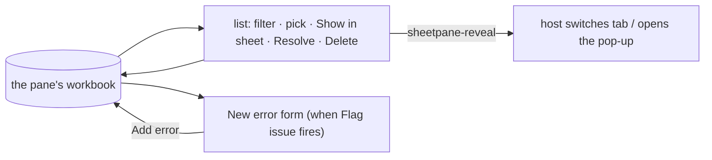

# SR-ERRORS — <sheetpane-errors>

## §1 — For humans

**The reviewer's checklist, anywhere on the page.** The host puts
`<sheetpane-errors pane="q3">` beside the sheet, in a side column, in another
tab or inside a pop-up. It lists every error flagged on the workbook — what
was found, what it should be — and holds the form that **Flag issue** opens.

**It is never out of step.** It keeps nothing of its own: an error added,
resolved or deleted here shows in the sheet at once, and the reverse (L7).
There is no "linked" chip and no export footer — it is always linked.



<details>
<summary><b>ASCII twin</b> — the same diagram, for terminals and diffs</summary>

```text
   ( pane's workbook ) --> list (filter, pick, Show in sheet, Resolve, Delete) --> workbook
                       --> New error form (Flag issue) --Add error--> workbook
   list --sheetpane-reveal--> host switches tab / opens the pop-up
```

</details>

---

## §2 — For agents

### Context

W-02 asked for the error component, always linked to the sheet. The schema,
the store and the contract are the contract verdict's and
[SR-GRID](0105_GRID.md)'s; this record owns the element.

### Decision

1. **The element** registers on import; attributes `pane`, `readonly`,
   `author`, `plugins`, `theme` (SR-GRID decision 15a), `results` (decision 13); properties `workbook`, `errors`, `errorTypes`,
   `readOnly`, `theme`, `results`; methods `getErrors()`, `setErrors(list, { plugins? })`; events
   `sheetpane-errors {errors, plugins}`, `sheetpane-change`,
   `sheetpane-select`, `sheetpane-history`, `sheetpane-reveal {error}` —
   bubbling, composed; an action's event fires on the element where it
   happened.
2. **No private copy:** every render reads the store. Connecting registers the
   element with the store, so Flag issue opens the form here and not in the
   sheet; disconnecting releases it.
3. **The list:** "n open" (problems only — decision 13); severity filter (All · ✕ · ! · i, each with its
   count of problems) and — when errors come from more than people — an author filter
   (People · Workbook rules · Column rules — "Rules file" when the pane has
   a rules file, its rows then grouped by sheet — · File comments); rows open first then resolved,
   by number; each row shows the number (✓ when resolved), the type's name,
   Found → Should be, the range and severity, and tags (cell changed ·
   resolved · matches suggestion · stale · hidden row · hidden column ·
   hidden sheet — W-49: picking such a row shows the place in the sheet,
   SR-GRID 21c). Picking a row selects its cell
   (selection syncs) and expands it: the message, author and time, **Show in
   sheet**, Resolve / Reopen, Delete.
4. **Show in sheet** selects the cell and dispatches `sheetpane-reveal
   {error}`, so the host can switch tab or open the pop-up.
5. **The form** (while the pane is composing, in Edit, and never when the
   pane is `flagging="off"` — SR-GRID 22e): the cell, Found (the
   uploaded text), Column (the header text found above, and the letter), Row
   (number and first value); type chips from `errorTypes` (each with its
   default severity); What’s wrong; What it should be; **Also change the cell
   to this value**; severity Error / Warning / Note with its help line; the
   chosen type's example; Add error (⌘/Ctrl+↵) and Cancel (Esc). A
   `duplicate-row` error covers the whole row.
6. **`errorTypes`** defaults to the seven types and Other from the board
   `Edit-Examples` (`DEFAULT_ERROR_TYPES`, SR-GRID).
7. **`readonly`** hides the form, Resolve, Delete, Undo and Redo — a sign-off
   screen. Errors authored `workbook`, `file` or `host` are always read-only
   (SR-GRID decision 19b) and named from `BUILTIN_TYPE_NAMES` when the
   host's `errorTypes` does not name their type.
8. **A saved review** restored with a different plugin set shows the
   "formatted differently" notice (plugins verdict decision 3).
9. **Undo / Redo** buttons and Ctrl/⌘+Z, Ctrl+Y, ⌘+Shift+Z act on the pane's
   one stack (W-23).
10. **Font (L5):** no font family; every control is `font: inherit`.
    Severity is a glyph and a colour, never colour alone.

11. **Codes (W-40, SR-CODES):** `SheetpaneError` gains an optional `code`
    (`SP-xxxx`, additive to v1); a machine-authored note from the rules engine
    always sets it, and the expanded row shows it beside the author and time.

12. **Test hooks (W-41):** rows carry `data-sp-error` and `data-sp-ref`; Resolve `data-sp="resolve"`; the form's Add `data-sp="add-error"` (SR-GRID decision 9a lists them all).

13. **Results (W-50):** `pass` and `skipped` entries (SR-GRID decision 23)
    are listed apart from the problems. The `results` attribute (and
    property) sets the pane's level, as on the sheet. **Summary line** —
    under the header whenever the pane holds results and the level is not
    `off`: "*n* problems · ✓ *n* passed · — *n* not checked" (problems are
    open entries; results are cells) and an **On sheet** `role="switch"`
    that moves the pane between `summary` and `marks` (a view setting: no
    change, no undo step). **Chips** — *Problems n* · *✓ Passed n* · *— Not
    checked n*, the result chips only when such results exist; *Problems* is
    the default and the only view with the severity and author filters.
    **Groups** — *Passed* lists one row per check (`type` + `message`),
    *Not checked* one per reason (`message`, else `type`); each says its
    name (the message, else the type's name), its cell count and where it
    is (one range when its cells fill it, "H6, H31, H44 …" otherwise, "*n*
    sheets" across sheets), largest first, with **Show ▸**: it selects the
    group's bounding range on its first sheet, marks that range's results on
    the sheet even at `summary` (`store.focusResults`) and fires
    `sheetpane-reveal` with the group's first entry. A group opens to its
    entries, **virtualised** — 28 px rows in a box at most 280 px tall, only
    the rows in view (± 4) in the DOM; each row (with `data-sp-error` and
    `data-sp-ref`) is Show in sheet for that entry, and marks its range.
    **Counts that ask for action ignore results:** "n open", the severity
    filters, and the sheet's tab and toolbar counts (SR-GRID decision 23).
    The form offers the three problem severities only.

### Consequences

- **Enforced today:** `packages/grid/test/errors.test.ts` (form, list,
  filters, reveal, readonly, `errorTypes`, events, notice, font, axe) and the
  L7 sync test in both mount orders with the errors element inside a
  `<dialog>`; the undo-across-elements test in `plugins.test.ts`;
  `results.test.ts` (W-50: the summary line and chips only with results,
  Problems by default, groups by check and by reason with their counts and
  ranges, Show ▸ marking at `summary`, Show in sheet for all five
  severities, the On sheet switch from here marking the sheet, counts that
  ignore results, axe with a group open, 5,000 passes as two rows and an
  opened group drawing fewer than 20 rows as it scrolls).

### Alternatives considered

- A linked / not-linked chip and an export footer — removed by the decider
  (2026-10-18): the element is always linked, and export belongs to the sheet.

### Reference (required)

- [`packages/grid/src/errors/element.ts`](../packages/grid/src/errors/element.ts)
- [`work/compare/workbook-and-error-contract.compare.md`](../work/compare/workbook-and-error-contract.compare.md)

### Veto condition

**Reopen this decision if:** the errors element is ever seen showing an error
the sheet does not, or the reverse.

**How to check it:** `just test-pkg grid -t "always in sync"`

---

## References

*Every source this record cites, gathered in one place. An archived document
is never listed here.*

**Records** — [SR-GRID](0105_GRID.md) · [SR-LAW-4](0006_LAW-4-web-component.md) · [SR-LAW-5](0007_LAW-5-host-font.md) · [SR-LAW-7](0009_LAW-7-surfaces-always-in-sync.md)

**Code**

- [`packages/grid/src/errors/element.ts`](../packages/grid/src/errors/element.ts)

**Project docs**

- [`work/compare/workbook-and-error-contract.compare.md`](../work/compare/workbook-and-error-contract.compare.md) · [`work/reference/design/README.md`](../work/reference/design/README.md)
