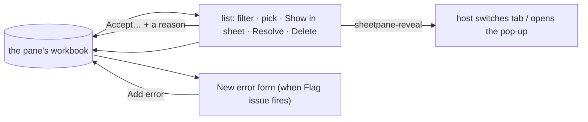

# SR-ERRORS — <sheetpane-errors>

## §1 — For humans

**The reviewer's checklist, anywhere on the page.** The host puts
`<sheetpane-errors pane="q3">` beside the sheet, in a side column, in another
tab or inside a pop-up. It lists every error flagged on the workbook — what
was found, what it should be — and holds the form that **Flag issue** opens.

**It is never out of step.** It keeps nothing of its own: an error added,
resolved or deleted here shows in the sheet at once, and the reverse (L7).
There is no "linked" chip and no export footer — it is always linked.

**A known deviation can be accepted.** *Accept…* asks why; the error then
stays in the review and the download with who, when and the reason, but no
longer counts as open (W-69).



<details>
<summary><b>ASCII twin</b> — the same diagram, for terminals and diffs</summary>

```text
   ( pane's workbook ) --> list (filter, pick, Show in sheet, Resolve, Delete) --> workbook
                       --> New error form (Flag issue) --Add error--> workbook
   list --sheetpane-reveal--> host switches tab / opens the pop-up
   list --Accept… + a reason--> workbook (accepted: kept, not counted)
```

</details>

---

## §2 — For agents

### Context

W-02 asked for the error component, always linked to the sheet. The schema,
the store and the contract are the contract verdict's and
[SR-GRID](0105_GRID.md)'s; this record owns the element.

### Decision

1. **The element** registers on import; attributes `pane`, `readonly`,
   `author`, `plugins`, `theme` (SR-GRID decision 15a); properties `workbook`, `errors`, `errorTypes`,
   `readOnly`, `theme`, `renderDetail` (W-68, decision 13); methods `getErrors()`, `setErrors(list, { plugins? })`; events
   `sheetpane-errors {errors, plugins}`, `sheetpane-change`,
   `sheetpane-select`, `sheetpane-history`, `sheetpane-reveal {error}` —
   bubbling, composed; an action's event fires on the element where it
   happened.
2. **No private copy:** every render reads the store. Connecting registers the
   element with the store, so Flag issue opens the form here and not in the
   sheet; disconnecting releases it.
3. **The list:** "n open"; severity filter (All · ✕ · ! · i, each with its
   count) and — when errors come from more than people — an author filter
   (People · Workbook rules · Column rules — "Rules file" when the pane has
   a rules file, its rows then grouped by sheet — · File comments); rows open first then resolved,
   by number; each row shows the number (✓ when resolved), the type's name,
   Found → Should be, the range and severity, and tags (cell changed ·
   resolved · matches suggestion · stale · hidden row · hidden column ·
   hidden sheet — W-49: picking such a row shows the place in the sheet,
   SR-GRID 21c). **Errors with no cell come first (W-55, SR-GRID 5a):** a
   *Workbook* group, then one group per sheet for its whole-sheet errors
   (*Holdings · whole sheet*) in the workbook's sheet order, then the cell
   errors under *Cells*. The filters apply within each group, and keyboard
   order follows the groups. Such a row reads *whole sheet* or *workbook* where a
   range would be, and has no Found → Should be line when both are empty.
   Picking a row selects its cell
   (selection syncs) and expands it: the message, author and time, **Show in
   sheet**, Resolve / Reopen, **Accept…** (an open error, decision 14),
   Delete. **Accepted errors are not counted (W-69):** "n open", the severity
   chips and *All* leave them out, and the list hides them until the
   **Accepted n** chip (shown while any exists) is pressed — it then lists
   only them, the other filters still applying.
4. **Show in sheet** selects the cell and dispatches `sheetpane-reveal
   {error}`, so the host can switch tab or open the pop-up. For a whole-sheet
   error it opens the sheet's tab, as a tab click does, and keeps the
   selection if it is already on that sheet. For a workbook-level error it is
   disabled, with *About the whole workbook — no sheet to show* beside it, and
   nothing is dispatched (W-55).
5. **The form** (while the pane is composing, in Edit, and never when the
   pane is `flagging="off"` — SR-GRID 22e): the cell, Found (the
   uploaded text), Column (the header text found above, and the letter), Row
   (number and first value); type chips from `errorTypes` (each with its
   default severity); What’s wrong; What it should be; **Also change the cell
   to this value**; severity Error / Warning / Note with its help line; the
   chosen type's example; Add error (⌘/Ctrl+↵) and Cancel (Esc). A
   `duplicate-row` error covers the whole row.
6. **`errorTypes`** defaults to the seven types and Other from the board
   `Edit-Examples` (`DEFAULT_ERROR_TYPES`, SR-GRID).
7. **`readonly`** hides the form, Resolve, Accept…, Delete, Undo and Redo — a sign-off
   screen. Errors authored `workbook`, `file` or `host` are always read-only
   (SR-GRID decision 19b) and named from `BUILTIN_TYPE_NAMES` when the
   host's `errorTypes` does not name their type.
8. **A saved review** restored with a different plugin set shows the
   "formatted differently" notice (plugins verdict decision 3).
9. **Undo / Redo** buttons and Ctrl/⌘+Z, Ctrl+Y, ⌘+Shift+Z act on the pane's
   one stack (W-23).
10. **Font (L5):** no font family; every control is `font: inherit`.
    Severity is a glyph and a colour, never colour alone.

11. **Codes (W-40, SR-CODES):** `SheetpaneError` gains an optional `code`
    (`SP-xxxx`, additive to v1); a machine-authored note from the rules engine
    always sets it, and the expanded row shows it beside the author and time.

12. **Test hooks (W-41):** rows carry `data-sp-error` and `data-sp-ref`; Resolve `data-sp="resolve"`; the form's Add `data-sp="add-error"` (SR-GRID decision 9a lists them all).

13. **The host's detail (W-68):** `renderDetail(error) → Node | string |
    null | undefined`, a property on this element and on `<sheetpane-excel>`,
    each its own. It is called with a copy of the error (its `meta`, SR-GRID
    5b, included) and its result is drawn in a `part="detail"` region right
    after the message: in the open row here, in the error card in the sheet.
    So the host's focusable controls come after the row's button (the card's
    previous / next) and before Show in sheet, Resolve and Delete. A string
    is text, never parsed as HTML; a Node is trusted host code, placed as it
    is. `null`, `undefined` or `''` leaves the region empty, and an empty
    region takes no room. The hook runs again only when that error changes
    (`meta` included) or the hook is replaced, so a list re-drawn for another
    error keeps the host's node. A throw is logged as SP-3017 and shows
    nothing. Clicks, input and keys inside the region are the host's: the
    element does not act on them. No hook, no region.

14. **Accept… (W-69):** in the open row of an open error a person may
    change (not `readonly`, not machine-authored — as Resolve), **Accept…**
    opens a small form after the row's buttons: *Why is this accepted?*
    (required — **Accept** stays disabled while it is blank), Cancel and
    Accept. Focus goes to the reason; Esc or Cancel closes it and returns
    focus to Accept…; ⌘/Ctrl+↵ accepts. Accepting calls the store's
    `acceptError` (SR-GRID 5c) with this element's `author` as who — one
    undo step, so Ctrl/⌘+Z here or in the sheet takes it back. The row then
    moves under the Accepted chip, which takes focus. An accepted row's badge
    reads **A** and its name ends *, accepted*; open, it shows *Accepted by
    <who> · <when>* and the reason after the message, and Reopen (which drops
    them). The sheet's error card shows the same lines and Reopen (SR-GRID
    13); the form itself is only here. The workbook's own errors (validation,
    file comments) are not accepted here — B-029.

### Consequences

- **Enforced today:** `packages/grid/test/errors.test.ts` (form, list,
  filters, reveal, readonly, `errorTypes`, events, notice, font, axe; W-55:
  the groups and their order, keyboard order, the tab count, Show in sheet
  for a sheet and disabled for the workbook, restore, axe; W-68: a string as
  text in the card and the row, a Node kept until its error changes, the hook
  replaced, a throw as SP-3017, the region's clicks left to the host, focus
  order, axe; W-69: Accept… with a required reason, who / when / why, the
  counts and the Accepted chip in both elements, the pin and the card, Esc,
  Cancel and ⌘↵, one undo step, Reopen, `readonly` and a rule's row, axe with
  the form open) and the
  L7 sync test in both mount orders with the errors element inside a
  `<dialog>`; the undo-across-elements test in `plugins.test.ts`.

- **Known gap (found by W-55):** axe's label-in-name rule (WCAG 2.5.3) fails
  on every row and filter in the browser's default font. For example,
  *All 4* is named *All severities: 4*. The host-font axe test passes only
  because of the font, and the W-55 axe test turns that one rule off and
  says why. Not fixed yet.

### Alternatives considered

- A linked / not-linked chip and an export footer — removed by the decider
  (2026-10-18): the element is always linked, and export belongs to the sheet.

### Reference (required)

- [`packages/grid/src/errors/element.ts`](../packages/grid/src/errors/element.ts)
- [`work/compare/workbook-and-error-contract.compare.md`](../work/compare/workbook-and-error-contract.compare.md)

### Veto condition

**Reopen this decision if:** the errors element is ever seen showing an error
the sheet does not, or the reverse.

**How to check it:** `just test-pkg grid -t "always in sync"`

---

## References

*Every source this record cites, gathered in one place. An archived document
is never listed here.*

**Records** — [SR-GRID](0105_GRID.md) · [SR-LAW-4](0006_LAW-4-web-component.md) · [SR-LAW-5](0007_LAW-5-host-font.md) · [SR-LAW-7](0009_LAW-7-surfaces-always-in-sync.md)

**Code**

- [`packages/grid/src/errors/element.ts`](../packages/grid/src/errors/element.ts)

**Project docs**

- [`work/compare/workbook-and-error-contract.compare.md`](../work/compare/workbook-and-error-contract.compare.md) · [`work/reference/design/README.md`](../work/reference/design/README.md)
