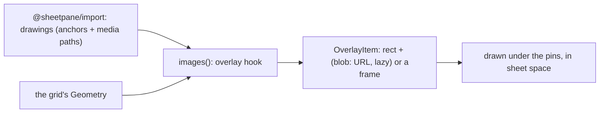

# SR-IMAGES — @sheetpane/images

## §1 — For humans

**The pictures in a workbook show where the author put them.** With
`@sheetpane/images` on a pane, every picture a sheet anchors — a logo, a
signature, a photo — is drawn over the grid at its cells, scrolls with them
and sits under the error pins. It is view only: pictures are never changed,
and export keeps them exactly as they were.

**Nothing is decoded until it is needed.** A picture is read from the file
only when it scrolls near the screen; a format the browser cannot show (EMF,
WMF) gets a labelled frame instead.



<details>
<summary><b>ASCII twin</b> — the same diagram, for terminals and diffs</summary>

```text
   import: drawings (anchors + media) --+
   the grid's Geometry -----------------+--> images(): overlay --> rect +  (lazy blob: URL) or a frame --> under the pins
```

</details>

---

## §2 — For agents

### Context

W-20 asked for the first `overlay` provider; the plugins verdict made
pictures a plugin and view only. The reader exposes drawing anchors and the
media parts (SR-IMPORT decision 2).

### Decision

1. **`images()`** → `{ id: 'images', provides: ['overlay'] }`; importing the
   package registers `images` (`sideEffects` names the entry). No `./ui`
   entry; one `status` control: "N pictures · M preview unavailable".
2. **Items:** each `picture` drawing of the sheet is one `OverlayItem`
   (charts and shapes are skipped; a picture without media or with no area
   is skipped). Ids carry a workbook generation, so a cached element is never
   reused across workbooks. `alt` and the image's `alt` come from `descr`,
   else the name.
3. **Anchors** (`src/anchors.ts`, public, DOM-free — `@sheetpane/charts`
   imports it): 9,525 EMU per pixel; `twoCell` from/to with offsets, `oneCell`
   from + `ext`, `absolute` `pos` + `ext`, placed in the **grid's** `Geometry`
   (28 px rows; hidden rows and columns shown, as the grid shows them), not in
   Excel's row heights. An offset is clamped to its own cell.
4. **Media** (`src/media.ts`, the one file that makes object URLs): read
   through `book.part()` only when the item nears the viewport
   (IntersectionObserver, 300 px margin); the format sniffed from the bytes,
   the extension as fallback; PNG, JPEG, GIF, BMP, WebP and SVG shown through
   `` (never inline SVG); one URL per part.
5. **No preview:** EMF, WMF, TIFF, bytes that do not decode and a missing part
   show a frame "name — preview unavailable" at the anchor's size, without
   reading the bytes when the extension already says so.
6. **Lifetime:** every URL is revoked, once, when the pane loads another
   workbook or a load fails; a decode still running then makes no URL.
7. **Interaction:** in Edit a click on a picture selects the cell under the
   click; in View it does nothing.
8. **Export:** nothing — patch mode copies drawing and media parts byte for
   byte (SR-EXPORT). Deleting rows does not re-anchor pictures (there is no
   row deletion in v1).

### Consequences

- **Enforced today:** `just test-pkg images` — 29 tests (anchor arithmetic;
  rects against the rendered cells for every anchor type and at 150 % zoom;
  decode of each raster format; the EMF frame; URL revocation; click to
  select), Chromium per push, WebKit locally green.
- **Owed:** pictures from files saved by Excel and LibreOffice, and positions
  compared with Excel's own rendering — W-30 (the decider's files). Because the
  grid's rows are 28 px, a picture in a file with taller or shorter rows sits
  differently than in Excel (decision 3).
- **A store that is dropped without loading another workbook keeps its URLs
  until the page goes** — the plugin contract has no dispose signal.

### Alternatives considered

- Excel's row heights and hidden rows for placement — rejected: the grid does
  not draw them, and a picture must sit on the cells the user sees.
- `data:` URLs — rejected: the bytes would live as strings for the page's life.
- Inline SVG — rejected: file-supplied markup in the page.
- Decoding at load — rejected: a 20 MB photo should cost nothing off screen.

### Reference (required)

- [`packages/images/src/`](../packages/images/src/) · [`packages/images/test/`](../packages/images/test/)
- [`work/compare/plugins.compare.md`](../work/compare/plugins.compare.md) — the `overlay` hook.

### Veto condition

**Reopen this decision if:** a picture's frame stops matching the cells its
anchor names in the grid, or a URL outlives its workbook.

**How to check it:** `just test-pkg images`

---

## References

*Every source this record cites, gathered in one place. An archived document
is never listed here.*

**Records** — [SR-GRID](0105_GRID.md) · [SR-IMPORT](0104_IMPORT.md) · [SR-EXPORT](0103_EXPORT.md) · [SR-DOWNLOAD](0101_DOWNLOAD.md)

**Code**

- [`packages/images/src/index.ts`](../packages/images/src/index.ts) · [`anchors.ts`](../packages/images/src/anchors.ts) · [`media.ts`](../packages/images/src/media.ts)

**Project docs**

- [`work/compare/plugins.compare.md`](../work/compare/plugins.compare.md) · [`work/reference/design/boards/Plugin-Images.dc.html`](../work/reference/design/boards/Plugin-Images.dc.html)
