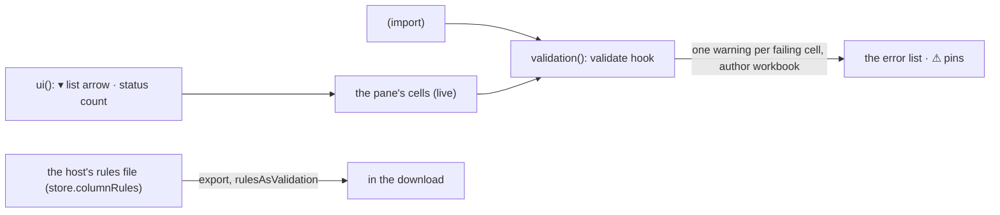

# SR-VALIDATION — @sheetpane/validation

## §1 — For humans

**The file's own rules find the wrong cells before a person does.** A
workbook that says "Units must be a whole number above 0" or "Status is one of
Core, Income, Cap" gets every breaking cell listed in `<sheetpane-errors>` as
a warning from the workbook, on load and after every edit.

**They clear themselves.** Fix the cell and the warning resolves; break it
again and it reopens. They are the workbook's, so a person cannot resolve or
delete them. A list rule gives the cell a ▾ in Edit with the allowed values.

**The host's rules go back out as Excel's own (W-58).** With *Write rules as
Excel dropdowns* on, the download carries the host's rules file as the
workbook's data validation: "Status is one of Active, Inactive" becomes a
dropdown in Excel, "Units is a whole number of at least 1" a check. What
Excel cannot hold — a pattern, "none of", unique — is listed, never dropped
silently, and a rule the workbook already had on those cells wins.



<details>
<summary><b>ASCII twin</b> — the same diagram, for terminals and diffs</summary>

```text
   <dataValidations> + live cells --> validation(): validate --> one warning per failing cell (author: workbook)
                                                                  --> error list, ⚠ pins
   ui(): list arrow ▾ (sets the cell), status count
   host rules file --export, rulesAsValidation--> <dataValidations> in the download (what Excel cannot hold: listed)
```

</details>

---

## §2 — For agents

### Context

W-18 asked for the workbook's validation rules to land in the error pane; the
plugins verdict put them on the `validate` hook as workbook-authored errors
(SR-GRID decision 17).

### Decision

1. **`validation({ severity?, rulesAsValidation? })`** → `{ id: 'validation',
   provides: ['validate', 'exportPatch'], exportOptions }`;
   `@sheetpane/validation` registers it, `@sheetpane/validation/ui` registers
   it with `ui()` (`validation-ui`: a `cell` list arrow and a `status` count).
   No third-party runtime dependency; `@sheetpane/export` (a workspace
   package) writes the rules of decision 10.
2. **One error per failing cell:** `type: 'validation'`, severity `warning`
   (the host may choose another), `author: 'workbook'`, `range` = the cell,
   `found` = its current text (`(blank)` when empty), `expected` = the rule in
   words, `message` = the rule's `errorTitle: error` (either alone), else the
   rule in words. When a cell breaks several rules, the first counts.
3. **Rule types:** `whole`, `decimal`, `date`, `time`, `textLength` with all
   eight operators (default `between`, inclusive); `list` from a literal, a
   range, another sheet's range, a defined name, a table's structured
   reference (`Units[Unit]`, `Units[[#Data],[Unit]]`, directly or through a
   defined name — W-61, resolved by `@sheetpane/export`'s
   `resolveStructuredRef`, re-exported by the grid, to the table's cells as
   the file stores its `ref`; it never shifts per cell), a **dependent list**
   `INDIRECT(<cell>)` (W-60, decision 9), or the x14 form; `custom`
   only through a `derive` provider exposing a synchronous `evaluate(formula,
   { sheet, ref })`, relative references shifted per cell —
   `@sheetpane/formulas` provides it (SR-FORMULAS decision 8).
4. **Operands:** numbers, quoted text, `DATE` / `TIME` with numeric
   arguments, cell references (relative parts shift from the rule's first
   cell, through `@sheetpane/export`'s `shiftFormula`, re-exported by the
   grid), defined names and structured references, and `INDIRECT` of one cell
   or of quoted text (`INDIRECT(x, TRUE)` too; decision 9); anything else — a
   table or column that is not there, `[#This Row]`, `INDIRECT` of
   `SUBSTITUTE`, `&` or R1C1 (`FALSE`), `OFFSET` — skips the rule and counts
   it (`source` for a list), never guessed.
5. **Values:** number rules need a number (`whole` an integer); text dates are
   not parsed; `textLength` uses the stored value's length; a list matches
   text ignoring case and a number by value. Blank cells pass with
   `allowBlank`. Only the used range (data plus changed cells) is checked.
   `showErrorMessage="0"` rules still check.
6. **Lifecycle (SR-GRID):** errors appear on load, re-check on every sheet
   after every change and after `derive`, resolve themselves when the cell
   passes and reopen (with `found` refreshed) when it fails again; they are
   read-only, drawn with a square ⚠ pin at the cell's right edge, filterable
   as "Workbook rules", named "Workbook rule".
7. **Skipped rules:** `skippedRules(book | store)` returns what was not
   checked and why (`custom`, `operand`, `operator`, `type`, `source`); the
   status line shows "n validation warnings · k rules not checked". It is not
   in `sheetpane-load`'s detail — the plugin contract has no way to add to a
   core event (B-032).
8. **List arrow:** in Edit, on cells a `list` rule covers — even past the data,
   the grid widens to the columns rules name — by mouse or Alt+↓; the choices
   are re-read live; a pick sets the cell (undoable). `showDropDown` (Excel's
   "hide the arrow") is read by the importer and not yet honoured.
9. **Dependent lists (W-60):** `INDIRECT(<cell>)` reads the cell (relative
   parts shifted from the rule's first cell) at each checked cell, live, and
   resolves its text to a defined name (case-insensitive, the rule sheet's
   own name before a global one), a table or table column (W-61) or an A1
   cell or range — always fixed; `INDIRECT("text")` resolves once. Text that
   names nothing (blank, a space, an unknown name) gives no list: the cell
   passes with `allowBlank` and fails without it, as Excel does, `expected`
   saying why (`list — (A7 "Flow Rate" names no list)`). Because `validate`
   re-runs on every sheet after every change (decision 6), a parent edit
   re-checks its children in the same edit: an orphaned child opens a
   warning, an open one follows the new list (SR-GRID decision 19b), and the
   arrow offers the new parent's choices. A number rule's `INDIRECT` operand
   reads the one cell its text names.
10. **The host's rules written as the workbook's own (W-58).** The export
    option `rulesAsValidation` — the Download menu's *Write rules as Excel
    dropdowns*, off unless `validation({ rulesAsValidation: true })`; shown
    only while the pane has a rules file or element `columns` (SR-GRID
    decision 17, `applies`), and then an untouched workbook is exported, not
    handed back — writes the rules the rules engine checks (the element's
    `columns` < the file's `"*"` < the named sheet, by title, from
    `store.columnRules` through the grid's `checkDocument`) into each `.xlsx`
    sheet's `<dataValidations>` (`setDataValidations`, SR-EXPORT decision 3).
    One rule → one Excel rule (`validationOf`); a column rule covers its
    column from the row under `headerRow` to row 1,048,576, a cell rule its
    cell or range. Every Excel rule gets `errorTitle` / `promptTitle` (the
    column title or cell, cut to 32), `error` (the rule's `message`, else the
    rule in words, cut to 255), `prompt` (the rule in words) and `errorStyle`
    (`onInvalid: 'block'` → `stop`; severity `note` → `information`; else
    `warning`). `required` (and `equals`) clear `allowBlank`.

    | rules-file words | Excel rule | not written (listed) |
    |---|---|---|
    | `oneOf`, `equals` | `list`, typed out: `"Active,Inactive"` (booleans `TRUE` / `FALSE`) | a value with a comma, an empty list, over 255 characters — SP-5403 |
    | `type: 'integer'` / `'number'`, or `min` / `max` alone | `whole` / `decimal`: `between`, `≥`, `≤`; no bound: ±9.99E+307 | a bound that is not a number, `min` above `max` — SP-5404 |
    | `type: 'date'` with `min` / `max` | `date`, `DATE(y,m,d)` or a serial; no bound: 1900-01-01 to 9999-12-31 | a bound not `2026-01-31` or a serial — SP-5404 |
    | `minLength` / `maxLength` | `textLength` | not whole numbers from 0, `minLength` above `maxLength` — SP-5404 |
    | `type: 'boolean'` | `list` `"TRUE,FALSE"` | |
    | `required` alone | `textLength ≥ 1`, blank not allowed | |
    | `type: 'text'`, `message`, `note`, `severity`, `onInvalid` | no rule of their own (the text and style above) | |
    | `pattern`, `noneOf`, `unique` | — | always — SP-5401 |
    | two checks (a list with a bound or length; a number or date with a length; `equals` with `oneOf`; list values outside the `type`) | — | always — SP-5402 |
    | a title no sheet has, a sheet the workbook lacks | — | SP-5405 |

    **Merging (one rule per cell in Excel):** the workbook's own rules —
    classic and `x14` — keep their cells; a written rule leaves them (a
    conflict, SP-5406) unless it checks the same thing (type, operator,
    operands, `allowBlank`), when its cells join the workbook's rule instead
    of a second copy (`merged`). A cell rule wins over a column rule and a
    named sheet's over `"*"`'s, the same way. `x14` rules stay in `<extLst>`
    (`mainBlockCount`), never copied into the main block. A sheet whose own
    rules export refuses (SP-2015) keeps its block and none are written to it
    (SP-5407). Each rule not written and each conflict is one console warning
    with its code; `lastRulesWrite(book)` → `{ written, merged, skipped,
    conflicts }`, and the status line adds "k rules not written to Excel"
    (not in `sheetpane-export`'s detail — B-032). `rulesAsValidations(store)`
    gives the plan without writing. `.xlsx` only: a CSV, or a CSV converted
    to `.xlsx`, carries no rules.

    **Parity:** export the fixtures' rules sample (`showcase.xlsx` +
    `showcase.rules.json`) with the rules, open the file again with this
    plugin alone, and it flags exactly the cells the rules engine flags
    except under rules not written. Known differences beyond the skipped
    rules: whitespace-only text is blank to the rules engine but text to
    Excel; text that reads as a number or a date passes the rules engine's
    `number` / `date` but not Excel's; `minLength` counts the shown text,
    Excel the stored value.

### Consequences

- **Enforced today:** `just test-pkg validation` — 59 tests (every type and
  operator, list sources (a table column by structured reference, W-61), dependent
  `INDIRECT` lists — names per parameter, sheet-scoped first, tables, A1 text, a parent
  that names nothing, the skipped forms, a parent edit and undo, the arrow following
  the parent, `@sheetpane/fixtures`' `dependent-lists.xlsx` (W-60) — x14, relative operands, live limits, resolve /
  reopen / undo, the arrow and its menu, the shared error pane with the
  author filter, a `custom` rule evaluated by IronCalc through
  `@sheetpane/formulas`; W-58's `write.test.ts`: the mapping table row by row,
  placing and merging, `x14` left alone, SP-5407, the option, the console and
  status line, the Download menu, and parity on the showcase), plus SR-GRID's
  core tests for read-only rows, the ⚠ pin and cross-sheet re-validation.
- **Owed:** a fixture with every rule type saved by Excel — W-30; a file
  written with the rules opened in Excel and LibreOffice, the dropdowns and
  checks working, no repair prompt — W-30 DoD 3 (W-58 DoD 3).

### Alternatives considered

- A formula engine of its own for operands — rejected: it would duplicate W-16.
- Flagging blanks under whole-column rules — rejected: a million rows.
- Severity from Excel's `errorStyle` — rejected: the spec fixes `warning`; the
  host chooses.

### Reference (required)

- [`packages/validation/src/`](../packages/validation/src/) · [`packages/validation/test/`](../packages/validation/test/)
- [`work/compare/plugins.compare.md`](../work/compare/plugins.compare.md) — `validate`.

### Veto condition

**Reopen this decision if:** a cell that breaks a supported rule is not
listed, or a listed workbook error stays open after the cell passes; or a
rules-file rule the table writes is missing from the download, a written
rule takes cells from the workbook's own, or the re-opened showcase flags a
cell the rules engine does not (or misses one it does) under a written rule.

**How to check it:** `just test-pkg validation`

---

## References

*Every source this record cites, gathered in one place. An archived document
is never listed here.*

**Records** — [SR-GRID](0105_GRID.md) · [SR-ERRORS](0106_ERRORS.md) · [SR-IMPORT](0104_IMPORT.md) · [SR-EXPORT](0103_EXPORT.md) · [SR-CODES](0117_CODES.md)

**Code**

- [`packages/validation/src/index.ts`](../packages/validation/src/index.ts) · [`rules.ts`](../packages/validation/src/rules.ts) · [`ui.ts`](../packages/validation/src/ui.ts) · [`write.ts`](../packages/validation/src/write.ts)

**Project docs**

- [`work/compare/plugins.compare.md`](../work/compare/plugins.compare.md) · [`work/reference/design/boards/Plugin-Validation.dc.html`](../work/reference/design/boards/Plugin-Validation.dc.html)
