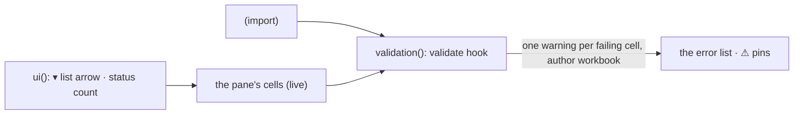

# SR-VALIDATION — @sheetpane/validation

## §1 — For humans

**The file's own rules find the wrong cells before a person does.** A
workbook that says "Units must be a whole number above 0" or "Status is one of
Core, Income, Cap" gets every breaking cell listed in `<sheetpane-errors>` as
a warning from the workbook, on load and after every edit.

**They clear themselves.** Fix the cell and the warning resolves; break it
again and it reopens. They are the workbook's, so a person cannot resolve or
delete them. A list rule gives the cell a ▾ in Edit with the allowed values.



<details>
<summary><b>ASCII twin</b> — the same diagram, for terminals and diffs</summary>

```text
   <dataValidations> + live cells --> validation(): validate --> one warning per failing cell (author: workbook)
                                                                  --> error list, ⚠ pins
   ui(): list arrow ▾ (sets the cell), status count
```

</details>

---

## §2 — For agents

### Context

W-18 asked for the workbook's validation rules to land in the error pane; the
plugins verdict put them on the `validate` hook as workbook-authored errors
(SR-GRID decision 17).

### Decision

1. **`validation({ severity? })`** → `{ id: 'validation', provides: ['validate'] }`;
   `@sheetpane/validation` registers it, `@sheetpane/validation/ui` registers
   it with `ui()` (`validation-ui`: a `cell` list arrow and a `status` count).
   No runtime dependency.
2. **One error per failing cell:** `type: 'validation'`, severity `warning`
   (the host may choose another), `author: 'workbook'`, `range` = the cell,
   `found` = its current text (`(blank)` when empty), `expected` = the rule in
   words, `message` = the rule's `errorTitle: error` (either alone), else the
   rule in words. When a cell breaks several rules, the first counts.
3. **Rule types:** `whole`, `decimal`, `date`, `time`, `textLength` with all
   eight operators (default `between`, inclusive); `list` from a literal, a
   range, another sheet's range, a defined name, or the x14 form; `custom`
   only through a `derive` provider exposing a synchronous `evaluate(formula,
   { sheet, ref })`, relative references shifted per cell —
   `@sheetpane/formulas` provides it (SR-FORMULAS decision 8).
4. **Operands:** numbers, quoted text, `DATE` / `TIME` with numeric
   arguments, cell references (relative parts shift from the rule's first
   cell, through `@sheetpane/export`'s `shiftFormula`, re-exported by the
   grid) and defined names; anything else skips the rule and counts it.
5. **Values:** number rules need a number (`whole` an integer); text dates are
   not parsed; `textLength` uses the stored value's length; a list matches
   text ignoring case and a number by value. Blank cells pass with
   `allowBlank`. Only the used range (data plus changed cells) is checked.
   `showErrorMessage="0"` rules still check.
6. **Lifecycle (SR-GRID):** errors appear on load, re-check on every sheet
   after every change and after `derive`, resolve themselves when the cell
   passes and reopen (with `found` refreshed) when it fails again; they are
   read-only, drawn with a square ⚠ pin at the cell's right edge, filterable
   as "Workbook rules", named "Workbook rule".
7. **Skipped rules:** `skippedRules(book | store)` returns what was not
   checked and why (`custom`, `operand`, `operator`, `type`, `source`); the
   status line shows "n validation warnings · k rules not checked". It is not
   in `sheetpane-load`'s detail — the plugin contract has no way to add to a
   core event (B-032).
8. **List arrow:** in Edit, on cells a `list` rule covers — even past the data,
   the grid widens to the columns rules name — by mouse or Alt+↓; the choices
   are re-read live; a pick sets the cell (undoable). `showDropDown` (Excel's
   "hide the arrow") is read by the importer and not yet honoured.

### Consequences

- **W-52 (2026-10-19):** rows and columns inserted or deleted move
  `dataValidations` in the workbook the plugin reads (SR-IMPORT decision 11);
  `structure.test.ts` checks a rule and its error follow their cells — no
  code here changed.
- **Enforced today:** `just test-pkg validation` — 30 tests (every type and
  operator, list sources, x14, relative operands, live limits, resolve /
  reopen / undo, the arrow and its menu, the shared error pane with the
  author filter, a `custom` rule evaluated by IronCalc through
  `@sheetpane/formulas`), plus SR-GRID's core tests for read-only rows, the ⚠ pin and
  cross-sheet re-validation.
- **Owed:** a fixture with every rule type saved by Excel — W-30.

### Alternatives considered

- A formula engine of its own for operands — rejected: it would duplicate W-16.
- Flagging blanks under whole-column rules — rejected: a million rows.
- Severity from Excel's `errorStyle` — rejected: the spec fixes `warning`; the
  host chooses.

### Reference (required)

- [`packages/validation/src/`](../packages/validation/src/) · [`packages/validation/test/`](../packages/validation/test/)
- [`work/compare/plugins.compare.md`](../work/compare/plugins.compare.md) — `validate`.

### Veto condition

**Reopen this decision if:** a cell that breaks a supported rule is not
listed, or a listed workbook error stays open after the cell passes.

**How to check it:** `just test-pkg validation`

---

## References

*Every source this record cites, gathered in one place. An archived document
is never listed here.*

**Records** — [SR-GRID](0105_GRID.md) · [SR-ERRORS](0106_ERRORS.md) · [SR-IMPORT](0104_IMPORT.md)

**Code**

- [`packages/validation/src/index.ts`](../packages/validation/src/index.ts) · [`rules.ts`](../packages/validation/src/rules.ts) · [`ui.ts`](../packages/validation/src/ui.ts)

**Project docs**

- [`work/compare/plugins.compare.md`](../work/compare/plugins.compare.md) · [`work/reference/design/boards/Plugin-Validation.dc.html`](../work/reference/design/boards/Plugin-Validation.dc.html)
