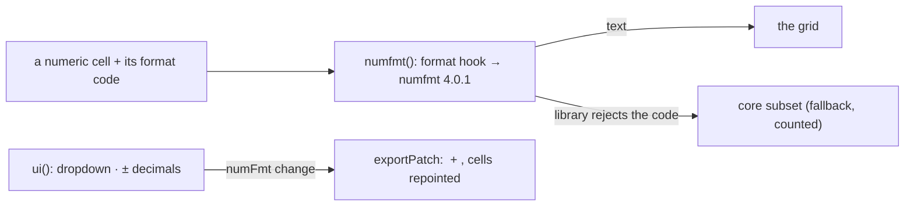

# SR-NUMFMT — @sheetpane/numfmt

## §1 — For humans

**Numbers look the way Excel shows them.** Without this plugin the grid
formats dates, percentages and fixed decimals and shows anything else as
stored. With it, every format a workbook uses — currency, accounting,
fractions, elapsed time, conditional sections, locales — renders as in Excel.

**And a reviewer can change one.** In Edit a dropdown and ± decimals set a
cell's format; the change is held in memory like any other, undoable, and
export writes it into the file.



<details>
<summary><b>ASCII twin</b> — the same diagram, for terminals and diffs</summary>

```text
   numeric cell + code --> numfmt(): format --> numfmt 4.0.1 --> text in the grid
                                         \--> rejected code: the core subset (counted)
   ui(): dropdown, ± decimals --> numFmt change --> exportPatch: <numFmt> + <xf>, cells repointed
```

</details>

---

## §2 — For agents

### Context

W-15 asked for the full ECMA-376 format grammar through the
[`numfmt`](https://github.com/borgar/numfmt) library (MIT, zero
dependencies), replacing the core subset (SR-IMPORT decision 4) when
installed — the plugins verdict's `format` hook.

### Decision

1. **`numfmt(options?)`** → `{ id: 'numfmt', provides: ['format',
   'decorate', 'exportPatch'] }`; `ui()` (`numfmt-ui`) carries the controls.
   Importing `@sheetpane/numfmt` registers `numfmt` alone; `@sheetpane/numfmt/ui`
   registers `[numfmt(), ui()]`. The headless entry never imports the UI.
   Runtime: the peer `@sheetpane/grid` and `numfmt@4.0.1`, pinned.
2. **The code** for a cell is the user's `numFmt` change, else its
   `cellXfs[s].numFmtId` — the file's `<numFmts>` entry first, else the
   library's built-in for that id in the locale (so ids 5–8, 14–22, 41–44
   follow it, as in Excel).
3. **Output:** finite numbers only; out-of-range dates show `########`;
   `General` follows Excel's 11-character rule.
4. **1904:** a code that shows a year, month or day gets the serial shifted by
   1,462 days; elapsed `[h]` formats are not shifted.
5. **Locale:** `options.locale`, else `document.documentElement.lang` read
   when formatting (guarded for Node); `-IN` territories group `3,2`.
6. **Fallback:** a code the library rejects returns nothing, so the core
   subset shows the cell; the cell is counted in `plugin.fallbacks()`. The
   count is not in `sheetpane-load`'s detail (backlog B-032).
7. **`decorate`** only sets `white-space: pre` for codes with `_`, `*` or `?`
   padding — never a font.
8. **UI:** a `format-row` dropdown (General · Number · Currency · Accounting ·
   Date · Time · Percentage · Fraction · Scientific · Text · Custom…) and ±
   decimals; a choice applies to the selection's numeric cells as **one undo
   step** (`setChanges`), each a `numFmt` change whose `was` is the file's own
   code; Custom… asks for a code (`ui({ ask })`, default `prompt`) and
   refuses an invalid one. The change lives in the cell's `numFmt` slot
   (`sheet!#numFmt:A1`, SR-GRID decision 3), so a value edit and a format on
   one cell are two changes. The cell bar keeps showing the raw value.
9. **Export:** `exportPatch` appends deduplicated `<numFmt>` (new ids from
   max(163, existing) + 1; a built-in code uses its id) and `<xf>` entries — a
   copy of the cell's old xf with the new `numFmtId` — and repoints each
   changed cell's `s`, inserting a missing `<c>` or `<row>`.

### Consequences

- **Enforced today:** `just test-pkg numfmt` — 42 tests (every built-in id
  and 50 custom codes through load → text; 1904; fallback; locales `de-DE`,
  `en-IN`; the dropdown, ranges, ± decimals, Custom…; export and read-back;
  package shape and the headless boundary). The table also found five bugs
  in the core subset; two are fixed (month-only codes, serial 0) and three
  are recorded as limits in SR-IMPORT.
- **Owed:** expected values captured from Excel itself (the table follows
  Excel's documented output) — W-30.
- **The reading verdict's "1 in 100" trigger** compares misreads; the one
  fixture cell where the subset and the library differ (`[$€-407]#,##0.00`)
  is a code the subset declines and shows raw, not a misread.

### Alternatives considered

- `addLocale` for `en-IN` — rejected: global state shared by every pane.
- A copy of the core subset for fallback — rejected: returning nothing reuses
  the core's.
- `[Red]` colours through `decorate` — left for a follow-up (dark-theme
  contrast, W-29).

### Reference (required)

- [`packages/numfmt/src/`](../packages/numfmt/src/) · [`packages/numfmt/test/`](../packages/numfmt/test/)
- [`work/compare/plugins.compare.md`](../work/compare/plugins.compare.md) — the `format` hook.

### Veto condition

**Reopen this decision if:** the library misformats more than 1 in 100
numeric cells across the real-app fixtures (W-30), or a code Excel accepts is
refused.

**How to check it:** `just test-pkg numfmt`

---

## References

*Every source this record cites, gathered in one place. An archived document
is never listed here.*

**Records** — [SR-GRID](0105_GRID.md) · [SR-IMPORT](0104_IMPORT.md) · [SR-EXPORT](0103_EXPORT.md)

**Code**

- [`packages/numfmt/src/index.ts`](../packages/numfmt/src/index.ts) · [`fmt.ts`](../packages/numfmt/src/fmt.ts) · [`patch.ts`](../packages/numfmt/src/patch.ts) · [`ui.ts`](../packages/numfmt/src/ui.ts)

**Project docs**

- [`work/compare/plugins.compare.md`](../work/compare/plugins.compare.md) · [`work/reference/design/boards/Plugin-Numfmt.dc.html`](../work/reference/design/boards/Plugin-Numfmt.dc.html)
