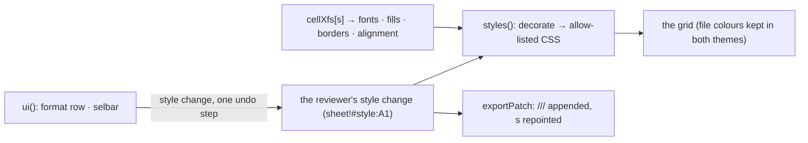

# SR-STYLES — @sheetpane/styles

## §1 — For humans

**Cells look the way the file formats them.** Without this plugin the grid
draws every cell plain. With it, fills, bold, italic, underline, colours,
sizes, borders and alignment show as saved — in the host's own font, always.

**And a reviewer can restyle them.** In Edit a format row (and Bold · Fill ·
Merge on the selection bar) restyles the selection; each action is one change
per cell, one undo step, and export writes it into the file.



<details>
<summary><b>ASCII twin</b> — the same diagram, for terminals and diffs</summary>

```text
   cellXfs[s] (fonts, fills, borders, alignment) --> styles(): decorate --> allow-listed CSS --> grid
   reviewer's style change (sheet!#style:A1)      --/
   ui(): format row, selbar --style change, one undo step--> change map
   change map --> exportPatch: <font>/<fill>/<border>/<xf> appended, cells' s repointed
```

</details>

---

## §2 — For agents

### Context

W-17 asked for the styles plugin on the plugins verdict's `decorate` hook,
with the format row the Plugin-Styles board draws. Merges are core (SR-GRID);
the number format is SR-NUMFMT's.

### Decision

1. **`styles({ fileStyles? })`** → `{ id: 'styles', provides: ['decorate',
   'exportPatch'] }`; `ui(options?)` (`styles-ui`) carries the controls.
   Importing `@sheetpane/styles` registers `styles` alone;
   `@sheetpane/styles/ui` registers `[styles(), ui()]`. The headless entry
   never imports the UI. No runtime dependency; `@sheetpane/grid` is a peer.
2. **`decorate`** reads `cellXfs[s]` → `fonts`, `fills`, `borders`,
   `alignment` and returns only `background-color`, `color`, `font-weight`,
   `font-style`, `font-size`, `text-decoration`, `text-align`,
   `vertical-align`, `white-space` and `border-top/right/bottom/left` —
   **never `font-family`** (the host refuses one, SR-GRID 17). Colours: ARGB,
   theme with Excel's tint (the file's theme, else Office's), indexed (the
   file's `<indexedColors>`, else the 64-colour default), `auto`.
3. **The default font's size and colour are the host's:** only a size or
   colour that differs from the workbook's default font is drawn (size as
   `sz / default` of the grid's size), so a plain cell stays plain in both
   themes. A filled cell with automatic text gets the workbook's default ink.
   Patterns blend by density; a gradient shows its midpoint; diagonal
   borders, indent and rotation are not drawn.
4. **File colours are data** (SR-GRID 15a): they render as saved in light and
   dark; the grid's state tints sit above them (SR-GRID 15b).
5. **The change** is kind `style` in the cell's style slot
   (`sheet!#style:A1`, SR-GRID 3); `now` is a `StylePatch` (`clear`, `b`,
   `i`, `u`, `strike`, `color`, `fill`, `border`, `align`, `valign`,
   `wrap`). Fields the file already shows are dropped; a cell back to its file
   look has no change; `clear` drops the file's font, fill, border and
   alignment and keeps the number format.
6. **UI:** `format-row` groups text (Bold `Mod+B`, Italic `Mod+I`, Underline
   `Mod+U`, Strikethrough `Mod+5`) · colour · fill · border · align (left,
   centre, right with `Mod+Shift+L/E/R`; top, middle, bottom; Merge/Unmerge)
   · wrap · clear (`Mod+\`); `selbar` (docked in the cell bar and in the right-click menu, SR-GRID 13) adds Bold, Fill and Merge/Unmerge. Every
   action restyles the selection as **one undo step** (`setChanges`). Merge
   calls the core's `setMerge` (kind `merge`), is labelled Merge or Unmerge,
   and is disabled on a CSV or a single unmerged cell. `ui({ colours, fills,
   highlight })` sets the swatches; the default fills keep the changed mark at
   3:1.
7. **Export:** `exportPatch` appends deduplicated `<font>`, `<fill>`,
   `<border>` and `<xf>` entries (counts updated, every other byte kept),
   repoints `s` on each changed cell (adding `<c r s/>` and `<row>` where
   missing), and creates `styles.xml` with its relationship and content type
   when the package has none. Untouched cells keep their `s`; a workbook
   without style changes is left byte for byte. A CSV is never restyled.
8. **For condfmt (W-19):** the colour and CSS helpers (`resolveColor`,
   `applyTint`, `paletteOf`, `fontCss`, `fillCss` with `{ dxf: true }`,
   `borderCss`, `alignmentCss`, `dxfCss`, `ALLOWED_PROPS`, `allowListed`)
   are exported.

### Consequences

- **Enforced today:** `just test-pkg styles` — 46 tests (colours: rgb, theme
  and tint, indexed; decorate from the ExcelJS fixture property by property
  and from hand-made `styles.xml` for every border style, alignment, font and
  fill; the allow-list and the L5 veto over the package; the format row in
  View and Edit, every group, shortcuts, one undo step; merges; the core
  layout showing alignment and wrap with tints above a fill; contrast of the
  changed mark on every default fill; export round-trips, dedup, missing
  `styles.xml`, byte-for-byte when untouched).
- **Owed:** a fixture of every fill, font and border combination **saved by
  Excel** — W-30.

### Alternatives considered

- One change per cell for value and style — replaced by per-kind slots
  (SR-GRID 3): a value edit and a restyle of one cell are two changes.
- Drawing the default font's size and colour — rejected: a dark host would
  get dark-on-dark text in every plain cell.

### Reference (required)

- [`packages/styles/src/`](../packages/styles/src/) · [`packages/styles/test/`](../packages/styles/test/)
- [`work/compare/plugins.compare.md`](../work/compare/plugins.compare.md) — the `decorate` hook

### Veto condition

**Reopen this decision if:** a cell in a real-app fixture (W-30) renders a
fill, font or border property differently from Excel, or any decorate result
names a font family.

**How to check it:** `just test-pkg styles`

---

## References

*Every source this record cites, gathered in one place. An archived document
is never listed here.*

**Records** — [SR-GRID](0105_GRID.md) · [SR-NUMFMT](0109_NUMFMT.md) · [SR-LAW-5](0007_LAW-5-host-font.md) · [SR-LAW-6](0008_LAW-6-edits-in-memory-export-with-changes.md)

**Code**

- [`packages/styles/src/index.ts`](../packages/styles/src/index.ts) · [`color.ts`](../packages/styles/src/color.ts) · [`css.ts`](../packages/styles/src/css.ts) · [`model.ts`](../packages/styles/src/model.ts) · [`xml.ts`](../packages/styles/src/xml.ts) · [`ui.ts`](../packages/styles/src/ui.ts)

**Project docs**

- [`work/compare/plugins.compare.md`](../work/compare/plugins.compare.md) · [`work/reference/design/boards/Plugin-Styles.dc.html`](../work/reference/design/boards/Plugin-Styles.dc.html)
