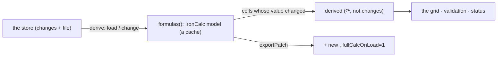

# SR-FORMULAS — @sheetpane/formulas

## §1 — For humans

**Edit a number, and the totals follow.** Without this plugin a formula cell
shows the value Excel saved, marked stale once its inputs change. With it,
IronCalc recalculates every formula that depends on the edit; those cells are
marked ⟳ and are never counted as the reviewer's changes.

**A reviewer can type a formula.** In Edit the cell bar holds the cell's
formula; typing `=` makes a formula change that evaluates at once and is
written into the file with its new value.



<details>
<summary><b>ASCII twin</b> — the same diagram, for terminals and diffs</summary>

```text
   store (changes + file) --derive--> formulas(): IronCalc model (a cache)
   model --cells whose value changed--> derived (marked, never changes) --> grid, validation, status
   model --exportPatch--> <f> + new <v>, fullCalcOnLoad="1"
```

</details>

---

## §2 — For agents

### Context

W-16 asked for recalculation on the plugins verdict's single-provider
`derive` hook, with IronCalc (MIT/Apache-2.0) as the engine.

### Decision

1. **`formulas({ preload?, wasm? })`** → `{ id: 'formulas', provides:
   ['derive', 'exportPatch'] }` plus `ready()`, `cycles()`, `unsupported()`,
   `stateOf()`, `built()`; `ui(engine?)` (`formulas-ui`) carries the overlay
   and the controls. Importing `@sheetpane/formulas` registers `formulas`;
   `@sheetpane/formulas/ui` registers `[formulas(), ui()]`. Runtime: the peer
   `@sheetpane/grid` and `@ironcalc/wasm@0.9.0`, pinned.
2. **Lazy:** IronCalc is loaded by a dynamic `import()` on the first `derive`
   with a formula to calculate — a workbook with none never loads it until one
   is typed; `preload: true` warms it; `wasm` names its bytes or URL (Node).
   A failed load is retried on the next call.
3. **L9 — the model is a cache:** each cell's input is read from the store
   (a change, else the file's formula, else its value); the model is rebuilt
   when the workbook object changes; only computed values are read back.
   Only reachable cells are loaded (formulas, the ranges they and defined names
   reference); `INDIRECT` or `OFFSET` loads everything; a new formula loads
   its ranges when typed. `_xlfn.`, `_xlws.`, `_xlpm.` prefixes are stripped
   for the engine.
4. **Derive:** on load, only cells whose computed value differs from the
   saved one; on a change, every formula whose value changed and every typed
   formula. A file formula back at its saved value, and a typed formula
   reverted away, return `clear: true` (SR-GRID 21b), so ⟳ and export mean
   "recalculated". Calls queue; calls behind a running recalculation share one
   evaluation. Numbers compare at a 1e-14 relative tolerance; `null` equals
   `''`. Values are read at 15 significant digits.
5. **Errors:** `#DIV/0!`, `#REF!`, `#N/A` are values; a half-typed formula
   never throws (it shows IronCalc's `#ERROR!`). A cycle shows 0, as Excel
   does, is listed by `cycles()`, marked ↻ and named in the status line. A
   file formula IronCalc cannot calculate (`#NAME?`, `#SPILL!` or an engine
   error where Excel saved something else) keeps its saved value, is marked ≈
   and listed by `unsupported()` until it becomes computable.
6. **Export:** typed formulas become `<f>` + `<v>` (`t="e"`, `"str"`, `"b"`
   as needed); recalculated file formulas get a new `<v>` with their `<f>`
   (shared formulas included) kept; `fullCalcOnLoad="1"`. An untouched
   workbook's parts are byte-identical.
7. **UI:** `cellbar` — in View, `fx =…` as read-only text; in Edit the grid's
   own input holds the formula (SR-GRID 21b); `status` — Sum · Avg · Count of
   the selection, `⟳ N cells recalculated`, circular references; `cell`
   marks ⟳ (recalculated), ↻ (cycle), ≈ (unsupported); `overlay` — coloured,
   labelled outlines of the referenced ranges while a formula is edited
   (drawn as four edges, so cells stay clickable). A hidden formula on a
   protected sheet (W-62, SR-GRID 21d — `formulaHiddenIn`) shows no `fx` and
   no outlines; its value only.
8. **`evaluate(formula, { sheet, ref })`** returns one formula's value
   synchronously, through a scratch cell (the sheet's last cell) set,
   evaluated, read and cleared — the workbook is never touched. It serves
   `@sheetpane/validation`'s `custom` rules (SR-VALIDATION decision 3); a
   workbook with a `custom` validation rule, or a conditional-format
   expression, formula operand or formula threshold (W-19), builds the model
   even without a formula cell.
   `undefined` until the model is built or while a recalculation is queued.

### Consequences

- **Codes (W-40, SR-CODES):** a failed recalculation is logged as SP-5201, an engine that did not load as SP-5202.
- **Enforced today:** `just test-pkg formulas` — 34 tests (derive on load
  and change, undo, revert, paste, cross-sheet and quoted names, defined
  names, CSV, cycles, errors, unsupported; export of typed and recalculated
  formulas and read-back; the cell bar, status and marks in a real
  `<sheetpane-excel>`; lazy load — no `.wasm` request before the first
  formula; preload; the parity and perf runs), plus SR-VALIDATION's
  `custom`-rule test through `evaluate()`.
- **Measured** (Arpit's MacBook, headless Chromium 156, 10 cores, under
  load from sibling agents): 250,000 rows with 10,000 formulas — the plugin
  adds about 0.4 s to a 6.1 s read (lightest run), one edit 40–48 ms; the
  `.wasm` loads in 34 ms. Parity: 3/3 formula cells of the W-13 fixtures,
  113/116 in a hand-written function probe (misses: `AGGREGATE`, `XLOOKUP`
  over array constants, `TEXTJOIN` with an empty literal — the test fails if
  the list changes).
- **Owed:** parity against **Excel-saved** fixtures (W-30, DoD 7's ≥ 99 %);
  perf on the reference machine against an `.xlsx` budget; reporting a cycle
  in `sheetpane-load`/`-change` detail (backlog B-032; today the status line
  and `cycles()`); 1904-date workbooks (IronCalc knows only 1900 — date
  functions over serials are off by 1,462 days); array and spilled formulas
  fall back to unsupported (the reader does not expose `t="array"`).
- The A1 and XML helpers duplicate `@sheetpane/export`'s small ones, to keep
  the grid the only peer.

### Alternatives considered

- Loading every non-empty cell — rejected: 2.6 s for 1.25 M cells and every
  evaluation slower.
- Reading values through IronCalc's General format — rejected: ~10
  significant digits.
- Returning every formula cell on load — rejected: ⟳ would mark every
  formula.
- An editable `fx` button in the cell bar — replaced by the grid's own input
  holding the formula (one place to edit a cell).

### Reference (required)

- [`packages/formulas/src/`](../packages/formulas/src/) · [`packages/formulas/test/`](../packages/formulas/test/)
- [`work/compare/plugins.compare.md`](../work/compare/plugins.compare.md) — the `derive` hook

### Veto condition

**Reopen this decision if:** IronCalc's value differs from Excel's cached
value in more than 1 in 100 formula cells across the real-app fixtures
(W-30), or a workbook without formulas requests the `.wasm`.

**How to check it:** `just test-pkg formulas`

---

## References

*Every source this record cites, gathered in one place. An archived document
is never listed here.*

**Records** — [SR-GRID](0105_GRID.md) · [SR-EXPORT](0103_EXPORT.md) · [SR-LAW-2](0004_LAW-2-foss-dependencies.md) · [SR-LAW-9](0011_LAW-9-memory-is-a-javascript-object.md)

**Code**

- [`packages/formulas/src/index.ts`](../packages/formulas/src/index.ts) · [`model.ts`](../packages/formulas/src/model.ts) · [`cells.ts`](../packages/formulas/src/cells.ts) · [`export.ts`](../packages/formulas/src/export.ts) · [`ui.ts`](../packages/formulas/src/ui.ts)

**Project docs**

- [`work/compare/plugins.compare.md`](../work/compare/plugins.compare.md)
