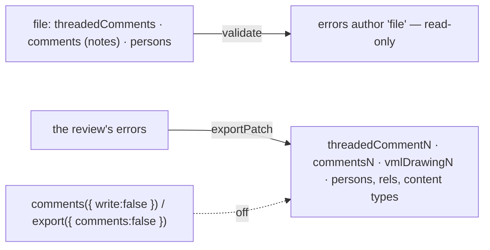

# SR-COMMENTS — @sheetpane/comments

## §1 — For humans

**What colleagues wrote in Excel shows in the review.** A cell's note or
comment thread arrives in the error list as a *File comment* — read-only,
filterable, shown at its cell.

**And the review goes back into the file.** On export, every error becomes an
Excel comment thread at its cell — the message, then *Should be* as a reply,
marked done when resolved — so someone without sheetpane reads the review in
Excel. On by default; the host can switch it off (the decider, 2026-10-18).



<details>
<summary><b>ASCII twin</b> — the same diagram, for terminals and diffs</summary>

```text
   file: threaded comments, notes, persons --validate--> errors (author 'file', read-only)
   review's errors --exportPatch--> threadedCommentN, commentsN, vmlDrawingN, persons + rels, content types
   comments({ write: false }) or export({ comments: false }) --> nothing written
```

</details>

---

## §2 — For agents

### Context

W-22 asked for comments both ways; the decider ruled writing on by default
with a host switch (2026-10-18). The error schema and the read-only rule for
`file` errors are SR-GRID's (decision 19b).

### Decision

1. **`comments({ write? })`** → `{ id: 'comments', provides: ['validate',
   'exportPatch'] }` and a read-only `lastExport: { written, skipped }`.
   Importing the package registers `comments`. No `./ui`; no runtime
   dependency; `@sheetpane/grid` is the only peer. String XML only — no
   `DOMParser`, no `document` — so it runs in Node.
2. **Read:** one draft per commented cell, `{ type: 'comment', severity:
   'note', author: 'file', found: <uploaded text or (blank)>, expected: '',
   message, status: 'open' }`. The message is the thread's first comment,
   its replies in file order, then the cell's note, each line led by
   `Name: ` (not twice). Excel's `tc=` placeholder notes are skipped; thread
   entries this review wrote are skipped.
3. **Write:** every error not authored `file` in the layers shown
   (`snapshot.visibleErrors`, W-51, SR-GRID 5d) — or, with
   `export({ layers: [...] })` (`ctx.exportOptions.layers`), in the layers
   named, whatever is shown; `[]` writes nothing — at the top-left cell of its
   range. An error with no cell, about a whole sheet or the workbook (W-55,
   SR-GRID 5a), is not written, because a comment needs a cell and sheetpane
   never puts one on A1. It is reported in `lastExport.skipped` as `{ id,
   reason: 'no-cell', code: 'SP-5804' }`. The review sheet (W-59) is where
   these errors go into the file. First comment `<id> · <Severity> · <Type name> · Found: <found>`,
   newline, the message; `expected` as a reply `Should be: <expected>`. All
   errors on one cell share one thread, `done="1"` only when every one is
   resolved or accepted. **An accepted error (W-69, SR-GRID 5c)** gets one
   more reply, `Accepted: <reason>`, written by who accepted it (`acceptedBy`,
   else the error's author) at `acceptedAt`; reopened, the next export drops
   it. On a cell with someone's thread the errors join it as replies; on
   a cell holding a legacy note nothing is written and the error is reported
   `note-at-cell` in `lastExport.skipped` (the file author's note is never
   rewritten).
4. **Parts:** `xl/threadedComments/threadedCommentN.xml`, `xl/commentsN.xml`
   (author `tc={root}`, the placeholder text), `xl/drawings/vmlDrawingN.vml`
   (one hidden Note shape per cell, a free `o:idmap` block),
   `<legacyDrawing>` in schema position, `xl/persons/person.xml` (one person
   per author, `providerId="None"`); every rel and content type. Existing
   parts are **extended, never replaced**; a sheet whose parts cannot be
   parsed is left as is (`unreadable-part`).
5. **Ids:** a thread entry's id is the version-5 UUID of
   `sheetpane:<id>:<createdAt>` (`…#expected` and `…#accepted` for the
   replies); a person's, of
   `sheetpane-person:<name>`. A second export of the same review replaces its
   own entries in place; replies added in Excel are kept and re-pointed.
6. **Switches:** `write: false` for good; `ctx.exportOptions.comments ===
   false` (`<sheetpane-excel>.export({ comments: false })`, SR-GRID decision
   6) for one export — then the parts are byte-identical to the input. The
   plugin declares `exportOptions: [{ key: 'comments', label: 'Write review
   as Excel comments', default: true }]`, so the Download menu shows the
   switch (W-34; none when `write: false`).
7. **No font** is written: the legacy `<t>` is plain and the VML names none.

### Consequences

- **Codes (W-40, SR-CODES):** SP-5801 (a comment part with no container), SP-5802 (not a worksheet), SP-5803 (comments not written for a sheet), SP-5804 (an error with no cell not written — W-55).
- **Enforced today:** `just test-pkg comments` — 31 tests (notes and threads
  from the ExcelJS fixture and hand-written packages; read-only rows,
  author filter; the four parts, rels, content types and `legacyDrawing`
  order; extending existing parts; joining a thread; the note-at-cell and no-cell (W-55) skips;
  an error's `meta` (W-68, SR-GRID 5b) found in no written part;
  an accepted error's *Accepted* reply, its person and time, the thread
  done, the reply dropped once reopened and skipped when read back (W-69);
  both switches byte-identical; W-51: the layers shown by default, a named
  set by option, none for `[]`, and every layer's threads skipped when read
  back; export → reload → `setErrors` → export
  giving the same ids and counts; every written part well-formed; package
  shape and the Node-safe boundary).
- **Owed:** opening the exported fixture in Excel 365, Excel 2019 and
  LibreOffice (DoD 4; an accepted error's reply included — W-69) and fixtures saved by Excel with notes, threads and
  both — W-30, the decider's; validating the parts against the OOXML schema
  (backlog B-033). Unverified until then: whether Excel links the note to its
  thread by the `tc=` author alone (no `xr:uid` is written), the `dT` format
  (UTC, hundredths, no `Z`) and the computed VML anchors.
- Author names land in the file as personal data.
- The type name comes from `DEFAULT_ERROR_TYPES` and `BUILTIN_TYPE_NAMES`;
  a host's own `errorTypes` (on the element, not the store) are written by id.
- A plugin cannot report export warnings to the host's events; `lastExport`
  stands in (backlog B-032).

### Alternatives considered

- Reading `done` threads as `resolved` — kept `open`, as the DoD says; a
  ruling may change it.
- Converting a note to a thread, or appending to it, for an error on a note
  cell — rejected: it rewrites the file author's content.
- An id from `id` alone — rejected: ids restart at ERR-0001 each session.
- `crypto.subtle` for the UUID hash — rejected: `validate` is synchronous.

### Reference (required)

- [`packages/comments/src/`](../packages/comments/src/) · [`packages/comments/test/`](../packages/comments/test/)
- [`work/compare/plugins.compare.md`](../work/compare/plugins.compare.md)

### Veto condition

**Reopen this decision if:** Excel or LibreOffice reports a repair, or drops
a comment, on a file this plugin wrote (W-30).

**How to check it:** `just test-pkg comments`

---

## References

*Every source this record cites, gathered in one place. An archived document
is never listed here.*

**Records** — [SR-GRID](0105_GRID.md) · [SR-ERRORS](0106_ERRORS.md) · [SR-LAW-5](0007_LAW-5-host-font.md) · [SR-LAW-6](0008_LAW-6-edits-in-memory-export-with-changes.md)

**Code**

- [`packages/comments/src/index.ts`](../packages/comments/src/index.ts) · [`read.ts`](../packages/comments/src/read.ts) · [`write.ts`](../packages/comments/src/write.ts) · [`xml.ts`](../packages/comments/src/xml.ts) · [`guid.ts`](../packages/comments/src/guid.ts)

**Project docs**

- [`work/compare/plugins.compare.md`](../work/compare/plugins.compare.md)
