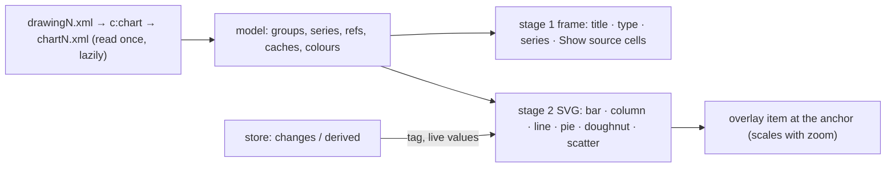

# SR-CHARTS — @sheetpane/charts

## §1 — For humans

**A chart shows where Excel puts it.** Each chart in the workbook appears at
its cells: a frame naming its title, its type and its series, with **Show
source cells** to select the data it plots. The common types — bar, column,
line, pie, doughnut, scatter — are drawn; the rest stay a frame that says why.

**And it says when the review changed its data.** Edit a plotted cell and the
chart shows *data changed — Excel will redraw*. With the formulas plugin the
drawing follows the live cells; the file's chart part is never rewritten.



<details>
<summary><b>ASCII twin</b> — the same diagram, for terminals and diffs</summary>

```text
   drawingN.xml -> c:chart -> chartN.xml (read once, lazily) -> model (groups, series, refs, caches, colours)
   model -> stage 1 frame (title, type, series, Show source cells)
   model -> stage 2 SVG (bar, column, line, pie, doughnut, scatter) <- store changes / derived (tag, live values)
   SVG -> overlay item at the anchor, scaled with zoom
```

</details>

---

## §2 — For agents

### Context

W-21 asked for charts on the plugins verdict's `overlay` hook, in two
stages, with no chart library (L2 rules one out as a dependency the reviewer
does not need). Anchors are SR-IMAGES' arithmetic.

### Decision

1. **`charts({ draw? })`** → `{ id: 'charts', provides: ['overlay'] }`;
   `draw: false` keeps every chart a frame. `ui()` (`charts-ui`) adds a
   `status` line naming the source under the selection (or "N charts") and
   the Mod+Shift+U shortcut for Show source cells. Importing
   `@sheetpane/charts` registers `charts`; `/ui` registers `[charts(),
   ui()]`. Peers: `@sheetpane/grid` and `@sheetpane/images` (`anchorRect`,
   `cellAt`); no runtime dependency.
2. **Items:** one per `kind: 'chart'` drawing with a chart part; the id
   carries a workbook generation; the rectangle is SR-IMAGES' anchor
   arithmetic in the grid's geometry. The item is a `group` (it holds a
   button) named by the title once the part is read, else the drawing's
   description or name; the drawing inside is `role="img"` with a `<title>`.
3. **Reading:** on first render through `book.part()`, once per workbook,
   cached; DOMParser by local name. A missing or malformed part gives a
   labelled frame. Title: rich text, else the title reference's cache, else
   the only series' name, else "Chart". Type label from the plot-area
   element, `barDir` and `grouping` ("column + line" for a combination).
4. **Show source cells** selects the union of the plotted ranges when they
   tile one rectangle, else the first series' values (a selection is one
   rectangle — backlog B-034); across sheets; disabled when the data is
   literal.
5. **The tag** "data changed — Excel will redraw" shows while a `value` or
   `formula` change lies in a range the chart reads (names, categories,
   values), drawn in the SVG's title band so it scales with zoom.
6. **Stage 2** draws exactly one group of bar, column (clustered, stacked,
   100 %), line, pie, doughnut or scatter that is not a pivot chart; area,
   radar, 3-D, combination and pivot charts stay frames saying why. Values:
   the cached points, or the live cells (`store.value`) when a `derive`
   plugin is installed (`data-values` says which). Own SVG: a `viewBox` the
   anchor's size, no font named, every file string escaped, colours checked
   as `#RRGGBB`; nice ticks (1, 2, 2.5, 5 × 10ⁿ); pies from 12 o'clock plus
   `firstSliceAng`, clockwise.
7. **Colours:** explicit `solidFill` (srgb, scheme, sys with
   lumMod/lumOff/tint/shade), else the theme's accents by `c:idx`, else
   Office's. File colours are data: the same in both themes (SR-GRID 15a).
8. **Export:** nothing — patch mode copies the chart parts byte for byte.
9. **Edit:** a click on the frame away from its button selects the cell
   under it.

### Consequences

- **Codes (W-40, SR-CODES):** a malformed chart part is logged as SP-5701, a part with no chart as SP-5702.
- **Enforced today:** `just test-pkg charts` — 43 tests (the model of every
  type; frames at their anchors; Show source cells; the tag and undo; stage 2
  against the series' values — bar lengths proportional, line points linear,
  slice angles, scatter positions; colours; live values through a `derive`
  provider; zoom; the accessible names; the chart part byte-identical on
  export), and SR-GRID's geometry and overlay tests.
- **Owed:** fixtures with each type **saved by Excel** — W-30; a run with
  the real `@sheetpane/formulas` (the live path is the store's, tested with a
  generic `derive` provider).
- Not drawn: data labels, trendlines, axis titles, secondary, log and date
  axes. Placement uses the grid's 28 px rows (SR-IMAGES).
- Contract gaps — multi-area selection, `selbar` `appliesTo`, context for
  `text()`, a dispose signal — are backlog B-034.

### Alternatives considered

- A chart library — ruled out by L2 and the bundle a reviewer does not need.
- An HTML title band over a letterboxed SVG, or a CSS transform with a
  ResizeObserver — rejected: neither scales exactly with zoom.
- Selecting the bounding box of non-adjacent ranges — rejected: it selects
  cells the chart does not read.

### Reference (required)

- [`packages/charts/src/`](../packages/charts/src/) · [`packages/charts/test/`](../packages/charts/test/)
- [SR-IMAGES](0107_IMAGES.md) — anchors

### Veto condition

**Reopen this decision if:** a frame stops matching its anchor's cells, a
drawn mark disagrees with its series value, or a chart part changes on
export.

**How to check it:** `just test-pkg charts`

---

## References

*Every source this record cites, gathered in one place. An archived document
is never listed here.*

**Records** — [SR-GRID](0105_GRID.md) · [SR-IMAGES](0107_IMAGES.md) · [SR-LAW-2](0004_LAW-2-foss-dependencies.md) · [SR-LAW-5](0007_LAW-5-host-font.md)

**Code**

- [`packages/charts/src/index.ts`](../packages/charts/src/index.ts) · [`model.ts`](../packages/charts/src/model.ts) · [`svg.ts`](../packages/charts/src/svg.ts) · [`refs.ts`](../packages/charts/src/refs.ts) · [`colors.ts`](../packages/charts/src/colors.ts) · [`ui.ts`](../packages/charts/src/ui.ts)

**Project docs**

- [`work/compare/plugins.compare.md`](../work/compare/plugins.compare.md)
