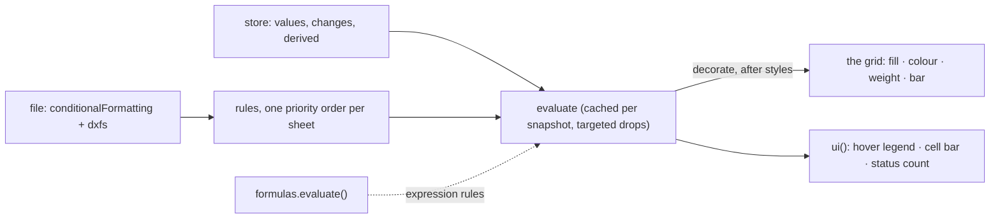

# SR-CONDFMT — @sheetpane/condfmt

## §1 — For humans

**Cells light up the way Excel lights them.** A workbook's conditional
formats — "over 1,000 in red", a colour scale, data bars, duplicates, top 10,
a formula rule — are drawn on the cells they cover, and change as the
reviewer edits. Nothing here writes a rule: it shows what the file says.

**Colour never speaks alone.** Hovering a coloured cell names the rule
("Conditional: greater than 1000 · F2:F5"); the status line counts the
file's rules and says how many are not shown.



<details>
<summary><b>ASCII twin</b> — the same diagram, for terminals and diffs</summary>

```text
   file: conditionalFormatting + dxfs --> rules (one priority order per sheet)
   store values, changes, derived ----> evaluate (cached per snapshot, targeted drops)
   formulas.evaluate() ...............> evaluate (expression rules)
   evaluate --decorate, after styles--> grid (fill, colour, weight, data bar)
   evaluate --> ui(): hover legend, cell bar, status count
```

</details>

---

## §2 — For agents

### Context

W-19 asked for conditional formatting as a second `decorate` provider after
`@sheetpane/styles` (SR-STYLES), render only; expression rules through
`@sheetpane/formulas` (SR-FORMULAS decision 8).

### Decision

1. **`condfmt()`** → `{ id: 'condfmt', provides: ['decorate'], after:
   ['styles'] }`: a rule's dxf overrides the static style per property.
   `ui()` (`condfmt-ui`) adds the legend and the count. Importing
   `@sheetpane/condfmt` registers `condfmt`; `/ui` registers `[condfmt(),
   ui()]`. Peers: `@sheetpane/grid` and `@sheetpane/styles` (`dxfCss`,
   `allowListed`, colours); no runtime dependency.
2. **Rules drawn:** `cellIs` (all eight operators), `containsText`,
   `notContainsText`, `beginsWith`, `endsWith`, `containsBlanks`,
   `notContainsBlanks`, `containsErrors`, `notContainsErrors`,
   `duplicateValues`, `uniqueValues`, `top10` (top/bottom, percent, ties
   included; percent is floor(n·rank/100), at least 1), `aboveAverage`,
   `colorScale`, `dataBar`, `expression`. **Skipped and counted:** `iconSet`
   (needs glyphs), `timePeriod`, unknown or malformed rules.
3. **Comparison** follows Excel: numbers < text < logicals, text without
   case, a blank as 0 or empty text; duplicates count text without case and
   never blanks.
4. **Priority** is one order per sheet across every block (file order breaks
   ties); a higher rule wins each property it sets and a lower one fills the
   rest; a matching `stopIfTrue` rule stops the walk; multi-area `sqref` is
   one range.
5. **Drawing:** a dxf through styles' `dxfCss` + `allowListed` (never a font
   family); a colour scale as `background-color`, 2 or 3 colours interpolated
   in sRGB with `min`, `max`, `num`, `percent`, `percentile`, `formula`
   thresholds; a data bar as a `background-image` gradient from `minLength`
   (10) to `maxLength` (90) %. A rule fill with no text colour keeps the
   static style's colour, else `fonts[0]`'s, else black. These colours are
   the file's data: the same in both themes (SR-GRID 15a); state tints and
   error rings sit above them (SR-GRID 15b).
6. **Formulas** — `expression`, formula operands, formula thresholds — run
   through the `derive` provider's synchronous `evaluate()`, shifted from the
   first range's top-left (`shiftFormula`, re-exported by the grid); without
   one they are skipped with reason `formula`. `skippedRules(store)` →
   `{ rules, shown, skipped[] }`.
7. **Live, cached:** range statistics per sheet and `sqref`, results per
   cell, keyed on the snapshot's `book`, `changes` and `derived`; a change
   drops the changed cells, every cell of a range whose statistics hold one,
   and every result that read another cell; a `#style:` change drops only its
   cell; a new workbook resets all.
8. **UI:** hovering a rule-coloured cell shows `Conditional: <the rule in
   words>` and its range (an overlay with `passThrough`); the cell bar names
   the selected cell's rules; `status`: "n conditional rules from the file"
   (· k not shown).

### Consequences

- **Enforced today:** `just test-pkg condfmt` — 44 tests (one hand-made
  fixture per rule type compared cell by cell through the plugin and a real
  `<sheetpane-excel>`; priority and `stopIfTrue`; scales and bar widths;
  expressions through the real `@sheetpane/formulas`, including a workbook
  without a formula cell; live re-evaluation counted; the order against
  styles, in both registration orders; the legend, the count and error rings
  over rule fills; L5; the package shape and the headless boundary).
  Mutation runs on the evaluator (stopIfTrue, statistics drop, volatile drop)
  each failed tests.
- **Owed:** a fixture per rule type **saved by Excel** — W-30.
- Not drawn: x14 data-bar extensions (negative colour, axis, solid fill,
  `showValue`), icon sets; a dxf's `<b val="0"/>` is lost at import.
- The hover legend reads the grid's cell elements (`data-r`, `data-c`): the
  plugin host has no per-cell hover text (backlog B-034); controls get no
  store, so the plugin keeps one per workbook from `decorate`.

### Alternatives considered

- Recomputing statistics per cell, or dropping the whole cache on any change
  — rejected for cost.
- A `title` through `decorate` — not on the allow-list; a `cell` control
  mark — its label is fixed and it would mark every coloured cell.
- Icon sets in v1 — they need glyphs.

### Reference (required)

- [`packages/condfmt/src/`](../packages/condfmt/src/) · [`packages/condfmt/test/`](../packages/condfmt/test/)
- [SR-STYLES](0110_STYLES.md) decision 8 — the helpers

### Veto condition

**Reopen this decision if:** a cell in a real-app fixture (W-30) is coloured
differently from Excel by a rule type listed as drawn, or a rule fill hides a
sheetpane mark.

**How to check it:** `just test-pkg condfmt`

---

## References

*Every source this record cites, gathered in one place. An archived document
is never listed here.*

**Records** — [SR-GRID](0105_GRID.md) · [SR-STYLES](0110_STYLES.md) · [SR-FORMULAS](0111_FORMULAS.md) · [SR-LAW-5](0007_LAW-5-host-font.md)

**Code**

- [`packages/condfmt/src/index.ts`](../packages/condfmt/src/index.ts) · [`rules.ts`](../packages/condfmt/src/rules.ts) · [`evaluate.ts`](../packages/condfmt/src/evaluate.ts) · [`ui.ts`](../packages/condfmt/src/ui.ts)

**Project docs**

- [`work/compare/plugins.compare.md`](../work/compare/plugins.compare.md) · [`work/reference/design/boards/Plugin-CondFmt.dc.html`](../work/reference/design/boards/Plugin-CondFmt.dc.html)
