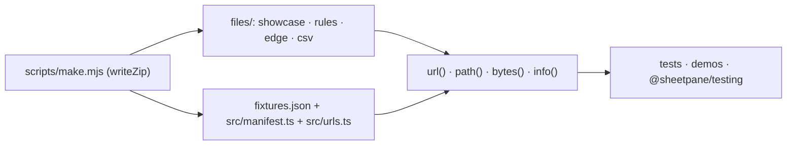

# SR-FIXTURES — @sheetpane/fixtures

## §1 — For humans

**Test files you don't have to make.** A host, a demo or a test loads a known
workbook and knows what is in it: its sheets, its titles, the features it
exercises, the errors the rules sample produces on it.



<details>
<summary><b>ASCII twin</b> — the same diagram, for terminals and diffs</summary>

```text
   scripts/make.mjs (writeZip) --> files/ (showcase, rules sample, edge cases, csv dialects)
                               --> fixtures.json, src/manifest.ts, src/urls.ts
   files + manifest --> url(), path(), bytes(), info() --> tests, demos, @sheetpane/testing
```

</details>

---

## §2 — For agents

### Context

W-42 asked for the samples scattered across `examples/` and the plugins' test
helpers to become one package any runner can load (W-32 made the showcase).

### Decision

1. **The package** has no dependencies (`@sheetpane/export` is a
   devDependency of the generator only) and ships `dist/` and `files/` —
   the one exception to SR-BUILD decision 7's `dist`-only rule, so that
   `url()` reaches the files from `src/` and `dist/` alike. `./files/*` is
   exported.
2. **The files** — `showcase.xlsx` (one sheet per plugin; its `Tables`
   sheet, W-61, holds two Excel tables — Units, and Readings with a totals
   row — and a list rule over `Units[Unit]` through the defined name
   `UnitList`), `showcase.rules.json`, `dependent-lists.xlsx` (W-60:
   Readings' Unit list is `=INDIRECT($A2)` over one defined name per
   parameter on Lists; one stale unit, `Readings!C6`), `protected.xlsx`
   (W-62: Spec and Lists protected with the password `sheetpane`, stored as
   Excel's legacy hash `CC7D`; Spec's Value, Unit and Description columns
   unlocked — their cells and their `<col style>`, so empty rows below stay
   open — Parameter and the header locked, Limit a hidden formula; Notes not
   protected; the structure locked, Archive hidden), `edge/` (empty,
   hidden sheet, non-ASCII names, merged, 1904, formula errors, a legacy
   `.xls`, not a ZIP), `csv/` (comma, semicolon, tab, BOM, quoted, formula
   guard), `compare/` (W-63: `base.xlsx` and `now.xlsx`, two versions of one
   spec workbook — a price changed, a row removed, added and moved, a sheet
   renamed, removed and added) — are written by `scripts/make.mjs`, never hand-zipped, and are the
   same byte for byte on every run (`writeZip`'s fixed timestamps). The
   250,000-row case is `hugeCsv(rows)`, not a file.
3. **The manifest** `files/fixtures.json` (and `src/manifest.ts`, generated
   beside it) lists per file its kind, `appSaved` (null for hand-built), its
   sheets with titles, its features, and for the rules sample the cells it
   fails; refused files are `kind: "refused"`.
4. **The API:** `url(name)` (one literal `new URL('../files/…',
   import.meta.url)` per file in the generated `src/urls.ts`, so every
   bundler copies each — a template string reaches no subfolder),
   `path(name)` (Node), `bytes(name)` (disk in Node, `fetch` elsewhere, typed
   without Node's types), `info(name)`, `MANIFEST`, `hugeCsv(rows)`.
5. **Used by** both demos (the gallery and the Rules file tab) and the grid's
   rules-file test; `@sheetpane/testing` (W-41) loads from here;
   `@sheetpane/validation`'s tests read `dependent-lists.xlsx` (W-60);
   the grid's, the formulas plugin's and `@sheetpane/visibility`'s
   protection tests read `protected.xlsx` (W-62). `book()` in `make.mjs`
   takes its own `styles`, a `workbookProtection` element and per-column
   formats (`colStyle`); every other file is unchanged byte for byte.
6. **The parity pair (W-54):** `test/parity.ts` names the cases — every
   manifest file (the refused two by their code) and `hugeCsv(20000)` — and
   the pane's settings for each (the rules sample, element `columns`, an
   async `validate`; plugins numfmt, validation, comments, formulas).
   `parity.test.ts` opens each in `<sheetpane-excel>` in the browser,
   `parity.node.test.ts` runs `check()` from `@sheetpane/grid/check` in Node;
   both must equal `test/golden/parity.json` (errors without `id` and
   `createdAt`, in one order), so the browser and Node agree.
   `UPDATE_GOLDEN=1` rewrites it from Node. Those four plugins and
   `@sheetpane/validation` are this package's devDependencies for it.
6a. **The static pair (W-67):** `test/static.ts` names the cases — the
   showcase, `merged`, `hidden-sheet`, `unicode-names`, `date1904` and
   `comma.csv`, with the rules sample, plugins numfmt, styles, condfmt,
   validation and comments, and one edit on the showcase (a changed and a
   stale cell) plus its Numbers sheet's later marks — results at `marks`
   (one under a rule's error), an accepted deviation, an error about the
   sheet and one about the workbook, and one in a hidden layer. `static.test.ts` opens each in `<sheetpane-excel>` (Edit,
   Chromium) and, for every sheet in both themes, compares each cell and
   header of `renderStatic()`'s table with the grid's — computed text,
   colours, weight, style, size, alignment, borders, padding, the mark's ring
   and tint, a result's glyph, colour, size and label, the changed corner,
   width and height; `static.node.test.ts`
   renders the same in Node; both equal `test/golden/static.json`.
   `@sheetpane/styles` and `@sheetpane/condfmt` are devDependencies for it.

### Consequences

- **Enforced today:** `pnpm exec vitest run --project fixtures --project
  node` — every listed file read in Chromium matches its sheets and titles;
  refused files are refused; the hidden sheet and 1904 read as listed; the
  rules sample on the showcase fails exactly the listed cells; `path()` and
  `bytes()` in Node; `hugeCsv()`; the parity pair (decision 6); the static
  pair (decision 6a). `pack-check` checks the `./files/*` folder.
- **Owed:** files saved by Excel, Google Sheets, LibreOffice and Numbers,
  with `appSaved` naming the app and version — W-30 (DoD 5). The import
  package's ExcelJS fixtures stay with their generator (ExcelJS is that
  package's devDependency).

### Alternatives considered

- Fixtures inside `dist/` only — rejected: `url()` from `src/` (the
  workspace's `source` condition) would point at nothing.
- One template `new URL(\`../files/${name}\`, import.meta.url)` — rejected:
  Vite rewrites it into a one-level glob and subfolders resolve to nothing.

### Reference (required)

- [`packages/fixtures/`](../packages/fixtures/) · [`packages/fixtures/scripts/make.mjs`](../packages/fixtures/scripts/make.mjs)

### Veto condition

**Reopen this decision if:** a listed file stops matching its manifest, or the
generator writes different bytes from the same source.

**How to check it:** `just fixtures && git diff --exit-code packages/fixtures/files`

---

## References

*Every source this record cites, gathered in one place. An archived document
is never listed here.*

**Records** — [SR-BUILD](0102_BUILD.md) · [SR-GRID](0105_GRID.md) · [SR-LAW-3](0005_LAW-3-xlsx-and-csv-only.md)

**Code**

- [`packages/fixtures/src/index.ts`](../packages/fixtures/src/index.ts) · [`packages/fixtures/scripts/make.mjs`](../packages/fixtures/scripts/make.mjs)
