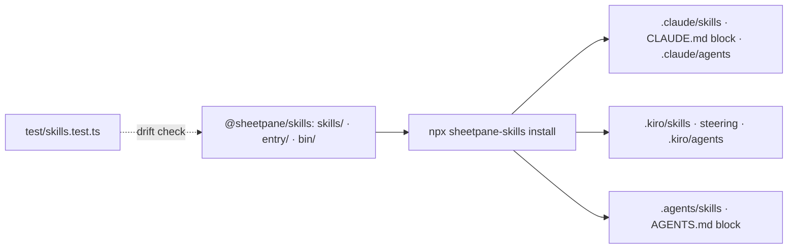

# SR-SKILLS — @sheetpane/skills

## §1 — For humans

**A host's agent knows sheetpane.** One command copies sheetpane's skills into
a repository, so Claude Code, Kiro and Codex embed, load, export, review, rule,
theme, test and extend sheetpane from the same text — each skill pointing back
to the record it summarises.



<details>
<summary><b>ASCII twin</b> — the same diagram, for terminals and diffs</summary>

```text
   @sheetpane/skills (skills/, entry/, bin/) --npx sheetpane-skills install--> .claude/, .kiro/, .agents/ (+ marked blocks)
   test/skills.test.ts checks every skill against the elements' source
```

</details>

---

## §2 — For agents

### Decision

1. **The package** ships `skills/`, `entry/`, `bin/` only, has no
   dependencies and no build, and is a `dependency` of export, import, grid
   and all eight plugins at the lockstep version — SR-BUILD decision 7's
   second exception. `@sheetpane/grid` exposes the same `sheetpane-skills`
   bin (`src/skills-bin.ts` forwards to `@sheetpane/skills/bin`), because
   package managers link only direct dependencies' bins.
2. **The skills:** 25 folders `skills/<name>/SKILL.md` — 23 for hosts, two
   for contributors (`sheetpane-file-work-item`, `sheetpane-records`), and the
   router `sheetpane`. Frontmatter is the subset all three tools read: `name`
   (= folder), `description` (≤ 250 characters, saying when to use it **and
   when not**; unquoted, it never holds `: ` or ` #`, which break YAML and make
   Claude Code drop every key), optional `license` and `metadata`
   (`audience`). No `argument-hint`: claude.ai and the Skills API refuse it. A `SKILL.md`
   is ≤ 200 lines. A skill links to its records on GitHub (so the links work
   once installed elsewhere) and never restates a rule as its own
   (SR-LAW-0).
2a. **Commands (W-45):** every skill is a command in all three tools (`/name`
    in Claude Code and Kiro, `$name` in Codex), the typed text reaching it
    (`$ARGUMENTS` where filled). Three are written as commands:
    `sheetpane-embed [framework]`, and two thin routers — `sheetpane-rules
    [path]` → `sheetpane-rules-file`, `sheetpane-test [runner]` →
    `sheetpane-testing`. Nothing was renamed.
3. **Entry files:** `entry/claude.md` and `entry/agents.md` — a ≤ 30-line
   block between `<!-- sheetpane:start -->` / `<!-- sheetpane:end -->`;
   `entry/kiro-steering.md` (`inclusion: fileMatch`); `entry/claude-agent.md`
   and `entry/kiro-agent.json` (a `sheetpane-integrator`, the Kiro one listing
   the skills as `skill://` resources).
4. **The installer** `bin/sheetpane-skills.mjs` (Node ≥ 20, no dependencies,
   no `postinstall`): `install` / `uninstall`, `--claude --kiro --codex
   --all`, `--skip` / `--only` (groups or skills), `--skills-only`,
   `--no-mcp`, `--dry-run`, `--force`, `--cwd`. With no tool flag it installs
   for the tools whose folders exist. It edits only the marked blocks of
   `CLAUDE.md` and `AGENTS.md`, refuses to overwrite a file changed since it
   wrote it unless `--force`, and records every path in
   `.sheetpane-skills.json` so `uninstall` removes exactly those.
4a. **The MCP server entry (W-39, SR-MCP decision 8):** unless `--no-mcp` or
   `--skills-only`, install also registers `@sheetpane/mcp` (`npx -y
   @sheetpane/mcp`) — the `sheetpane` key of `mcpServers` in `.mcp.json`
   (Claude Code) and `.kiro/settings/mcp.json` (Kiro), every other key kept;
   a `# sheetpane:start` … `# sheetpane:end` block holding
   `[mcp_servers.sheetpane]` in `.codex/config.toml` (Codex). A config that is
   not a JSON object, an entry edited since install, or a
   `[mcp_servers.sheetpane]` outside the block is refused without `--force`;
   `uninstall` removes the entry, and the file only when install created it
   and nothing else is left.
4b. **`sheetpane-skills check-rules <file…>` (W-45):** the rules file's
    document checks of the grid's `checkDocument` (SP-6010…SP-6021, the same
    codes and messages, re-implemented in the dependency-free bin; a test keeps
    the two equal on 19 documents), one line per problem; exit 0 clean, 1 a
    problem, 2 usage or an unreadable file. `--hook claude | codex | kiro`
    reads the edited path (Claude's `tool_input.file_path`, Codex's
    `apply_patch` text, Kiro's `{{filePath}}`), ignores all but
    `*.rules.json`, and on a problem writes stderr and exits 2 so the agent
    sees it.
4c. **Hooks (W-45):** `install` writes, unless `--no-hooks` or
    `--skills-only`: a `PostToolUse` group (`Edit|Write|MultiEdit`) in
    `.claude/settings.json`; `.codex/hooks.json` (`PostToolUse` on
    `apply_patch` — Codex runs it once the user trusts it in `/hooks`, so the
    `AGENTS.md` block also says to run the check); `.kiro/hooks/sheetpane-rules.json`
    (`PostFileSave`, `\.rules\.json$`). A JSON group is ours by its exact
    command, recorded like decision 4a's MCP entry (refused if hand-edited
    without `--force`; every other key kept; the file removed only when install
    made it and nothing else is left).
4d. **The Claude Code plugin (W-45):** `scripts/build-plugin.mjs` (`just
    plugin`) generates `plugins/sheetpane/` — the host skills, the integrator
    subagent, `.mcp.json` (`@sheetpane/mcp`), `hooks/hooks.json` running a
    bundled copy of the bin — and `.claude-plugin/marketplace.json`; a
    freshness test fails on any stale or extra file. `claude plugin validate
    --strict` passes on both. Install: `/plugin marketplace add
    arpitarya/sheetpane`, then `/plugin install sheetpane@sheetpane`. Formats
    as documented on 2026-10-18 (Claude Code skills, hooks, plugins; Kiro
    hooks 2026-10-10; Codex hooks).
5. **The drift check** (`test/skills.test.ts`) reads every skill and fails on
   a frontmatter key outside the subset, a `name` ≠ folder, a description over
   250 characters or without its "not for", a `SKILL.md` over 200 lines, a
   link that does not resolve, or an event, element attribute or member that
   the elements' source does not have (derived from `observedAttributes`, the
   classes' members and the events the packages fire).
6. **Dogfood:** this repository installs its two contributor skills for all
   three tools (`--only contributor --skills-only`); its own `CLAUDE.md` is
   governed by SR-WORK-DOCS and is not written by the installer.

### Consequences

- **Enforced today:** `test/skills.test.ts` — the drift check per skill and
  the installer in temp repositories (each tool and all, re-run no-op,
  hand-edit refused without `--force`, the block replaced with the text
  outside kept, uninstall restoring the repo, `--dry-run`, `--skip
  contributor`, Windows paths); `test/packages.test.ts` (the package shape
  and its font scan of `skills/`, `entry/`, `bin/`); `pack-check`.
- **Owed:** one real prompt per tool from the packed tarballs — W-48, the
  decider's (split from W-35 DoD 8; it did not block W-35). Skill 18 (`sheetpane-frameworks`) was written with
  W-37's typings; `sheetpane-react` points at `@sheetpane/grid/jsx`.

### Alternatives considered

- A `postinstall` that writes skills — rejected: pnpm blocks lifecycle
  scripts by default, and writing into a repository unasked is wrong.
- Reading skills from `node_modules` — none of the three tools does.
- Relative record links — rejected: they break once the skills sit in
  another repository.

### Reference (required)

- [`packages/skills/`](../packages/skills/) · [`test/skills.test.ts`](../test/skills.test.ts)

### Veto condition

**Reopen this decision if:** a skill names an API the elements do not have, or
`uninstall` leaves a file `install` wrote.

**How to check it:** `pnpm exec vitest run --project repo test/skills.test.ts`

---

## References

*Every source this record cites, gathered in one place. An archived document
is never listed here.*

**Records** — [SR-LAW-0](0002_LAW-0-authority.md) · [SR-BUILD](0102_BUILD.md) · [SR-GRID](0105_GRID.md) · [SR-WORK-DOCS](0055_WORK-docs.md)

**Code**

- [`packages/skills/bin/sheetpane-skills.mjs`](../packages/skills/bin/sheetpane-skills.mjs) · [`packages/grid/src/skills-bin.ts`](../packages/grid/src/skills-bin.ts)
