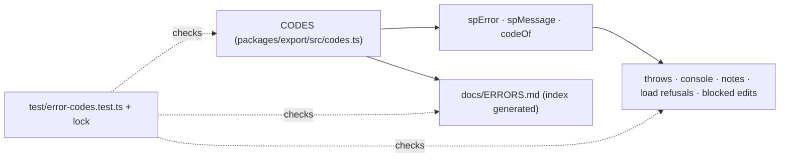

# SR-CODES — stable error codes

## §1 — For humans

**An error you can look up.** `SP-3012: header row 2 not found — …/ERRORS.md#sp-3012`
tells a host — or an agent — what happened and where the fix is. Codes are
permanent: a code is never reused or renumbered.



<details>
<summary><b>ASCII twin</b> — the same diagram, for terminals and diffs</summary>

```text
   CODES (export/src/codes.ts) --> spError, spMessage, codeOf --> throws, console, notes, load refusals, blocked edits
   CODES --> docs/ERRORS.md (index generated)
   test/error-codes.test.ts + error-codes.lock.json check all three
```

</details>

---

## §2 — For agents

### Decision

1. **Every message sheetpane shows a host carries `SP-` and four digits:**
   thrown errors, `console.warn` / `console.error`, rules-engine `note`
   errors, refused loads, event details that carry a reason.
2. **Ranges:** 1xxx import · 2xxx export (21xx `download()`) · 3xxx grid
   (SP-3020, W-54: `check()` given something other than bytes) ·
   4xxx `<sheetpane-errors>` · 5xxx plugins (5100 numfmt, 5200 formulas,
   5300 styles, 5400 validation, 5500 condfmt, 5600 images, 5700 charts,
   5800 comments, 5900 compare — W-63: SP-5901, a per-sheet key that is
   not a column) · 6xxx column rules and the rules file · 7xxx mcp
   (W-39: SP-7001…7007, the MCP server's tool errors — SR-MCP decision 7;
   `@sheetpane/mcp` also reports the 60xx rules notes `check_rules` finds).
3. **Never reuse:** a code is never renumbered or removed; a dead one stays in
   `CODES` with `retired: true`; `test/error-codes.lock.json` is append-only.
4. **The registry** is `CODES` in `packages/export/src/codes.ts` (the leaf
   every package depends on): titles and severity only — the long text lives
   in the docs. Plugins read it through `@sheetpane/grid`'s re-export.
5. **One helper:** `spMessage(code, detail)` →
   `SP-xxxx: <title> — <detail> (<docs>#sp-xxxx)`; `spError` builds an Error
   carrying `code`, `spCode`, `spDetail`; `codeOf(x)`, `detailOf(x)`,
   `codeUrl(code)`.
6. **Where the code lives:** `spCode` on every thrown error; where `code` was
   free it is the SP code (plain errors, `SheetpaneError.code`, the
   `sheetpane-editcancel` detail); where `code` is already a typed reason
   (`ExportError`, `ImportError`, `LoadState`) it stays and `spCode` sits
   beside it. Messages keep their old text after the code.
7. **`docs/ERRORS.md`:** one entry per code (`### SP-xxxx`): meaning, likely
   cause, fix, the record it comes from; its index is generated from `CODES`
   and compared by the test (`SP_WRITE_ERRORS_DOC=1` rewrites it).

### Consequences

- **Enforced today:** `test/error-codes.test.ts` (87) scans `packages/*/src`
  for a throw (outside a three-line, reasoned allow-list), a console line not
  built by `spMessage`, or a rules note without a code; checks ranges, the
  lock, a docs entry per code and none without one, and the index. 73 codes at
  W-40. Later codes are appended to the lock in the order they were issued,
  not by number. Example: SP-5804, from W-55, comes after SP-7007, and
  SP-3016 and SP-3017, from W-68 (a dropped error `meta`, a throwing
  `renderDetail`), come after SP-5804, and SP-3018, from W-69 (an acceptance
  refused), after them.
- **W-65** added SP-1009 (warning): no SHA-256 where Web Crypto is missing —
  the file's fingerprint is `undefined`, never a substitute (SR-IMPORT
  decision 11).
- **W-57** added SP-2015 (error, `bad-rule`): a data-validation rule,
  conditional format or differential format `toXlsx` / `patchXlsx` cannot
  write as Excel reads it (SR-EXPORT decision 6).
- **W-66** added SP-3019 (warning): the `ref` attribute or a `#sheetpane=`
  link names no cell (SR-GRID decision 11d).
- **W-58** added SP-5401 – SP-5407 (warnings), the first 5400 codes: the
  host's rules written into the download as Excel's own — a check Excel
  cannot hold, two checks in one rule, a list it cannot type out, a bound it
  cannot read, a missing column or sheet, cells that keep their own rule,
  and a sheet whose rules could not be rewritten (SR-VALIDATION decision 10).
- **W-54** added SP-3020 (error, `TypeError`): `check()` from
  `@sheetpane/grid/check` given something other than a file's bytes (SR-GRID
  decision 22f). Issued as SP-3016 in its lane; renumbered at the merge, as
  W-68 had taken SP-3016.
- Hosts that matched message text keep working; they should move to `spCode`
  / `codeOf()`.
- Consumers: the troubleshoot skill (W-35) and the MCP `explain_code` tool
  (W-39) read `CODES`.

### Alternatives considered

- Replacing `.code` with the SP code — rejected: it breaks the typed reasons
  the grid, hosts and tests read.
- A generator script under `scripts/` — rejected: the test renders and
  compares the index.
- A code per throw site for `ExportError` / `ImportError` — not yet: one code
  per typed reason, the docs list each reason's causes; finer codes can be
  added without reusing any.

### Reference (required)

- [`packages/export/src/codes.ts`](../packages/export/src/codes.ts) · [`docs/ERRORS.md`](../docs/ERRORS.md) · [`test/error-codes.test.ts`](../test/error-codes.test.ts)

### Veto condition

**Reopen this decision if:** a code is reused or renumbered, or a message
reaches a host without one.

**How to check it:** `pnpm exec vitest run --project repo test/error-codes.test.ts`

---

## References

*Every source this record cites, gathered in one place. An archived document
is never listed here.*

**Records** — [SR-EXPORT](0103_EXPORT.md) · [SR-IMPORT](0104_IMPORT.md) · [SR-GRID](0105_GRID.md) · [SR-ERRORS](0106_ERRORS.md)

**Code**

- [`packages/export/src/codes.ts`](../packages/export/src/codes.ts) · [`test/error-codes.test.ts`](../test/error-codes.test.ts) · [`test/error-codes.lock.json`](../test/error-codes.lock.json)

**Project docs**

- [`docs/ERRORS.md`](../docs/ERRORS.md)
