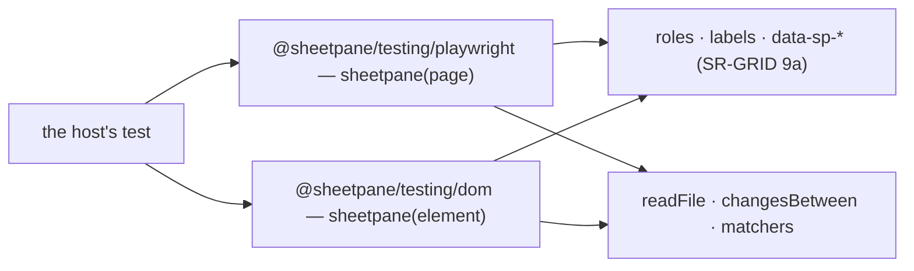

# SR-TESTING — @sheetpane/testing

## §1 — For humans

**A host's tests read like what a reviewer does:** `await sp.edit('B2', '42');
expect(await sp.readDownload()).toHaveCell('Sheet1!B2', 42)` — in Playwright and
in Vitest browser mode, through the hooks the grid promises to keep.



<details>
<summary><b>ASCII twin</b> — the same diagram, for terminals and diffs</summary>

```text
   host test --> sheetpane(page) [Playwright] | sheetpane(element) [Vitest browser]
             --> only roles, labels and data-sp-* hooks (SR-GRID 9a)
             --> readFile, changesBetween, valueAt, matchers (toHaveCell, toHaveError)
```

</details>

---

## §2 — For agents

### Decision

1. **The package** has three entries: `.` (`readFile`, `changesBetween`,
   `valueAt`, `matchers`, the driver types), `./playwright` (`sheetpane(page,
   { excel?, errors? })`) and `./dom` (`sheetpane(element, { errors? })`).
   Dependencies `@sheetpane/export`, `@sheetpane/import`, `@sheetpane/skills`;
   `@playwright/test` and `vitest` are optional peers — Playwright's Page and
   Locator are typed structurally, never imported.
2. **One API** for both drivers: `waitForLoad`, `ref`, `select`, `edit`,
   `paste`, `flag`, `resolve`, `undo`, `switchSheet`, `download`,
   `readDownload`, `errors`, `value`, `text`. A cell is `B3`, `Sheet1!B3` or
   `{ column, row, sheet? }` (the title read from the element's
   `header-row`).
3. **Only committed hooks:** roles, labels and SR-GRID decision 9a's
   `data-sp-*` attributes — never CSS classes. A hook the helpers need is
   added to that list first.
4. **Acting as a person:** clicks, the cell bar, a paste event, the Download
   button (Playwright's download event; in the DOM driver `sheetpane-export`
   is captured and the browser's save prevented); `flag` fills the form where
   it opens (SR-GRID decision 13) and waits for it to close.
5. **Reading back:** `readFile` uses `@sheetpane/import` where a DOM exists
   and, in Node, a values-only reader over `@sheetpane/export`'s ZIP reader
   (shared strings, inline strings, numbers, booleans, errors) — the import
   package needs `DOMParser` for `.xlsx` (SP-1008).
6. **Dogfood:** `scripts/demo-check.mjs` drives the review steps (load, flag,
   resolve, edit, Download read back) with these helpers.

### Consequences

- **Enforced today:** `--project testing` (the DOM driver, every helper, in
  Chromium; Firefox and WebKit nightly) and `--project node` (the Playwright
  driver against the HTML demo; the Node reader on `@sheetpane/fixtures`'
  showcase); `demo-check`.
- **Owed:** each starter template ships one test using these (W-43).

### Alternatives considered

- Requiring a DOM shim in Node to read `.xlsx` — rejected: a values-only
  reader is small and needs no dependency.
- Locating by CSS classes — rejected: restyling would break every host's tests.

### Reference (required)

- [`packages/testing/`](../packages/testing/)

### Veto condition

**Reopen this decision if:** a helper needs a CSS class, or a hook in SR-GRID 9a
changes name without a major version.

**How to check it:** `pnpm exec vitest run --project testing --project node`

---

## References

*Every source this record cites, gathered in one place. An archived document
is never listed here.*

**Records** — [SR-GRID](0105_GRID.md) · [SR-ERRORS](0106_ERRORS.md) · [SR-FIXTURES](0115_FIXTURES.md) · [SR-CODES](0117_CODES.md)

**Code**

- [`packages/testing/src/playwright.ts`](../packages/testing/src/playwright.ts) · [`dom.ts`](../packages/testing/src/dom.ts) · [`read.ts`](../packages/testing/src/read.ts)
