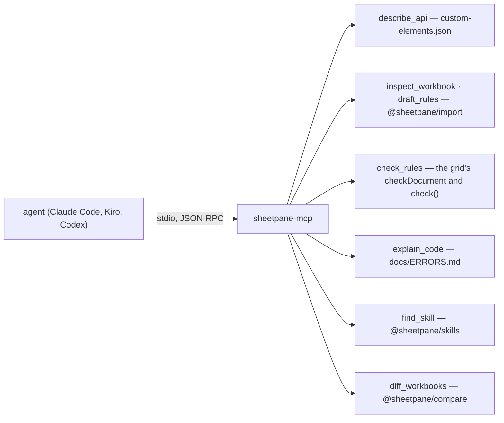

# SR-MCP — @sheetpane/mcp

## §1 — For humans

**An agent asks; sheetpane answers from what ships.** `npx @sheetpane/mcp`
starts a server any MCP client can use. Every answer is computed — from the
custom-elements manifest, the import package, the grid's own checks, the
error docs and the skills — never generated, so the same question always gets
the same answer.



<details>
<summary><b>ASCII twin</b> — the same diagram, for terminals and diffs</summary>

```text
   agent --(stdio, JSON-RPC, MCP 2026-07-28)--> sheetpane-mcp
       describe_api      <- custom-elements.json (W-37)
       inspect_workbook  <- @sheetpane/import (reads .xlsx in Node)
       draft_rules       <- @sheetpane/import
       check_rules       <- @sheetpane/grid/check: checkDocument, check()
       explain_code      <- docs/ERRORS.md
       find_skill        <- @sheetpane/skills descriptions
       diff_workbooks    <- @sheetpane/compare diffWorkbooks (W-63)
```

</details>

---

## §2 — For agents

### Context

Agents writing host code guessed attribute and event names, and could not
see inside a workbook or a rules file before wiring them. W-39 gives them a
server to ask.

### Decision

1. **The package** `@sheetpane/mcp`, bin `sheetpane-mcp`, Node ≥ 20. Runtime
   dependencies `@sheetpane/import`, `@sheetpane/grid` (its DOM-free
   `@sheetpane/grid/check` entry: the rules checker, the pane's `check()` and
   the code registry — SR-GRID decision 22f), `@sheetpane/compare` (its
   headless root) and `@sheetpane/skills`; nothing else. Its build copies `docs/ERRORS.md`, the grid's `custom-elements.json`
   and a plugin table (from each plugin's `package.json`) into `dist/`.
2. **Hand-written protocol, no SDK** (`work/compare/mcp-server.compare.md`):
   JSON-RPC 2.0 over stdio, one message per line; stdout carries protocol
   messages only. **Tools only** — no resources, prompts, sampling, roots or
   logging.
3. **Revision 2026-07-28, stateless:** no handshake is needed; a request's
   `_meta["io.modelcontextprotocol/protocolVersion"]` names the revision;
   `server/discover` returns `supportedVersions` and `capabilities`; every
   result carries `resultType: "complete"` and
   `_meta["io.modelcontextprotocol/serverInfo"]`; `tools/list` is cacheable
   (`ttlMs`, `cacheScope: "public"`) and lists the tools in one fixed order.
   A version the server does not support → error −32022 with
   `{ supported, requested }`.
4. **Older clients:** `initialize` (2025-11-25 and 2025-06-18) is answered
   with that revision, and a request without the version `_meta` is answered
   the 2025 way (no `resultType`, no cache fields). JSON-RPC batches (removed
   in 2025-06-18) are an invalid request; a notification gets no reply.
5. **The tools**, each input schema JSON Schema 2020-12, `additionalProperties:
   false`:
   - `describe_api(name)` — an element, attribute, member, event (with or
     without `on`), `--sp-*` property, slot, part or plugin → its manifest
     entry (which carries the TSDoc) and its record link — an element before
     a same-named event (`sheetpane-errors` is both), a member's own `kind`
     kept as `memberKind`; near names when nothing matches (a name holding
     the ask, or a name of four letters or more the ask holds).
   - `inspect_workbook(path)` — sheets, rows × columns, dimension, the
     header-row guess (the first of the top ten rows whose two or more filled
     cells are all text), titles, each column's type (text, number, integer,
     date — by its number format — boolean, mixed, empty), blanks, up to 12
     distinct values, merges, freeze, counts of formulas, validations,
     conditional formats, pictures, charts and notes, and the plugins the file
     would use (`@sheetpane/tables` when a sheet holds an Excel table, W-61).
   - `draft_rules(path, sheet?)` — a W-33 rules file: per titled column
     `required` when it has no blanks, its type, `oneOf` for a text column of
     2–12 distinct values; `draft: true` and a note to review it; problems
     (no title, duplicate title, mixed types) listed.
   - `check_rules(rules, path?)` — the grid's `checkDocument` (the same 60xx
     notes the grid gives), each rule in words (`describeRule`); with a
     workbook, the pane's own `check()` over it (W-54 — no third copy): its
     workbook notes as problems (SP-6022 a sheet it lacks, SP-6023 a title no
     header row has, SP-6024 a duplicated title a rule names — each on the
     sheet and cell the grid puts it) and the cells that fail as `findings`
     (`sheet`, `range`, `type`, `severity`, `found`, `expected`, `message`;
     the first 50, in `check()`'s order) with `findingCount`; `ok` speaks of
     the rules file only.
   - `explain_code(code)` — title and severity from the registry; meaning,
     cause and fix from `docs/ERRORS.md`; the link.
   - `find_skill(task)` — words of the task against each skill's name (×3)
     and description, the "Not for …" clause left out; the top three.
   - `diff_workbooks(base, path, key?, headerRow?, limit?)` — SR-COMPARE's
     `diffWorkbooks` on two files: the summary and its line, then per sheet
     that is not the same its status, names, rename likeness, key, counts,
     columns, rows (1-based: added, removed, changed, moved from → to),
     cells (`was` / `now`), merges, hidden and rule counts — at most `limit`
     (default 200) rows of each kind and cells per sheet, with a `truncated`
     note; the key is for every sheet, so a sheet without it is aligned
     unkeyed and says so in a `note`. Listed last. A coded error a package
     throws reaches the agent with its code first, as a ToolError does.
6. **Read-only and bounded:** paths come from the agent and are only read;
   `.xlsx` and `.csv` only (SR-LAW-3, the import package refuses the rest);
   256 MB at most; no network, no writes.
7. **Errors:** a bad input is a tool result with `isError: true`, its text an
   SP code first — the reader's own (SP-10xx) or the server's SP-7001…7007 —
   never a crash; an unknown tool is −32602, an unknown method −32601.
8. **Registration:** `sheetpane-skills install` (SR-SKILLS) adds the server
   — `{ "command": "npx", "args": ["-y", "@sheetpane/mcp"] }` — under the
   `sheetpane` key of `.mcp.json` (Claude Code) and
   `.kiro/settings/mcp.json` (Kiro), and as a marked
   `[mcp_servers.sheetpane]` block in `.codex/config.toml` (Codex, trusted
   projects); `--no-mcp` leaves it out.

### Consequences

- **Enforced today:** `packages/mcp/test/mcp.node.test.ts` (`--project
  node`) — the protocol over a spawned server (discover, legacy initialize,
  list, call, every error), the schemas, golden outputs per tool on the
  showcase and the rules sample (`UPDATE_GOLDEN=1` rewrites them), bad input
  as tool errors; `test/skills.test.ts` for the registration; the error-code
  registry for 7xxx.
- **Goldens follow the manifest:** `describe-onchange.json` was rewritten
  (2026-10-19, W-52) when `sheetpane-change` gained `op`, `at` and `count`
  for an insert or delete — `describe_api` reads the element manifest, so a
  changed event contract changes its answer; no code here changed.
- **Not done:** a run against the MCP Inspector — it is an interactive tool;
  the spawned-server test stands in for it.

### Alternatives considered

- The official TypeScript SDK — rejected for now: several runtime
  dependencies for a server with six read-only tools; see the compare doc.
- Resources for the docs and records — rejected: tools answer a question;
  a resource dump is what `llms-full.txt` already is.

### Reference (required)

- [`packages/mcp/`](../packages/mcp/) · [MCP 2026-07-28 schema](https://github.com/modelcontextprotocol/modelcontextprotocol/blob/main/schema/2026-07-28/schema.ts)

### Veto condition

**Reopen this decision if:** a second transport (HTTP) or resources/prompts
are wanted, or the 2026-07-28 revision changes what a stateless request must
carry.

**How to check it:** `pnpm exec vitest run --project node packages/mcp`

---

## References

*Every source this record cites, gathered in one place. An archived document
is never listed here.*

**Records** — [SR-IMPORT](0104_IMPORT.md) · [SR-GRID](0105_GRID.md) · [SR-SKILLS](0116_SKILLS.md) · [SR-CODES](0117_CODES.md)

**Code**

- [`packages/mcp/src/protocol.ts`](../packages/mcp/src/protocol.ts) · [`tools.ts`](../packages/mcp/src/tools.ts) · [`api.ts`](../packages/mcp/src/api.ts) · [`bin.ts`](../packages/mcp/src/bin.ts)

**External**

- [MCP specification 2026-07-28](https://modelcontextprotocol.io/specification/2026-07-28) · [Kiro MCP configuration](https://kiro.dev/docs/mcp/configuration/) · [Codex MCP](https://developers.openai.com/codex/mcp)
