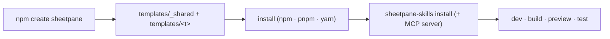

# SR-CREATE — create-sheetpane

## §1 — For humans

**One command, a running app that is tested and agent-ready:** `npm create
sheetpane@latest` asks for a folder, a framework, the skills and the MCP
server, and writes an app that shows a sheet and its errors panel, loads a
sample workbook with a rules file, and has one test that passes.



<details>
<summary><b>ASCII twin</b> — the same diagram, for terminals and diffs</summary>

```text
   npm create sheetpane -> copy _shared + <template>, fill placeholders
       -> install -> sheetpane-skills install [--skip contributor] [--no-mcp]
       -> dev / build / preview / test (Playwright on @sheetpane/testing)
```

</details>

---

## §2 — For agents

### Decision

1. **The package** is unscoped `create-sheetpane` — `npm create <name>` runs
   `create-<name>` — the one package outside `@sheetpane/` (SR-BUILD decision
   7's exception). It ships `bin/` and `templates/`, has no dependencies, no
   build and no `postinstall`, and moves in lockstep with the rest.
2. **The CLI** (`bin/create-sheetpane.mjs`, Node ≥ 20): a folder, `--template`
   (`vanilla` · `react` · `next` · `vue` · `angular` · `svelte`), `--skills
   all | host | none`, `--mcp` / `--no-mcp`, `--pm npm | pnpm | yarn` (default:
   the one that ran it), `--no-install`, `--yes`. It asks only at a terminal.
   It refuses a non-empty folder, writes nothing outside it, renames
   `_gitignore`, fills `__SHEETPANE_<KEY>__` placeholders — the version from
   its own `package.json` — then installs and runs `sheetpane-skills install
   --all` (`--skip contributor` for `host`, `--no-mcp` when asked).
3. **Every template is the same app:** `<sheetpane-excel>` (Edit) and
   `<sheetpane-errors>` on one `pane`, side by side; the sheet again behind a
   pop-up button (`display="popup"`); `showcase.xlsx` and its rules file
   copied from `@sheetpane/fixtures` into `public/` by `scripts/sample.mjs`
   before dev and build; one Playwright test on `@sheetpane/testing` (load, a
   rules finding, an edit read back from the download); the W-37 typings
   (`/jsx` for React and Next, `/vue`, `/svelte`); Angular through
   `CUSTOM_ELEMENTS_SCHEMA`; Next.js client-only (`next/dynamic`, `ssr:
   false`); a README pointing at the skills and the MCP server. No font
   (SR-LAW-5).
4. **Versions:** frameworks pinned exactly to what `create-check` built and
   tested; TypeScript 6.0.3 in the templates (Angular 22 and svelte-check
   need < 6.1). Every dependency is free and open source (SR-LAW-2).
5. **The check** (`scripts/create-check.mjs`, `just create-check [templates]`,
   and a CI job over the six): packs every package, runs the CLI from its own
   tarball, points `@sheetpane/*` at the tarballs, installs, runs the skills
   installer (and checks it wrote the skills, `.mcp.json` and `AGENTS.md`),
   builds and runs the template's test. A template that cannot pass is
   dropped, never shipped broken.

### Consequences

- **Enforced today:** `test/create.test.ts` (27: every template scaffolded
  with `--yes --no-install`, placeholders filled, the refusals, the install
  and skills commands per package manager with a stubbed runner);
  `create-check` per template in CI; `pack-check`.
- **Known:** Angular 22 needs Node ^22.22.3 or ^24.15.0 — the template's
  `engines`, a CLI note and its README say so.
- **Owed:** StackBlitz links per template (W-44 DoD 2).

### Alternatives considered

- `@sheetpane/create` (`npm create @sheetpane`) — kept as the fallback name;
  the unscoped one is the shorter command.
- Downloading templates from the repository at run time — rejected: the
  templates ship in the tarball, so the version matches and nothing is
  fetched but the install.

### Reference (required)

- [`packages/create-sheetpane/`](../packages/create-sheetpane/) · [`scripts/create-check.mjs`](../scripts/create-check.mjs)

### Veto condition

**Reopen this decision if:** a template fails `create-check` on a framework
release and cannot be fixed by a version bump, or a host needs a template the
six do not cover.

**How to check it:** `just create-check`

---

## References

*Every source this record cites, gathered in one place. An archived document
is never listed here.*

**Records** — [SR-BUILD](0102_BUILD.md) · [SR-SKILLS](0116_SKILLS.md) · [SR-MCP](0119_MCP.md) · [SR-TESTING](0118_TESTING.md) · [SR-FIXTURES](0115_FIXTURES.md)

**Code**

- [`packages/create-sheetpane/bin/create-sheetpane.mjs`](../packages/create-sheetpane/bin/create-sheetpane.mjs) · [`scripts/create-check.mjs`](../scripts/create-check.mjs)
