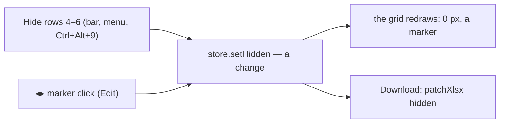

# SR-VISIBILITY — @sheetpane/visibility

## §1 — For humans

**Seeing is core; changing is the plugin.** Without this plugin the grid
still hides what the file hides, marks every place, and lets a reviewer show
it for viewing. With it, in Edit, an editor can hide and unhide rows,
columns and sheets and group outlines — counted, undoable, and in the
download.



<details>
<summary><b>ASCII twin</b> — the same diagram, for terminals and diffs</summary>

```text
   Hide / Unhide / Group (selection bar, cell + header + tab menus, keys, marker click)
       -> store.setHidden / setSheetState / setOutline (changes, undoable)
       -> the grid redraws (SR-GRID 21c)  -> the download carries it (SR-EXPORT hidden)
```

</details>

---

## §2 — For agents

### Decision

1. **The package:** `@sheetpane/visibility` — `visibility()` (headless, `id:
   'visibility'`, no hook: its presence lets a marker click unhide in Edit)
   and the actions `setSpanHidden`, `setSheetHidden`, `hiddenIn`,
   `canHideSheet`, `spanOf`, `blockedReason`, `sheetBlockedReason` (W-62); `@sheetpane/visibility/ui`
   adds the controls (`id: 'visibility-ui'`) and registers `visibility` for
   the `plugins` attribute. `@sheetpane/grid` is a peer; `@sheetpane/export`
   a dependency. No seventh hook: the core API (SR-GRID 21c) does the work.
2. **Controls** (all `selbar`, Edit, labels that follow the selection — "Hide
   rows 4–6", "Unhide columns C–E"): Hide rows (Ctrl/⌘+Alt+9), Hide columns
   (Ctrl/⌘+Alt+0), Unhide rows (Ctrl/⌘+Shift+9), Unhide columns
   (Ctrl/⌘+Shift+0) — in the cell and header menus (`menus`, SR-GRID 19);
   Group / Ungroup (Alt+Shift+→ / ←; whole columns selected → columns, else
   rows) — in the header menu; Hide sheet — in the tab menu. Keys are Google
   Sheets' (Excel's Ctrl+9 / Ctrl+0 are the browser's), digits matched on
   `e.code`.
3. **Rules:** Unhide needs a selection across the hidden span (as in Excel);
   the last visible sheet cannot be hidden ("A workbook needs one visible
   sheet"); Hide sheet writes `hidden`, never `veryHidden`, and moves to the
   next visible sheet; a CSV stores no hidden state, so every control is
   disabled there with the reason ("CSV can't store hidden rows"). **A
   protected structure (W-62):** while the file's `<workbookProtection
   lockStructure="1">` is honoured (SR-GRID 21d, `structureLockedIn`),
   Hide sheet is disabled with "Locked in the file — the workbook's
   structure is protected" (`sheetBlockedReason`) and `setSheetHidden`
   returns `false`; the store refuses `setSheetState` itself, and the core
   banner's *Unhide* is disabled with the same reason. `protection="ignore"`
   opens them. Rows and columns are not covered by the structure lock.
4. **Changes:** hiding is one change per sheet and axis (`hidden`), a sheet's
   state one (`sheetState`), outline levels one per axis (`outline`) —
   counted, undoable, exported (SR-GRID 21c, SR-EXPORT `hidden`).

### Consequences

- **Enforced today:** `packages/visibility/test/visibility.test.ts` (Chromium):
  the bar's label and its run, ⌘⌥9 matched on `e.code`, one change and undo;
  Unhide disabled until a range crosses the gap; a marker click unhides in
  Edit; the header menu's Hide and Group; the tab menu's Hide sheet and the
  last-sheet rule; CSV disabled; a protected structure (W-62, on
  `protected.xlsx`) — Hide sheet and the banner's Unhide disabled with the
  reason, `setSheetHidden` refused, both open again under
  `protection="ignore"`. The demos' gallery tab "Hide and show" and
  its `demo-check` step.
- **Not done:** opening a download in Excel and LibreOffice (W-30's real-app
  files).

### Alternatives considered

- A seventh plugin hook to change geometry — rejected: hiding changes which
  cells exist on screen; core owns geometry, as for merges and freeze panes.

### Reference (required)

- [`packages/visibility/`](../packages/visibility/)

### Veto condition

**Reopen this decision if:** editors expect a collapse of an outline group to
be saved, or a host needs hiding without the plugin's controls.

**How to check it:** `pnpm exec vitest run --project visibility`

---

## References

*Every source this record cites, gathered in one place. An archived document
is never listed here.*

**Records** — [SR-GRID](0105_GRID.md) · [SR-EXPORT](0103_EXPORT.md) · [SR-IMPORT](0104_IMPORT.md)

**Code**

- [`packages/visibility/src/index.ts`](../packages/visibility/src/index.ts) · [`ui.ts`](../packages/visibility/src/ui.ts)
