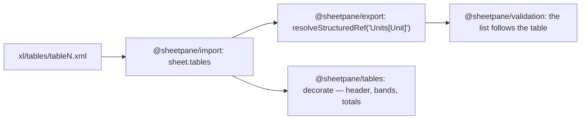

# SR-TABLES — @sheetpane/tables

## §1 — For humans

**A table looks like a table.** Excel's tables (*Insert › Table*) carry a
style: a coloured header row, banded rows, a totals row. The reader already
knows every table by name (SR-IMPORT decision 11) and a dropdown over a table
column already follows it (SR-VALIDATION decision 3); this plugin draws them.



<details>
<summary><b>ASCII twin</b> — the same diagram, for terminals and diffs</summary>

```text
   xl/tables/tableN.xml -> import: sheet.tables
        -> export: resolveStructuredRef('Units[Unit]') -> validation: list sources
        -> tables: decorate (header row, bands, first/last column, totals row)
```

</details>

---

## §2 — For agents

### Decision

1. **The package:** `@sheetpane/tables` — `tables()` (`id: 'tables'`,
   `provides: ['decorate']`), registered as `tables` on import; the helpers
   `tableAt(sheet, row, col)`, `findTable(book, name)` (case-insensitive),
   `tableCss(table, row, col, theme)`, `paletteOf(style, theme)`, `tint`,
   `TABLE_STYLES`. Draw-only: no control, no change kind, no `exportPatch` —
   a download keeps the file's table parts untouched (`patchXlsx` copies
   every part it does not rewrite, SR-EXPORT). `@sheetpane/grid` is a peer;
   `@sheetpane/export` (`parseRange`) a dependency. No third-party
   dependency (SR-LAW-2).
2. **What is drawn**, per cell inside a table's `ref`: the header row bold;
   the totals row bold under a 3 px double line in the style's colour; with
   `showRowStripes`, every other data row from the first filled with the
   stripe tint; with `showColumnStripes`, every other column from the first;
   `showFirstColumn` / `showLastColumn` bold. **Light** styles: a 1 px line
   in the style's colour over and under the table and under the header.
   **Medium** styles: the header filled in the style's colour with the
   theme's light colour as text, and a 1 px line (tint 0.4) under every row.
   A filled cell takes the theme's dark text colour, so it reads in a dark
   host (SR-GRID 15a: the file's colours are data). No `font-family`
   (SR-LAW-5).
3. **The subset:** `TableStyleLight1`–`7` and `TableStyleMedium1`–`7`,
   approximated from the workbook's theme (`themeColors`, Office's default
   when the file has none): style 1 in `dk1`, styles 2–7 in accents 1–6;
   stripes tint 0.8 (0.85 for `dk1`). **Every other style** — Light 8–21,
   Medium 8–28, Dark 1–11, a custom `<tableStyle>` — draws a bold header row
   only. A table that names no style draws nothing (Excel's *None*).
4. **Order:** a cell's own format and its conditional formats draw over the
   table's style, as in Excel, whatever order `plugins` lists them in:
   `styles` declares `after: ['tables']`, `condfmt` `after: ['styles',
   'tables']` (SR-GRID decision 17's `after`).

### Consequences

- **Enforced today:** `pnpm exec vitest run --project tables` (Chromium): the
  subset and its palette from the theme; Excel's HSL tint; each region's CSS
  (Medium header, bands, totals, banded and bold columns, Light lines, no
  header row, the fallback, no style, outside); through a store and a real
  `<sheetpane-excel>`; a cell's own fill over the table's in both plugin
  orders; registration. The demos' gallery tab "Tables" and its `demo-check`
  step (both tables in their colours; C9's list is `Units[Unit]`).
- **Not done:** inserting or deleting rows moves no table `ref` until W-52
  shifts it; a table's own `<autoFilter>` buttons, `[#This Row]`, totals-row
  formulas recalculated by the table and custom table styles are not drawn
  or evaluated. Opening a sheetpane download with tables in Excel is W-30's.

### Alternatives considered

- Reading each built-in style's dxfs from Excel's `presetTableStyles.xml` —
  rejected: the file is Microsoft's, not in the package, and 60 styles of
  exact borders are decoration; the subset covers the defaults
  (`TableStyleMedium2` is Excel's) and the rest stays readable.
- Drawing tables in core — rejected: a style is optional decoration, which
  is what `decorate` plugins are for; the reading and the resolver are core
  because validation needs them without this plugin.

### Reference (required)

- [`packages/tables/`](../packages/tables/)

### Veto condition

**Reopen this decision if:** hosts' files use table styles outside the
subset often enough that a bold header reads as broken, or a custom table
style must match Excel exactly.

**How to check it:** `pnpm exec vitest run --project tables`

---

## References

*Every source this record cites, gathered in one place. An archived document
is never listed here.*

**Records** — [SR-IMPORT](0104_IMPORT.md) · [SR-EXPORT](0103_EXPORT.md) · [SR-VALIDATION](0108_VALIDATION.md) · [SR-GRID](0105_GRID.md) · [SR-STYLES](0110_STYLES.md) · [SR-CONDFMT](0114_CONDFMT.md)

**Code**

- [`packages/tables/src/index.ts`](../packages/tables/src/index.ts) · [`styles.ts`](../packages/tables/src/styles.ts)
